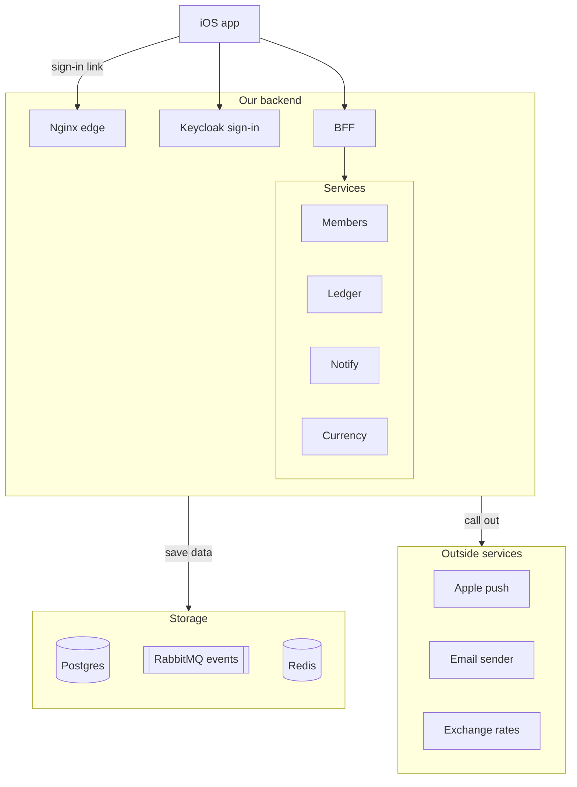

# My Money Recap

An iPhone and iPad app for adults that tracks one month of salary, spending and saving. It looks like a playful
kids' app, and at the end of each month it shows a short Recap of how the month went.

Work in progress: what is left before the first release is in
[#8](https://github.com/ravialdyh/my-money-recap-monorepo/issues/8) and
[#87](https://github.com/ravialdyh/my-money-recap-monorepo/issues/87).

## What it does not do

- No money in other than the Salary, such as side income.
- No bank connection, receipts, recurring Spends or budgets per category.
- No family accounts, shared views or child users. One adult per account.
- No adding Spends while offline. Reading offline works.
- No Android or web app.

## How the parts fit

The app signs in with Keycloak and calls the BFF for everything else. Nginx serves the page a sign-in link opens.
"Our backend" and "Storage" run together in one Compose stack.



## How it works

- **iOS app**: SwiftUI. The Member signs in, logs each Spend and reads the Recap ([README](apps/ios/README.md)).
- **Nginx edge**: serves the sign-in link page and the Apple app link file ([README](infra/nginx/README.md)).
- **BFF**: checks who is calling and builds each screen from the services ([README](apps/backend/cmd/bff/README.md)).
- **Services**: Members keeps profiles. Ledger keeps Spends and runs the money rules. Notify sends Apple
  pushes and emails. The Currency service fetches exchange rates ([apps/README.md](apps/README.md)).
- **Storage**: one Postgres with its own database for Keycloak, Members, Ledger and Notify. RabbitMQ carries
  events between services. Redis holds short-lived data for the BFF and the Currency service.

## Layout

| Path | What lives here |
| --- | --- |
| [`docs/`](docs/CONTEXT.md) | The glossary (`CONTEXT.md`) and the settings the coding agents read (`agents/`) |
| [`my-money-recap/`](my-money-recap/README.md) | The illustrations and the scripts that make them |
| [`design-tokens/`](design-tokens/README.md) | The colours, type and spacing, generated into `Tokens.swift` |
| [`apps/`](apps/README.md) | The Go backend and the SwiftUI app |
| [`packages/contract/`](packages/contract/README.md) | The API contract every client is generated from |
| [`infra/`](infra/README.md) | The Compose stack, sign-in setup, edge, secrets and setup wizard |
| [`tools/`](tools/policy/README.md) | The size policy and the [coverage gate](tools/coverage/README.md) |

## Getting started

```bash
npm install
```

```bash
pipx install pre-commit && pre-commit install --install-hooks
```

Then start the backend with the [compose README, "Run it"](infra/compose/README.md#run-it), and the app with the
[iOS README, "Open"](apps/ios/README.md#open).

## License

MIT, in `LICENSE`. The Fredoka and Nunito fonts (`apps/ios/Resources/Fonts/`) use the SIL Open Font License.
The CLDR currency data (`apps/backend/internal/cldr/`) uses the Unicode License.
