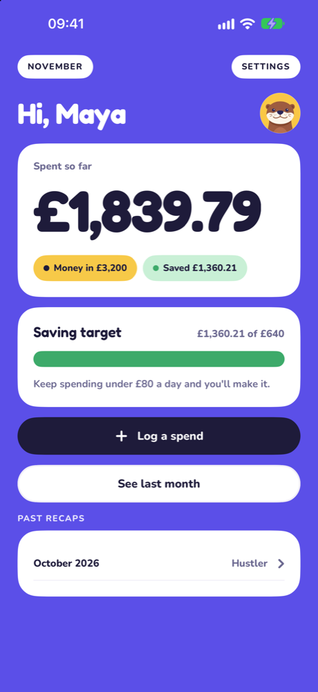
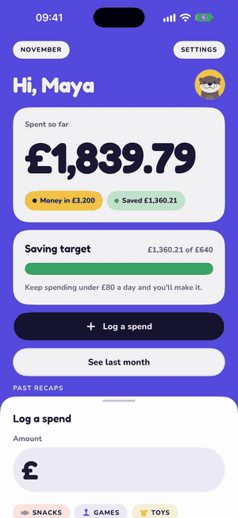
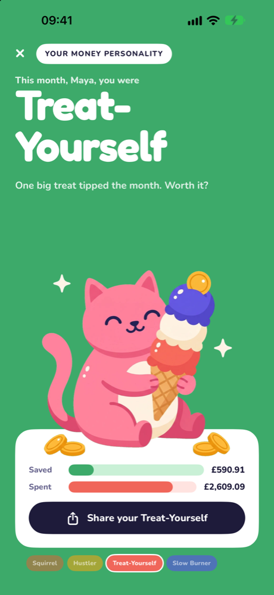
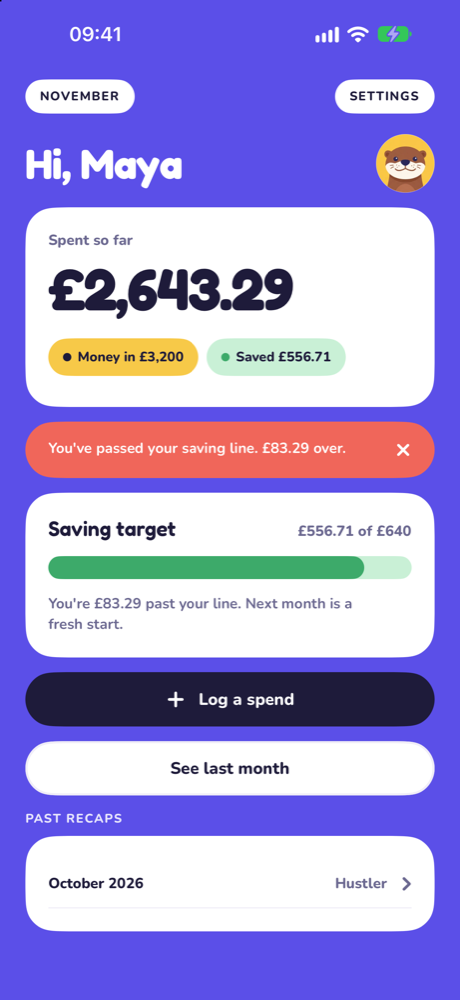
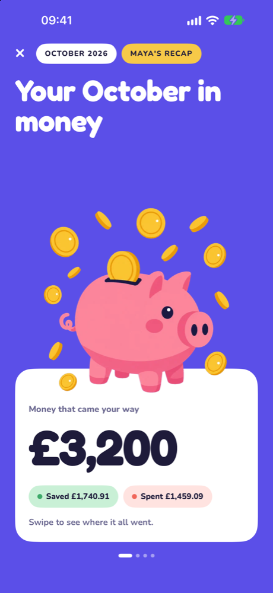
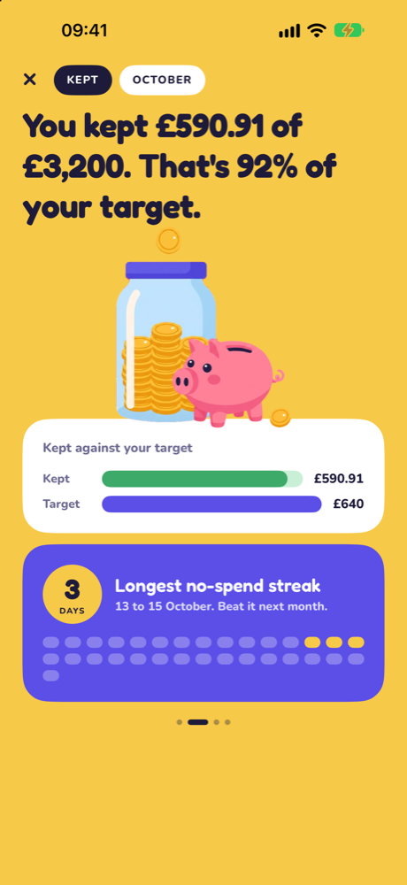
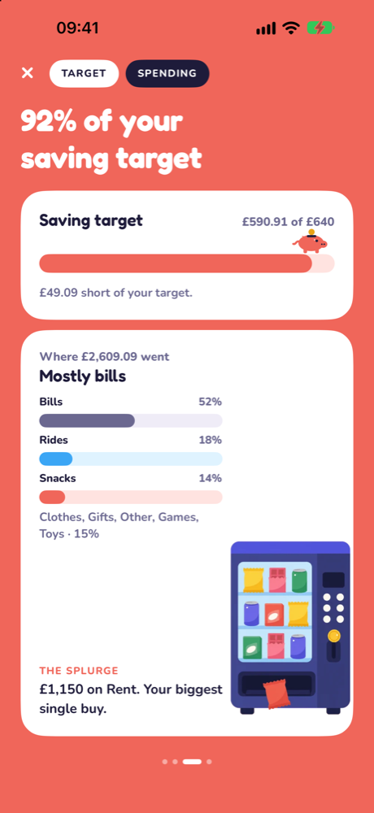
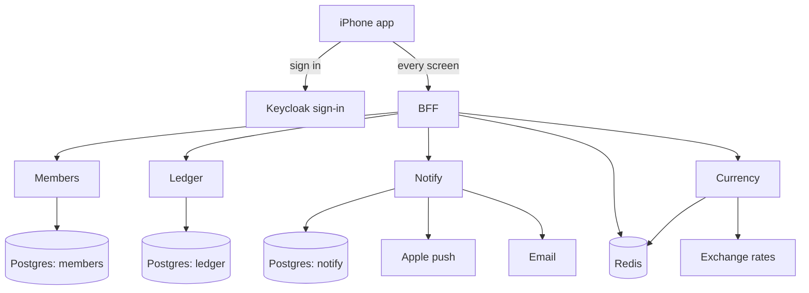
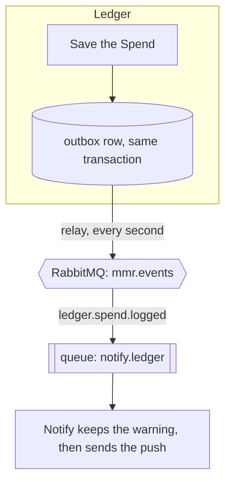

# My Money Recap

**Know where your salary went, one month at a time.** An iPhone app for adults that tracks one month of Salary,
Spends and saving. It looks like a playful kids' app, and at the end of each month it tells the story of how the
month went.

<p align="center">
  
  
  
  
</p>

Work in progress: what is left before the first release is in
[#8](https://github.com/ravialdyh/my-money-recap-monorepo/issues/8) and
[#87](https://github.com/ravialdyh/my-money-recap-monorepo/issues/87).

## What it does

- **The month at a glance.** Home shows what you have Spent so far, the Money In, what is Saved, and how far you
  are from your Saving Target, with a daily amount you can still spend and make it.
- **A Spend in a few taps.** Type the amount, pick one of eight Categories, add a note if you like, and save.
  Home updates at once.
- **A Recap every month.** Four pages on last month: what came in and went out, what you kept against your
  target, your longest run of days with no Spend, where the money went, your biggest Spend, and a money
  personality (Squirrel, Hustler, Treat-Yourself or Slow Burner) you can share.
- **A warning before the month goes wrong.** The first time Spent passes your saving line, Home shows a Target
  Warning and a push goes out. Optional pushes also say when a Recap is ready and remind you at a time you pick
  on days you have logged nothing.
- **Your data, your call.** Sign in with Apple, Google or an email link. Change the Currency and every amount is
  converted once. Email yourself an export, or delete the account.

<p align="center">
  
  
  
</p>

The screens show a made-up Member on the local stack.

## What it does not do

- No money in other than the Salary, such as side income.
- No bank connection, receipts, recurring Spends or budgets per Category.
- No family accounts, shared views or child users. One adult per account.
- No adding Spends while offline. Reading offline works.
- No Android or web app.

## How it works

### A request

The app signs in with Keycloak, then calls the BFF for every screen. The BFF checks the token and asks the
services. Each service that keeps data has its own Postgres database, and no service reads another's.



Calls the diagram leaves out, to stay readable:

- **Ledger and Notify ask Members** for the Member's profile.
- **Notify asks Ledger** which months have data (for the Recap ready push) and who logged nothing today (for the
  reminder).
- **The BFF asks Keycloak** for the token inside a sign-in link, and **Members asks Keycloak** to remove a deleted
  account.
- **Nginx edge** serves the page a sign-in link opens on a phone without the app, and the Apple app link file.

### Where data lives

| Store | Written by | What it holds | Read when |
| --- | --- | --- | --- |
| Postgres `members` | Members | Profiles, account deletion progress | Every BFF call looks up the Member. A job checks for due deletions every 10 minutes. |
| Postgres `ledger` | Ledger | Spends, Salary and Saving Target settings, Currency changes, a copy of each Member's facts | Home, Spends and every Recap are worked out from it, live. |
| Postgres `notify` | Notify | Devices, push settings, this month's Target Warning, a log of sent pushes, a copy of each Member's facts | Home reads the warning. A job checks for due pushes every minute. |
| Postgres `keycloak` | Keycloak | Accounts and sessions | At sign-in. |
| Redis | BFF | Requests per Member per minute (kept 2 minutes), sign-in links per email (1 hour), answers to writes (24 hours) | On every call, so a repeated write gets the first answer instead of running twice. |
| Redis | Currency | The day's exchange table (36 hours) | When the app asks for a rate. |

The Members, Ledger and Notify databases each also hold an `outbox` and a `processed_events` table for the
events below.

### Events between services

When a service changes something another service cares about, it says so with an event on RabbitMQ.



| Event | From | To | What the receiver does |
| --- | --- | --- | --- |
| `members.created`, `members.updated` | Members | Ledger, Notify | Updates its copy of the Member's facts: time zone, Currency and sign-up date for Ledger, time zone and email for Notify. |
| `members.deletion.requested`, `members.deletion.cancelled` | Members | Notify | Holds pushes back, or lets them go again. |
| `members.deleted` | Members | Ledger, Notify | Deletes all of that Member's rows, then answers `ledger.member.purged` or `notify.member.purged`. |
| `ledger.member.purged`, `notify.member.purged` | Ledger, Notify | Members | Once both arrive and the Keycloak account is gone, Members removes the profile. |
| `ledger.spend.logged`, `ledger.spend.edited` | Ledger | Notify | If Spent just passed the saving line, keeps that month's Target Warning and sends the push. |
| `ledger.currency.converted` | Ledger | Members | Sets the new Currency on the profile. |

What happens to an event:

1. **It is saved with the change.** The service writes the event to its `outbox` table in the same transaction
   as the data, so a change never goes out without its event, or the other way round.
2. **A relay sends it.** Every second it publishes unsent rows and marks each one sent once RabbitMQ confirms.
3. **The receiver applies it once.** In one transaction it records the event's id in `processed_events` and makes
   its change. A repeat delivery finds the id and is skipped.
4. **RabbitMQ then drops it.** The receiver acknowledges only after its transaction commits. A failure puts the
   event back on the queue. After five tries it moves to `<queue>.dead`, where it waits for a person.

The Target Warning also has a quick path: after a write, the BFF asks Notify straight away, so the banner shows
at once. The event covers the case where that call fails. Notify keeps one warning per month, so the push goes
out once.

### The parts

- **iOS app**: SwiftUI ([README](apps/ios/README.md)).
- **BFF**: checks who is calling and builds each screen from the services ([README](apps/backend/cmd/bff/README.md)).
- **Services**: Members, Ledger, Notify and Currency, all Go ([apps/README.md](apps/README.md)).
- **Nginx edge**: the sign-in link page and the Apple app link file ([README](infra/nginx/README.md)).
- Everything above runs in one Compose stack ([README](infra/compose/README.md)).

## Layout

| Path | What lives here |
| --- | --- |
| [`docs/`](docs/CONTEXT.md) | The glossary (`CONTEXT.md`), the README screenshots (`media/`) and the settings the coding agents read (`agents/`) |
| [`my-money-recap/`](my-money-recap/README.md) | The illustrations and the scripts that make them |
| [`design-tokens/`](design-tokens/README.md) | The colours, type and spacing, generated into `Tokens.swift` |
| [`apps/`](apps/README.md) | The Go backend and the SwiftUI app |
| [`packages/contract/`](packages/contract/README.md) | The API contract every client is generated from |
| [`infra/`](infra/README.md) | The Compose stack, sign-in setup, edge, secrets and setup wizard |
| [`tools/`](tools/policy/README.md) | The size policy and the [coverage gate](tools/coverage/README.md) |

## Getting started

```bash
npm install
```

```bash
pipx install pre-commit && pre-commit install --install-hooks
```

Then start the backend with the [compose README, "Run it"](infra/compose/README.md#run-it), and the app with the
[iOS README, "Open"](apps/ios/README.md#open).

## License

MIT, in `LICENSE`. The Fredoka and Nunito fonts (`apps/ios/Resources/Fonts/`) use the SIL Open Font License.
The CLDR currency data (`apps/backend/internal/cldr/`) uses the Unicode License.
