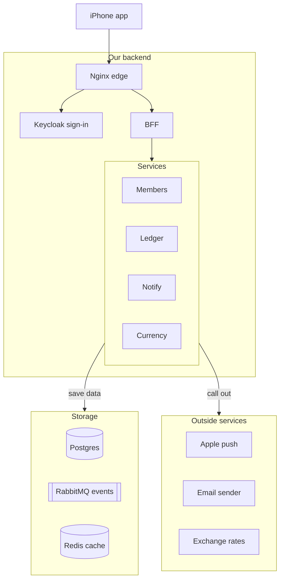

# My Money Recap

An iPhone app for adults that tracks one month of salary, spending and saving. It looks like a playful kids'
app, and at the end of each month it shows a short, Wrapped-style Recap of how the month went.

Work in progress: what is left before the first release is in #8 and #87.

## What it does not do

- No income other than the Salary: no side income, chores or earnings.
- No bank connection, receipts, recurring Spends or budgets per category.
- No family accounts, shared views or child users. One adult per account.
- No adding Spends while offline. Reading offline works.
- No Android or web app.

## How the parts fit

The phone talks only to the Nginx edge. "Our backend" and "Storage" run together in one Compose stack.



## How it works

- **iPhone app**: SwiftUI. The Member signs in, logs each Spend and reads the Recap.
- **Nginx edge**: the one public door. It sends app calls to the BFF and sign-in to Keycloak.
- **BFF**: checks who is calling and builds each screen from the services.
- **Services**: Members keeps profiles. Ledger keeps Spends and runs the money rules. Notify sends Apple
  pushes and emails. Currency fetches exchange rates.
- **Storage**: one Postgres with its own database for Keycloak, Members, Ledger and Notify. RabbitMQ carries
  events between services. Redis holds rate limits and cached exchange rates.

## Layout

| Path | What lives here |
| --- | --- |
| `docs/` | The glossary (`CONTEXT.md`) and the older long product and design documents |
| `my-money-recap/` | The illustrations and the scripts that make them |
| `design-tokens/` | The colours, type and spacing, generated into `Tokens.swift` |
| `apps/` | The Go backend and the SwiftUI app |
| `packages/contract/` | The API contract every client is generated from |
| `infra/` | The Compose stack, sign-in setup, edge, secrets and setup wizard |

## Getting started

```bash
npm install
```

```bash
pipx install pre-commit && pre-commit install --install-hooks
```

Then start the backend with `infra/compose/README.md` ("Run it") and the app with `apps/ios/README.md` ("Open").

## License

MIT, in `LICENSE`. The Fredoka and Nunito fonts (`apps/ios/Resources/Fonts/`) use the SIL Open Font License.
The CLDR currency data (`apps/backend/internal/cldr/`) uses the Unicode License.
