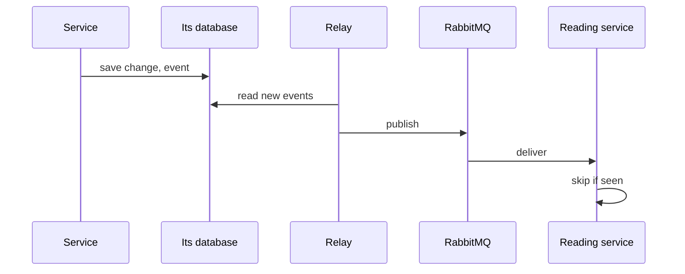

# apps

The two runnable parts: the Go backend in `apps/backend/` and the SwiftUI app in `apps/ios/`.

| Path | What lives here |
| --- | --- |
| `apps/backend/` | One Go module: one binary per service in `cmd/`, shared code in `internal/`, the generated contract in `gen/` |
| `apps/ios/` | The app for iPhone and iPad ([README](ios/README.md)) |

Each service has its own README: [bff](backend/cmd/bff/README.md), [members](backend/cmd/members/README.md),
[ledger](backend/cmd/ledger/README.md), [notify](backend/cmd/notify/README.md) and
[currency](backend/cmd/currency/README.md).

## How an event travels

A service saves its change and the event in one transaction, so neither exists without the other. A relay then
publishes the event, and each reader handles it once.



## What every service shares

- **One contract**: every call and event is defined in `packages/contract/money_recap/v1/*.proto`; the Go and
  Swift code is generated from it ([contract README](../packages/contract/README.md)).
- **One image**: `apps/backend/Dockerfile` builds any service with `--build-arg CMD=<name>`.
- **One token check** (`internal/auth`): every call checks the Keycloak token's issuer, audience, expiry and
  signature. The BFF passes the token on unchanged, so each service checks it again. The two sign-in link calls
  are the only ones without it.
- **One start-up** (`internal/serve`): a database pool, the token check, `/healthz`, and a clean shutdown.
  `<name> migrate` applies the files in `internal/<name>/migrations/` in order. Add a new file; never edit an
  old one.
- **One events package** (`internal/events`): the outbox, the relay and the reader shown above. A message that
  fails five times waits in a `.dead` queue.
- **One idempotency rule** (`internal/idempotency`): a write's key is saved with the write, so a retry with the
  same key gets the first answer and writes nothing.
- **Three shared tables** in every service with a database: `idempotency`, `outbox` and `processed_events`.
- **One currency list** (`internal/cldr`): which codes are Currencies and how many decimals each has.
- **One time zone per Member**: the app sends the phone's time zone on every launch. Every "today" is worked
  out in it.

## Settings every service with a database reads

`<NAME>` is the service name in capitals, such as `LEDGER`. Any variable can instead name a file in
`<VARIABLE>_FILE`, whose contents win.

| Variable | Default | Meaning |
| --- | --- | --- |
| `<NAME>_DATABASE_URL` | required | Its own Postgres database: `postgres://<name>:<password>@postgres:5432/<name>` |
| `<NAME>_AMQP_URL` | required | RabbitMQ, for the events it reads and sends |
| `<NAME>_OIDC_ISSUER` | required | The `iss` Keycloak puts in tokens |
| `<NAME>_OIDC_JWKS_URL` | required | Where it fetches Keycloak's signing keys |
| `<NAME>_OIDC_AUDIENCE` | `bff` | The `aud` a token must carry |
| `<NAME>_LISTEN` | `:8080` | Listen address |

## Test it

From `apps/backend`:

```bash
go vet ./... && go test ./...
```

Tests that need the Compose stack skip unless their variables are set. [TESTING.md, "Running the Go tests
against this stack"](../infra/compose/TESTING.md#running-the-go-tests-against-this-stack) lists them and runs
them with `-p 1`, as CI does.
