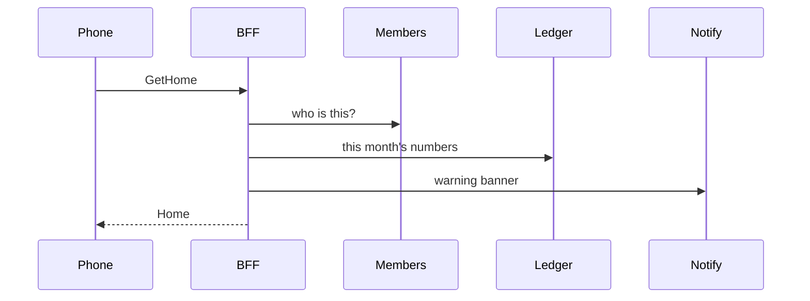
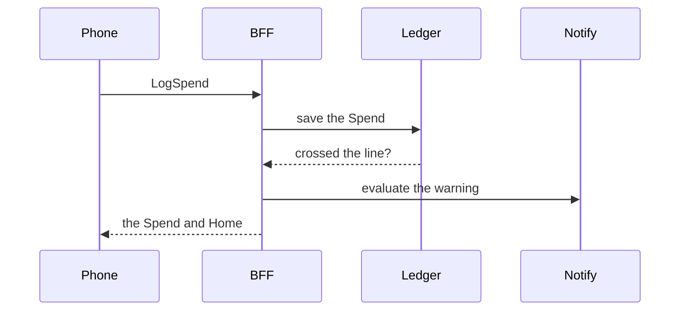

# bff

The BFF (backend for frontend) is the only backend the phone talks to. It checks the Member's token, calls the
services, and joins their answers into one answer per screen. It has no database.

## Opening Home

`members` is asked first. `ledger` and `notify` are then asked at the same time. Dashed arrows are answers.
Home still opens without `notify`, just with no banner.



## Logging a Spend

`notify` is told only when the Spend is in the current month.



## How it works

- **Calls it answers**, by screen:
  - Sign-in: `RequestMagicLink`, which needs no token.
  - Setup: `GetOnboardingState`, `SetTimezone`, `SaveProfile`, `SaveSalary`, `SaveTarget`.
  - Home and Spends: `GetHome`, `LogSpend`, `EditSpend`, `DeleteSpend`, `ListSpends`, `GetRecap`.
  - Settings: `GetSettings`, `SaveNotificationPrefs`, `RegisterDevice`, `ForgetDevice`, `RequestExport`,
    `PreviewCurrencyChange`, `ChangeCurrency`, `RequestDeletion`, `CancelDeletion`.
- **Token**: checked on every call but `RequestMagicLink`, then passed on unchanged, so each service checks it
  again.
- **Writes**: every Member write needs an `Idempotency-Key` header. Without one it is refused.
- **Time limits**: each service call has one second. `notify`'s warning call has 300 ms.
- **Redis** holds three things:
  - five sign-in links per email address per hour; if Redis is down, sign-in links are refused;
  - 120 calls per Member per minute; if Redis is down, calls go through;
  - each write's answer for 24 hours, so a retried write gets the same answer.

## Settings

| Variable | Default | Meaning |
| --- | --- | --- |
| `BFF_OIDC_ISSUER` | required | The `iss` Keycloak puts in tokens: `http://localhost:8080/realms/mmr` with the stock `.env` |
| `BFF_OIDC_JWKS_URL` | required | Where it fetches Keycloak's signing keys |
| `BFF_OIDC_AUDIENCE` | `bff` | The `aud` a token must carry |
| `BFF_MEMBERS_URL` | required | `members`: `http://members:8080` in Compose |
| `BFF_LEDGER_URL` | required | `ledger`: `http://ledger:8080` in Compose |
| `BFF_NOTIFY_URL` | required | `notify`: `http://notify:8080` in Compose |
| `BFF_CURRENCY_URL` | required | `currency`: `http://currency:8080` in Compose |
| `BFF_REALM_URL` | required | The realm, for sign-in links: `http://keycloak:8080/realms/mmr` in Compose |
| `BFF_CLIENT_SECRET` | required | The `bff` client's secret |
| `BFF_MAGIC_LINK_BASE_URL` | required | The address sign-in links start with: `http://localhost:8090/magic` on a laptop |
| `BFF_REDIS_ADDR` | required | Redis: `redis:6379` in Compose |
| `BFF_LISTEN` | `:8080` | Listen address |

## Run it

The whole stack starts it (`infra/compose/README.md`, "Run it") on `BFF_HOST_PORT`, 8082 by default.

To run it by hand against that stack, on a port the stack does not use:

```bash
cd apps/backend
BFF_OIDC_ISSUER=http://localhost:8080/realms/mmr BFF_OIDC_JWKS_URL=http://localhost:8080/realms/mmr/protocol/openid-connect/certs BFF_MEMBERS_URL=http://localhost:8081 BFF_LEDGER_URL=http://localhost:8084 BFF_NOTIFY_URL=http://localhost:8083 BFF_REALM_URL=http://localhost:8080/realms/mmr BFF_CLIENT_SECRET="$BFF_CLIENT_SECRET" BFF_MAGIC_LINK_BASE_URL=http://localhost:8090/magic BFF_REDIS_ADDR=localhost:6379 BFF_CURRENCY_URL=http://localhost:8085 BFF_LISTEN=:8086 go run ./cmd/bff
```

A token for the test Member and a `GetHome` call are in `infra/compose/README.md`, "Try it".

## Test it

From `apps/backend`:

```bash
go test ./internal/bff/
```

The unit tests need nothing. The `*EndToEnd` tests and `TestEdge` need the running stack
(`infra/compose/README.md`, "Running the Go tests against this stack").
