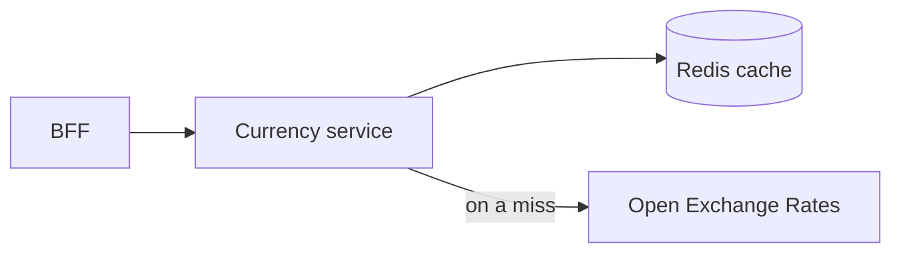

# currency

The service that gives the day's exchange rate between two Currencies. The phone shows it before a Member
changes Currency. It keeps nothing about any Member.

## Where a rate comes from

The day's whole rate table is fetched once and kept in Redis for 36 hours.



## How it works

- **Calls it answers**: `Quote`, the rate from one Currency to another, rounded to 8 significant digits.
- **A pair the site does not cover**: the Member types a rate instead.
- **No App ID, or the site is down**: the answer is `unavailable`. Every laptop stack has no App ID.
- **Tables and events**: none.

Its image and token check are the same as every service's ([apps/README.md](../../../README.md)).

## Settings

| Variable | Default | Meaning |
| --- | --- | --- |
| `CURRENCY_OIDC_ISSUER` | required | The `iss` Keycloak puts in tokens |
| `CURRENCY_OIDC_JWKS_URL` | required | Where it fetches Keycloak's signing keys |
| `CURRENCY_OIDC_AUDIENCE` | `bff` | The `aud` a token must carry |
| `CURRENCY_REDIS_ADDR` | required | Redis: `redis:6379` in Compose |
| `CURRENCY_OPEN_EXCHANGE_RATES_APP_ID` | empty | The Open Exchange Rates App ID (`infra/secrets/README.md`) |
| `CURRENCY_LISTEN` | `:8080` | Listen address |

## Run it

The whole stack starts it (`infra/compose/README.md`, "Run it") on `CURRENCY_HOST_PORT`, 8085 by default.

## Test it

From `apps/backend`:

```bash
go test ./internal/currency/
```

The tests use a fake rates site and the stack's Redis (`BFF_TEST_REDIS`).
