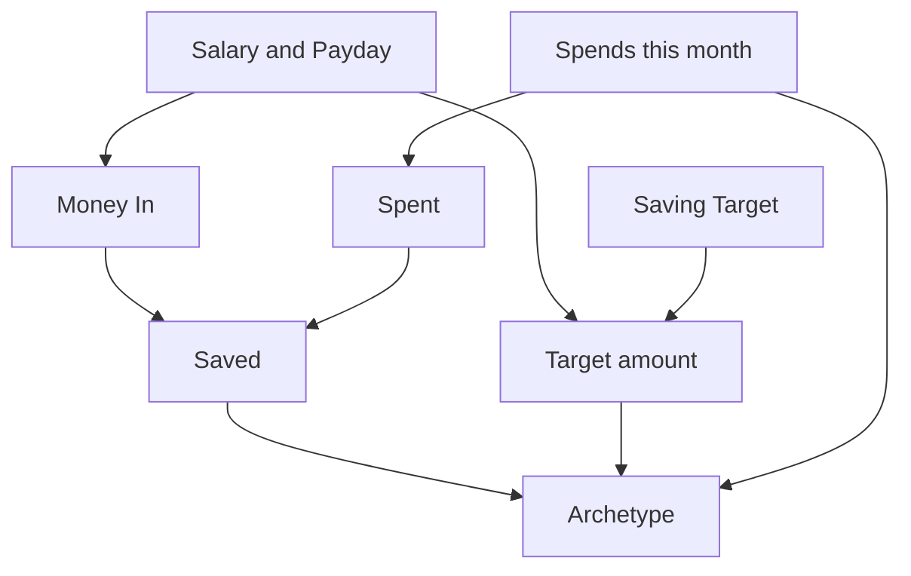

# Money rules

The rules `ledger` follows to turn a Member's Salary, Saving Target and Spends into the numbers on Home and in
the Recap. Every number in the examples comes from a test file in `packages/contract/fixtures/ledger/`, which
`TestTheAnswerKey` runs against the real service.

## How one month is worked out

Each box is worked out from the boxes that point to it. From the Spends, the Archetype also uses the Streak and
the Splurge.

## The rules

- **Month**: a calendar month, in the Member's own time zone.
- **Payday**: the Salary lands on that day. "Last day" is always the month's last day. A Payday of 29 to 31
  moves to the last day of a shorter month.
- **Money In**: the Salary once Payday has come, and 0 before it.
- **Spent**: the total of the month's Spends. A deleted Spend counts nowhere.
- **Saved**: Money In minus Spent. It is not shown at all while Money In is 0.
- **Splurge**: the month's largest Spend. On a tie, the earliest one.
- **Target amount**: Salary times the Saving Target percent, rounded half up to the Currency's decimals. A 0%
  Target means no Target.
- **Kept**: Saved divided by the Target amount, as a whole percent from 0 to 999.
- **Daily limit**: (Salary minus Target amount minus Spent) divided by the days left, counting today, rounded down
  to a whole unit, never below 0.
- **Progress sentence**: one of five, shown on Home and in the Recap:
  - before Payday: "Nothing to keep yet. Your salary lands on the 25th.";
  - this month, under the line: "Keep spending under £160 a day and you'll make it.";
  - this month, over the line: "You're £300 past your line. Next month is a fresh start.";
  - a past month that met the target: "Target met. £160 to spare.";
  - a past month that missed it: "{amount} short of your target."
- **Streak**: the longest run of days with no Spend. It starts no earlier than the sign-up date and never crosses
  into another month. Of two equal runs, the earlier one counts.
- **Target Warning**: fires once a month, the first time Spent goes past the saving line: Salary minus the
  Target amount. Only a Spend dated in the current month can fire it. Editing or deleting a Spend never takes it
  back. `notify` sends it.
- **Partial month**: the sign-up month when Payday came before sign-up, or a past month with Spends but no Money
  In. It has no Saved and no Archetype.

## Archetype

A full month with Money In and a Saving Target gets one Archetype. The first match wins.

| Archetype | When |
| --- | --- |
| Squirrel | Saved reaches the Target amount, and the Streak is 7 days or more |
| Hustler | Saved reaches the Target amount, and the Streak is under 7 days |
| Treat-Yourself | Saved is short, and the Splurge is 25% of Spent or more |
| Slow Burner | Saved is short, and no single Spend is that big |

## Changing things later

- **Salary amount**: saved before this month's Payday, it applies this month. Saved on or after Payday, the
  Member says whether it is this month's Salary or next month's.
- **Payday and Saving Target**: a change always starts next month. A Saving Target needs a Salary first.
- **First save**: a Salary or Target saved during setup counts from the sign-up month. The first one saved after
  setup counts from this month.
- **Spend**: dated in the last 60 days including today, never in the future, never before the sign-up month.
  A Spend already older than 60 days can still be edited, but its date cannot change. Amounts are above 0,
  with at most 11 digits before the decimal point and at most the Currency's decimals. A note is at most 80
  characters.
- **Currency change**: every Salary and Spend amount is multiplied by the rate and rounded half up to the new
  Currency's decimals, never below its smallest unit. The original amounts are kept. The Target percent stays.

## Worked example: Maya

Maya earns £2,400 with Payday on the 25th and a 20% Saving Target, so her Target amount is £480 and her warning
line is £2,400 minus £480, or £1,920.

| Day | What she sees | Fixture |
| --- | --- | --- |
| 20 September | Spent £900, Money In £0, no Saved yet | `maya-20-september.json` |
| 20 September | A £1,100 Spend takes Spent to £2,000: "You've spent £2,000 of the £1,920 you meant to spend this month." | `maya-20-september-before-payday.json` |
| 30 September | Spent £1,760, Money In £2,400, Saved £640, Streak 9 days (12 to 20 September), £160 a day left | `maya-30-september.json` |
| 1 October | September's Recap: kept 133%, Splurge £420 on the 27th, "Target met. £160 to spare.", Squirrel | `maya-september-recap.json` |
| 1 October | "Nothing to keep yet. Your salary lands on the 25th." | `maya-1-october.json` |
| 27 October | A £490 Spend takes Spent to £2,090: "You've passed your saving line. £170 over." | `maya-27-october-after-payday.json` |

More from the same files:

- **Salary edit** on 27 September, £2,400 to £2,800. As this month's Salary, September's Target amount becomes
  £560 (`maya-27-september-this-month.json`). As next month's, September stays at £2,400
  (`maya-27-september-next-month.json`).
- **Currency change** to IDR at 20,150: £2,400 becomes Rp48.360.000 and her £1,760 of Spends become
  Rp35.464.000; the Target stays 20% (`maya-gbp-to-idr.json`).
- **Partial month**: a Member who signs up on 27 September with Payday 25 gets a partial September; their first
  full Recap is October's (`signup-27-september.json`).
