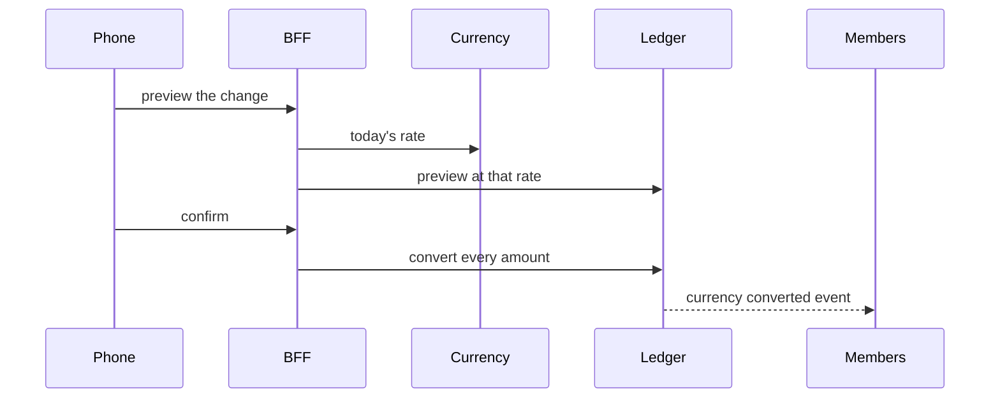

# ledger

The money service. It keeps each Member's Salary, Saving Target and Spends, and works out every number on
Home and in the Recap. The rules and a worked example are in [MONEY-RULES.md](MONEY-RULES.md).

## Changing the Currency

When a Member changes Currency with amounts saved, `ledger` rewrites them all in one go and tells `members`.



## How it works

- **Calls it answers**: Salary and Target saves, `LogSpend`, `EditSpend`, `DeleteSpend`, the month for Home,
  the Recap, the Spend list, Settings, the Currency preview and change, and the CSV export.
- **Tables**: `salary_setting` and `saving_target_setting` (a new row per change, never edited),
  `spend`, `currency_conversion`, and `member_facts`, its copy of each Member's zone, sign-up date and Currency.
- **Events it reads**: `members.created` and `members.updated` keep `member_facts` fresh. `members.deleted`
  removes everything it holds for that Member.
- **Events it sends**: `ledger.spend.logged`, `ledger.spend.edited`, `ledger.spend.deleted`,
  `ledger.currency.converted` and `ledger.member.purged`.
- **Background job**: `notify`'s own token may call only `GetSpentToday` and `ListMonthsWithData`.

Its image, token check, start-up and shared settings are the same as every service's
([apps/README.md](../../../README.md)).

## Settings

| Variable | Default | Meaning |
| --- | --- | --- |
| `LEDGER_MEMBERS_URL` | required | `members`, to fill `member_facts` on a miss: `http://members:8080` in Compose |
| `LEDGER_AMQP_URL` | required | RabbitMQ, for the events it reads and sends |

## Run it

The whole stack starts it (`infra/compose/README.md`, "Run it"), after `ledger-migrate` has run.

## Test it

From `apps/backend`:

```bash
go test ./internal/ledger/
```

Most tests need the stack's `ledger` database; a few also need `members` and Keycloak (`infra/compose/README.md`,
"Running the Go tests against this stack"). `TestTheAnswerKey` runs every file in
`packages/contract/fixtures/ledger/`.
