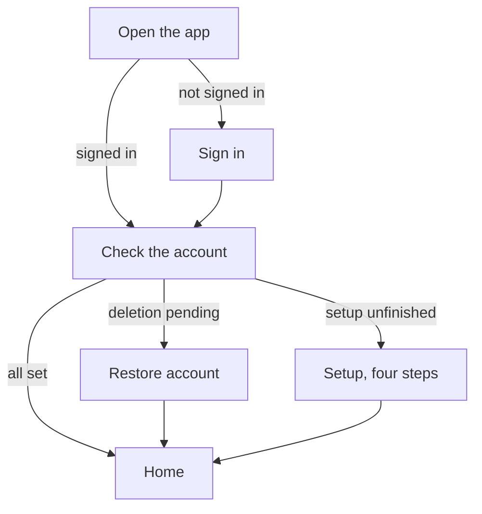
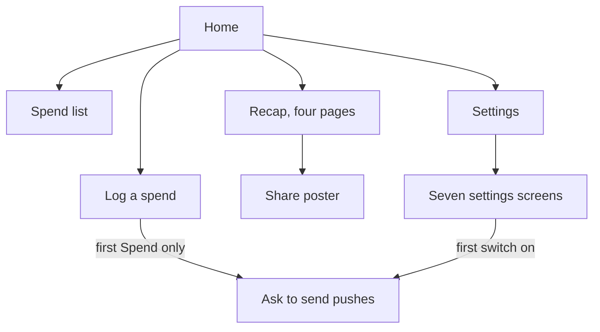

# apps/ios

The SwiftUI app for iPhone and iPad, iOS 17 and later. It shows numbers the server works out; it does no money
maths itself. It keeps the last answer for each screen, so Home and every Recap open with no network.

## From opening the app to Home

Each arrow is one way the app can go at launch; the labels say when.



## From Home to everything else

Each arrow opens the next screen or sheet; the labels say when.



## Screens

| Screen | What it does |
| --- | --- |
| Sign in | Apple, Google or email |
| Enter email | Asks for the address and sends a sign-in link |
| Check your inbox | Names the address and counts down to Resend |
| Name and avatar | Setup step 1: a first name and one of six Avatars |
| Currency | Setup step 2: the one Currency for every amount |
| Salary and payday | Setup step 3, can be skipped |
| Saving target | Setup step 4, can be skipped; needs a Salary |
| Restore account | Offered while a deletion is pending: keep the account, or continue with deletion |
| Home | This month's Spent, Money In, Saved and target progress |
| Log a spend | A sheet: amount, Category, date in the last 60 days, note |
| Spend list | One month's Spends, by Category, with edit and delete |
| Recap | Four pages: cover, kept and Streak, target and spending, Archetype |
| Month so far | The current month as a Recap preview, opened from Home |
| Share poster | The Archetype page as an image to share. It never shows the Salary or Money In |
| Settings | Profile, Salary and payday, Saving target, Currency, Notifications, Export spends, Delete account, Log out |

## How it works

- **Sign-in** uses AppAuth with Keycloak (`infra/README.md`, "Signing in"). The session sits in the Keychain on
  this device only; how long it lasts is in that section. A Face ID unlock is not built yet.
- **Calls** go through the generated Connect client from `packages/contract`. Every write sends an
  `Idempotency-Key` that stays the same across its retries.
- **Offline**: each screen's last answer is stored with SwiftData. With no network, Home shows a grey banner and
  logging a Spend is turned off.
- **Pushes**: the app asks for permission once: after the first Spend is saved, or when a Notifications switch is
  first turned on.
- **Log out** forgets the phone's push token, ends the session in Keycloak, and erases the Keychain and the cache.

| Folder | What lives here |
| --- | --- |
| `App/` | Start-up, the launch routing, push registration, `Info.plist` |
| `Auth/` | AppAuth set-up, the sign-in link handler, the Keychain |
| `Networking/` | The BFF client, the token interceptor, the network monitor |
| `Snapshots/` | The stored answer for each screen |
| `Screens/` | One folder per area: `SignIn`, `Onboarding`, `Account`, `Home`, `Recap`, `Settings` |
| `DesignSystem/` | The generated `Tokens.swift` (do not edit) and the SwiftUI components |
| `Resources/` | Illustrations, Avatars and the Fredoka and Nunito fonts |
| `Tests/`, `UITests/`, `scripts/` | Unit tests, UI tests and the simulator scripts |

## Open

```bash
open apps/ios/MyMoneyRecap.xcodeproj
```

Keep the build signed ("Sign to Run Locally"). With `CODE_SIGNING_ALLOWED=NO` every Keychain call fails, so the
app forgets the sign-in on each launch.

## Run against local Compose

1. Start the stack with `--profile mail` (`infra/compose/README.md`, "Run it").
2. Pick any iPhone simulator in Xcode and Run.
3. Tap **Continue with email**, type an address, and open the message in Mailpit at `http://localhost:8025`.
4. Hand the link's `lt` value to the app:

```bash
xcrun simctl openurl booted "mymoneyrecap://magic?lt=<value>"
```

Launch arguments: `--reset-session`, `--reset-snapshot`, `--magic-link <link>`, and in a debug build
`--authorization-code-flow`, which opens Keycloak's own login page. `MMR_ISSUER` and `MMR_BFF_URL` point the app
at another Keycloak and BFF.

## Run on a physical iPhone

Follow `infra/compose/README.md`, "A phone on the LAN", then open the `mymoneyrecap://magic?lt=<value>` link from
Mailpit in the phone's Safari.

## Test it

From `apps/ios`, the same build and unit tests CI runs:

```bash
xcodebuild build-for-testing -project MyMoneyRecap.xcodeproj -scheme MyMoneyRecap -destination 'generic/platform=iOS Simulator' -derivedDataPath build -enableCodeCoverage YES -quiet
```

```bash
xcodebuild test-without-building -project MyMoneyRecap.xcodeproj -scheme MyMoneyRecap -destination "id=$(scripts/simulator-udid.sh)" -derivedDataPath build -only-testing:MyMoneyRecapTests -enableCodeCoverage YES -resultBundlePath build/MyMoneyRecap.xcresult
```

Delete `build/MyMoneyRecap.xcresult` before running it again.

The UI tests need the Compose stack. They sign in by email link and through Keycloak's page, then walk setup,
Home, Spends, the Recap, Settings, log out and delete account:

```bash
scripts/ui-test.sh
```

They run on the newest and the oldest installed iOS runtime; `scripts/ui-test.sh newest` or `oldest` runs one.
Xcode 27 offers no iOS 17 or 18 runtime, so the oldest that can be installed is iOS 26.0:

```bash
xcodebuild -downloadPlatform iOS -buildVersion 26.0
```
