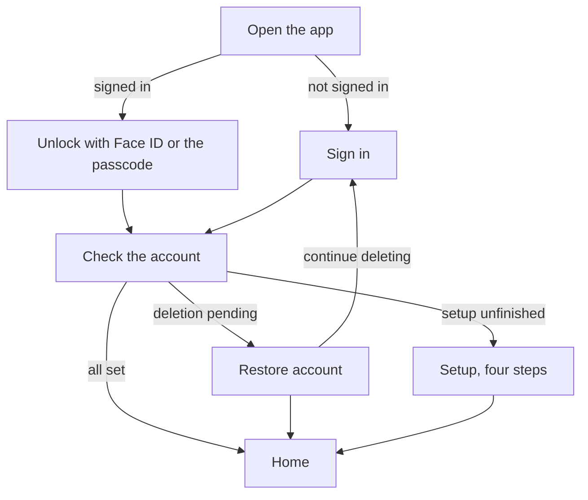
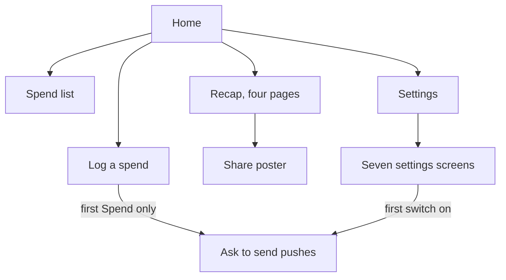

# apps/ios

The SwiftUI app for iPhone and iPad, iOS 26 and later. It shows numbers the backend works out. The one sum it
does itself is the Saving target screen's live preview, "£480 of £2,400 each month": the Salary times the percent,
rounded half up. It keeps the last answer for each screen, so Home and every Recap open with no network.

## From opening the app to Home

Each arrow is one way the app can go at launch; the labels say when.



## From Home to everything else

Each arrow opens the next screen or sheet; the labels say when.



## Screens

| Screen | What it does |
| --- | --- |
| Sign in | Apple, Google or email |
| Unlock | Face ID, Touch ID or the passcode, after a force quit or five minutes away |
| Enter email | Asks for the address and sends a sign-in link |
| Check your inbox | Names the address and counts down to Resend |
| Name and avatar | Setup step 1: a first name and one of six Avatars |
| Currency | Setup step 2: the one Currency for every amount |
| Salary and payday | Setup step 3, can be skipped |
| Saving target | Setup step 4, can be skipped; needs a Salary |
| Restore account | Offered while a deletion is pending: keep the account, or continue with deletion |
| Home | This month's Spent, Money In, Saved and target progress |
| Log a spend | A sheet: amount, Category, date and note |
| Spend list | One month's Spends, by Category, with edit and delete |
| Recap | Four pages: cover, kept and Streak, target and spending, Archetype |
| Month so far | The current month as a Recap preview, opened from Home |
| Share poster | The Archetype page as an image to share. It never shows the Salary or Money In |
| Settings | Profile, Currency, Salary and payday, Saving target, Notifications, Export spends, Delete account, Log out |

## How it works

- **Sign-in** uses AppAuth with Keycloak ([infra README, "Signing in"](../../infra/README.md#signing-in)). The
  session sits in the Keychain on this device only, and iOS releases it only after Face ID, Touch ID or the
  passcode. The app asks again after five minutes away. A phone with no passcode keeps no session. How long a
  session lasts is in that section.
- **Calls** go through the generated Connect client from `packages/contract`. Every write sends an
  `Idempotency-Key` that stays the same across its retries.
- **Offline**: each screen's last answer is stored with SwiftData. With no network, Home shows a grey banner and
  logging a Spend is turned off.
- **Pushes**: the app asks for permission once: after the first Spend is saved, or when a Notifications switch is
  first turned on.
- **Log out** forgets the phone's push token, ends the session in Keycloak, and erases the Keychain and the cache.

| Folder | What lives here |
| --- | --- |
| `App/` | Start-up, the launch routing, push registration, `Info.plist` |
| `Auth/` | AppAuth set-up, the sign-in link handler, the Keychain |
| `Networking/` | The BFF client, the token interceptor, the network monitor |
| `Snapshots/` | The stored answer for each screen |
| `Screens/` | One folder per area: `SignIn`, `Unlock`, `Onboarding`, `Account`, `Home`, `Recap`, `Settings` |
| `DesignSystem/` | The generated `Tokens.swift` (do not edit) and the SwiftUI components |
| `Resources/` | Illustrations, Avatars and the Fredoka and Nunito fonts |
| `Tests/`, `UITests/`, `scripts/` | Unit tests, UI tests and the simulator scripts |

## Open

```bash
open apps/ios/MyMoneyRecap.xcodeproj
```

Keep the build signed ("Sign to Run Locally"). With `CODE_SIGNING_ALLOWED=NO` every Keychain call fails, so the
app forgets the sign-in on each launch.

To run it against the local stack, on a real iPhone, or under test, see [TESTING.md](TESTING.md).
