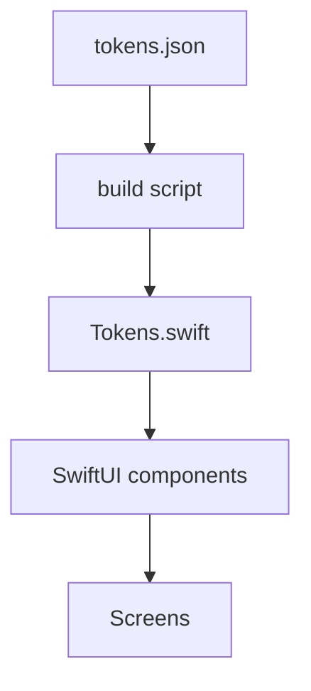

# Design tokens

Every colour, radius, space, size, font and motion value the app uses lives in `tokens.json`. A script turns it
into Swift, so the app never types a value by hand.

## From a token to a screen



## Change a value

Edit `tokens.json`, then regenerate and commit both files:

```bash
npm run build:swift-tokens
```

`tools/hooks/check-generated.sh tokens` fails when `apps/ios/DesignSystem/Tokens.swift` is out of date. CI runs it
in the `tokens` job.

## Design rules

- **One ground per screen, from four**: `recap` violet, `earning` yellow, `goal` coral, `personality` green. Sky
  is for icons, wells and the Rides Category, never a ground.
- **Yellow takes ink text**; every other ground takes white text.
- **Two fonts**: Fredoka for numbers, headlines and titles; Nunito for sentences.
- **Three radii**: `radius.card` 28, `radius.inset` 16 for a block inside a card, `radius.pill` 999.
- **No shadows.** Depth comes from an illustration overlapping the card below by `space.overlap`, 44pt.
- **One story per screen**: one big number, at most two supporting facts, one hero illustration.
- **Shareable screens have no page dots**, so a screenshot is clean.
- **Pressed** is scale 0.97 and brightness 0.92 for 120ms. **Disabled** is opacity 0.4. **Selected** is a 2pt white
  ring.
- **Tap targets are 44pt.** Mark a small `Chip` or `ArchetypePill` `tappable` when it is a control.
- **Motion** uses the `motion.*` tokens. With Reduce Motion on, every reveal becomes a 150ms fade.
- **Money** is an exact decimal plus an ISO 4217 code, printed by the platform formatter with the Currency's own
  decimals. `StatHero` and `AmountField` pick the largest size that fits: 80, 56 or 40pt, and 48, 36 or 28pt.
- **Contrast**: `ink.500` on white is 4.6:1, so use it at 14pt and up. White on coral or green is for large text
  only.
