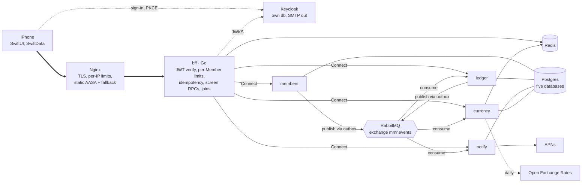
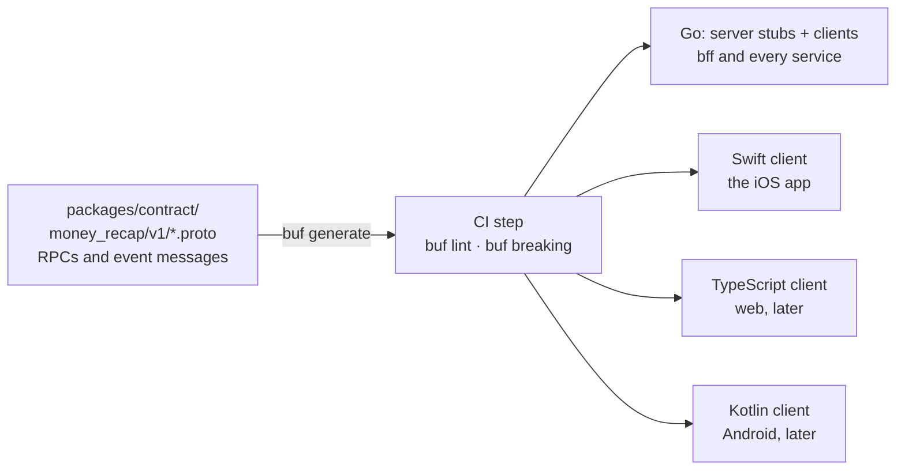
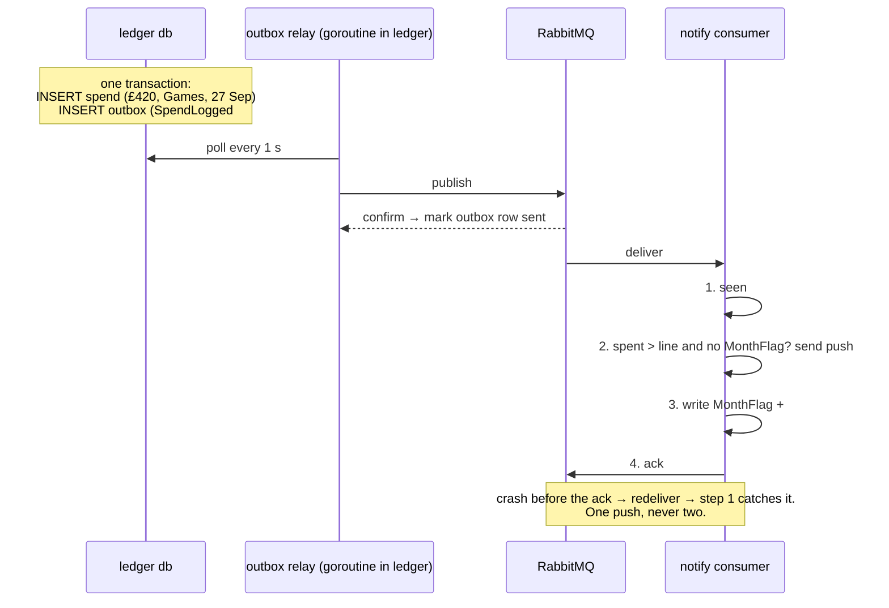
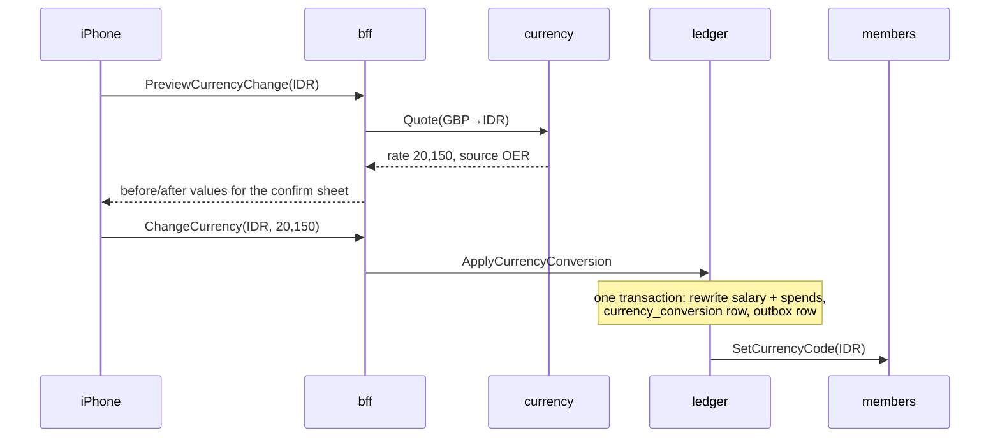
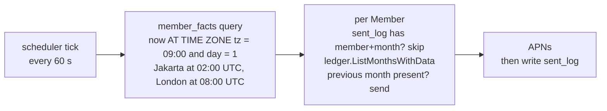

# My Money Recap — Architecture

| | |
|---|---|
| Status | Draft v1, 2026-09-12. Decisions A1–A10 below are proposed; each becomes an ADR under `adr/` once accepted. |
| Scope | The backend behind the iOS app named in `PRD.md` D11: the edge, the API the phone calls, the services, the broker, the cache, the databases and identity. The iOS app's internals live in `IOS.md` (beside this file), whose decisions are numbered `I*`. |
| Vocabulary | `CONTEXT.md` is the glossary. Terms in **bold caps** are defined there. Service names are lower-case code: `members`, `ledger`, `notify`, `currency`, `bff`. |
| Rules | `PRD.md` owns every product rule this document implements. Section references like §8.9 point there. |

## 1. Summary

The iPhone talks to one thing, a Go **BFF** (backend for frontend), through Nginx. The BFF verifies the Keycloak token, applies per-**Member** limits, and joins answers from four Go services, each with its own Postgres database: `members` (who the Member is), `ledger` (every money fact and all of PRD §8), `notify` (every notification in PRD §10), and `currency` (exchange rates). Services never read each other's databases. They talk synchronously over Connect RPC and asynchronously through RabbitMQ using the outbox pattern. Redis holds rate limits, idempotency keys, the daily rate table and the JWKS. Keycloak handles sign-in and owns no app data.

Payment and AI/ML services after phase 1, and web and Android clients later, plug in without changing this shape: a new service is one more box behind the BFF, and a new client is one more generated client of the same contract.

## 2. Decisions this document rests on

| Source | Decision |
|---|---|
| PRD D11, D31, §11 | Native iOS 17+, SwiftUI. Money is printed on the phone by the platform formatter. The phone caches its last snapshot in SwiftData. |
| PRD D6–D8, §9 | Keycloak for identity: Apple, Google and magic-link sign-in. Every service verifies the JWT on every request. |
| PRD §7 | Postgres. Amounts are `NUMERIC` with an ISO 4217 code. Salary and target settings are append-only rows. |
| PRD D61, D63 | Read offline, write online. Offline, the phone shows its last snapshot with a "Last updated" line. |
| A2 (this doc) | The server computes every figure; the phone only stores and displays. |
| A3 (this doc) | One IANA timezone per Member, sent by the app; every "today" in PRD §8 and §10 is evaluated in it. |
| A5–A7 (this doc) | Nginx at the edge, RabbitMQ for events, Redis in phase 1. |
| Product direction | Go services, one container each. Payment and AI/ML services after phase 1. Web and Android clients later. |

## 3. The whole system



Solid arrows are synchronous calls a request waits for. Dotted arrows are background traffic. The bold path is what one tap on the phone travels. Nothing on the right talks to the phone directly.

## 4. Cross-cutting rules

### 4.1 One contract file, every client generated (A1)

Every API here, phone-to-BFF and BFF-to-service, is defined once in `packages/contract/money_recap/v1/*.proto`. Buf generates the Go server stubs and clients, the Swift client for the app, and later the TypeScript and Kotlin clients. `buf breaking` runs in CI against `main` and fails the build on an incompatible change, so a renamed field cannot reach the phone. Event payloads on RabbitMQ are protobuf messages from the same package, so events and RPCs share types. Connect speaks plain HTTP/1.1 and HTTP/2, which is why Nginx proxies it with an ordinary `proxy_pass` and why a web client later needs no gateway change.



### 4.2 Authentication, at three points

1. **Nginx** does not read the token. Open-source Nginx has no JWT module; that is Nginx Plus. Nginx terminates TLS, limits requests and connections per IP, and hides internal addresses.
2. **The BFF** verifies the Keycloak JWT on every request against the realm's JWKS, cached and refreshed on an unknown key id. It rejects expired or wrong-audience tokens before any service is called. It applies the per-Member limit in Redis keyed by the token subject, because thousands of phones behind one carrier address make a per-IP limit useless for fairness.
3. **Each service** verifies the same JWT again, as PRD §9 requires. The BFF forwards the bearer token unchanged. A bug in the BFF therefore cannot expose one Member's rows to another.

### 4.3 Events: RabbitMQ with the outbox pattern (A4, A5)

RabbitMQ is a queue: it delivers each message to one consumer in a queue and forgets it after the ack. That is what phase 1 needs. Correctness comes from the pattern around it, which is the same for every broker.

| Element | Setting | Why |
|---|---|---|
| Exchange | `mmr.events`, type topic, durable | One exchange; routing keys name the producer and the fact, e.g. `ledger.spend.logged`. |
| Queues | Quorum queues, one per consumer service and topic family: `notify.ledger`, `ledger.members`, `notify.members`, `currency.members` | Quorum queues are replicated and are RabbitMQ 4's recommended durable queue. |
| Dead letters | `mmr.dlx` exchange, `<queue>.dead` queues, delivery limit 5 | A poison message stops after five tries and waits for a human instead of blocking the queue. |
| Publishing | Publisher confirms on; message id = outbox row id; persistent | The relay marks an outbox row sent only after the broker confirms it. |
| Consuming | Manual ack, prefetch 16, `processed_events` table keyed by message id | At-least-once delivery means duplicates happen; the table makes them harmless. |



The Spend and its event are written together, so neither can exist without the other. Delivery is at least once; step 1 makes a second delivery harmless. Debezium is the heavyweight relay that reads the outbox from the write-ahead log; a Go loop polling the outbox table every second is the phase-1 version.

### 4.4 Redis: four jobs (A6)

| Job | Owner | Key | TTL | If Redis is down |
|---|---|---|---|---|
| Per-Member rate limit | bff | `rl:{subject}:{minute}`, INCR + EXPIRE | 2 min | Fail open: requests pass, a metric fires. Nginx per-IP limits still stand. |
| Idempotency of writes | bff | `idem:{subject}:{Idempotency-Key}` → stored response | 24 h | Fail closed for writes: return 503; the sheet stays open with values intact (PRD §6.9). A retried Save must never create two Spends. |
| Exchange-rate cache | currency | `fx:{yyyy-mm-dd}:USD` → the day's rate table | 36 h | Fall back to the latest `rate_snapshot` row; fetch from OER if none. |
| JWKS cache | bff, services | `jwks:{realm}` | 1 h | Each process also keeps the last JWKS in memory, so token checks continue. |

Redis 8 is licensed AGPLv3 (alongside RSALv2 and SSPLv1). AGPL binds Redis itself, not programs that talk to it over a socket; nothing here modifies Redis. Valkey (BSD-3) is a drop-in swap if a licence policy ever requires it.

### 4.5 Time: one zone per Member, no zone list in code (A3)

The app sends `TimeZone.current.identifier` on every launch. `members` validates it with Go's embedded IANA database (`time/tzdata`) and stores it. Every "today" in PRD §8 and §10 is evaluated in that zone by the service doing the arithmetic: Money In on or after Payday (§8.2), the streak window (§8.5), days remaining (§8.7), "never in the future" on a Spend date (§8.10), and the Recap-ready and daily-reminder triggers (§10). Spend dates stay plain calendar dates, as D34 says. The `notify` scheduler runs one query a minute against its replica of member facts:

```sql
SELECT member_id FROM member_facts
WHERE (now() AT TIME ZONE timezone)::time >= '09:00'
  AND (now() AT TIME ZONE timezone)::time <  '09:01'
  AND extract(day FROM now() AT TIME ZONE timezone) = 1;
```

No cron per zone and no zone table. Postgres and Go both carry the IANA data, so a daylight-saving change is a package update.

### 4.6 Observability (A11)

Once one tap on the phone crosses Nginx, the BFF and up to three services, a slow or failed request cannot be understood from one log file. Every Go process, the BFF included, uses the OpenTelemetry SDK for traces, metrics and logs and exports them over OTLP to one container, `grafana/otel-lgtm`, which bundles Tempo (traces), Loki (logs), Prometheus (metrics) and Grafana in a single image for phase 1. The BFF starts a trace per request and propagates the context in Connect headers and in RabbitMQ message headers, so a `SpendLogged` event and the push it caused appear under the Save that produced them. Every log line carries the trace id and the Member id, never the token. The three alerts worth having on day one: any service health check failing, any queue's dead-letter count above zero, and BFF p95 latency above one second (PRD §11).

## 5. The edge: Nginx (A7)

| | |
|---|---|
| Responsibility | TLS termination, per-IP and per-connection limits, routing, static files, hiding every internal address. No business logic, no token parsing. |
| Routes | `/api/` → bff. `/auth/` → Keycloak. `/.well-known/apple-app-site-association` → static, `application/json`, no redirect. `/magic` → the static fallback page. |
| Limits | `limit_req_zone $binary_remote_addr rate=60r/s burst=120`, deliberately generous because a mobile carrier can put thousands of phones behind one address. `limit_conn` 100 per address. A stricter 5 r/min on the magic-link path only, matching PRD §11. |
| Certificates | Let's Encrypt via an `acme.sh` sidecar whose deploy hook runs `nginx -s reload`. The `certbot/certbot` image's own docs say it cannot install certificates or reload a web server, so it was dropped. |
| Why Nginx | The most widely deployed reverse proxy, documented everywhere, and it keeps TLS and abuse control out of Go. |
| Known limit | JWT validation needs Nginx Plus or the njs module. The design does not depend on it; the BFF verifies tokens. |

## 6. The API: `bff`

| | |
|---|---|
| Responsibility | The only thing the phone talks to. Screen-shaped RPCs, JWT verification, per-Member limits, idempotency, fan-out to services and the join. Owns no database. |
| RPCs | `GetHome`, `GetRecap(month)`, `ListRecapMonths`, `ListSpends(month)`, `LogSpend`, `EditSpend`, `DeleteSpend`, `GetOnboardingState`, `SaveProfile`, `SaveSalary`, `SaveTarget`, `PreviewCurrencyChange`, `ChangeCurrency`, `SaveNotificationPrefs`, `RegisterDevice`, `RequestExport`, `RequestDeletion`, `CancelDeletion`. |
| Depends on | `members`, `ledger`, `notify`, `currency` over Connect; Redis; Keycloak JWKS. |
| Publishes | Nothing. The BFF never writes state, so it needs no outbox. |
| Why a BFF | Home needs the profile (`members`), the numbers (`ledger`) and the warning state (`notify`). Someone must join them. Doing it in Go keeps the phone a pure display and keeps the join out of Nginx, which cannot do it. |

### 6.1 Flow: GetHome

```mermaid
sequenceDiagram
    participant P as iPhone
    participant B as bff
    participant M as members
    participant L as ledger
    participant N as notify
    P->>B: GetHome (bearer token)
    B->>B: verify JWT, per-Member limit
    par in parallel, 1 s timeout each
        B->>M: GetProfile
        B->>L: GetMonthSummary(current)
        B->>N: GetWarningState(current)
    end
    B->>B: join → HomeView
    B-->>P: HomeView; phone stores it in SwiftData
```

If `ledger` times out, the BFF returns an error and the phone keeps drawing its last snapshot. It never shows a half-joined screen.

### 6.2 Flow: LogSpend

1. The phone sends `LogSpend` with an `Idempotency-Key` it generated when the sheet opened.
2. The BFF verifies the JWT, checks the per-Member limit, and looks up the key in Redis. A hit returns the stored response without touching `ledger`.
3. The BFF calls `ledger.LogSpend`. Ledger validates D57 and §8.10 in the Member's zone, writes the Spend and the outbox row in one transaction, recomputes the month, and returns the new `MonthSummary`.
4. The BFF calls `notify.EvaluateWarning` with the figures from step 3. Notify applies §8.8, stamps `month_flag` if the line was crossed for the first time this month, and returns the warning state. The Home `Banner` is therefore in the same response as the numbers.
5. The BFF stores the response under the idempotency key for 24 hours and returns a fresh `HomeView`. The phone animates the numbers (§6.9) and replaces its snapshot.
6. Separately, the relay publishes `ledger.spend.logged`. Notify consumes it and sends the push if step 4 stamped the flag and the push has not been sent. The event path is the guarantee; the synchronous call is the user experience.

## 7. The services

### 7.1 `members`

| | |
|---|---|
| Responsibility | Who the Member is: Keycloak subject, Display Name, Avatar, Currency code, timezone, sign-up time, deletion request. First-sign-in detection (PRD §5 step 5). Onboarding progress (§6.4). The 24-hour deletion job (§9). |
| Owns | `member` (id, keycloak_subject, display_name, avatar_key, currency_code, timezone, created_at, deletion_requested_at, onboarding_step), `outbox`, `processed_events`. |
| RPCs | `GetOrCreateBySubject`, `GetProfile`, `SaveProfile`, `SaveOnboardingStep`, `SetTimezone`, `RequestDeletion`, `CancelDeletion`, `SetCurrencyCode` (called by `ledger` after a conversion). |
| Publishes | `members.created`, `members.updated` (name, avatar, timezone, currency), `members.deletion.requested`, `members.deletion.cancelled`, `members.deleted`. |
| Consumes | Nothing in phase 1. |
| Why separate | Identity and profile change rarely and are needed by every other service. Publishing them as events lets `ledger` and `notify` keep the two facts they need, timezone and `created_at`, without calling `members` on every request. |

Flow: deletion and restore (D39, D60)

1. `RequestDeletion` stamps `deletion_requested_at`, publishes `members.deletion.requested`, and the BFF tells the phone to sign out and erase its cache.
2. A sign-in within 24 hours: the BFF calls `GetOrCreateBySubject`, sees the stamp is under 24 hours old, and the phone shows the restore sheet (§6.18). "Keep my account" calls `CancelDeletion`, which clears the stamp and publishes `members.deletion.cancelled`.
3. A worker in `members` runs every 10 minutes: for every stamp older than 24 hours it deletes the Keycloak user through the admin API, deletes the member row, and publishes `members.deleted` from the same outbox transaction.
4. `ledger`, `notify` and `currency` each consume `members.deleted` and purge that Member's rows. Each purge is idempotent, so a redelivery is harmless.

### 7.2 `ledger`

| | |
|---|---|
| Responsibility | All money facts and all of PRD §8: salary and target settings, Spends, currency rewrites, and every computed figure: Spent, Money In, Saved, target amount, kept%, Streak, Splurge, Archetype, partial-month status, the target sentence, the warning line. |
| Owns | `salary_setting`, `saving_target_setting`, `spend`, `currency_conversion`, `member_facts` (replica: member_id, timezone, created_at, currency_code), `outbox`, `processed_events`. |
| RPCs | `GetMonthSummary(month)`, `GetRecap(month)`, `ListMonthsWithData`, `ListSpends(month)`, `LogSpend`, `EditSpend`, `DeleteSpend`, `GetSettings`, `SaveSalary(applies_from)`, `SaveTarget`, `ApplyCurrencyConversion(rate, source)`, `GetSpentToday`, `ExportCSV`. |
| Publishes | `ledger.spend.logged`, `ledger.spend.edited`, `ledger.spend.deleted`, `ledger.salary.changed`, `ledger.target.changed`, `ledger.currency.converted`. Every spend event carries the recomputed month figures, so `notify` never recalculates. |
| Consumes | `members.created`, `members.updated` → upsert `member_facts`. `members.deleted` → purge. |
| Tests | The PRD §8 worked examples and the §12 acceptance criteria live as JSON fixtures in `packages/contract/fixtures/ledger/`. Each fixture is one ledger and one "as of" date with the expected numbers. The ledger's test suite runs every fixture. This is the single answer key for the arithmetic. |
| Why one service for all of it | §8.9 rewrites salary rows and Spend rows "in one transaction". Keeping both tables in one database keeps that a real transaction instead of a saga. The §8 rules read every table here; splitting them would turn every computation into three network calls. |

Flow: currency change (§8.9)



The rewrite of every amount is one Postgres transaction inside `ledger`. The one cross-service step, telling `members` the new code, comes after the commit and is retried from the outbox event if it fails, so the worst case is a code that lags the amounts by seconds, never amounts that are half converted.

Flow: salary edit after Payday (D56)

1. The phone calls `GetSettings`; the response includes `payday_passed_this_month`, computed by `ledger` in the Member's zone.
2. If true, the phone shows the D56 sheet and sends `SaveSalary(applies_from = this_month | next_month)`. If false, it sends `this_month` with no sheet.
3. `ledger` appends a `salary_setting` row with that `effective_from`. Nothing is updated in place, so September's Recap is reproducible from the rows.

### 7.3 `notify`

| | |
|---|---|
| Responsibility | Deciding and sending every notification in PRD §10, and remembering what was sent. Device tokens. Notification preferences. The Target Warning state the Home banner reads. All outbound email the app itself sends, which in phase 1 is only the CSV export (PRD §6.16); Keycloak sends its own magic-link mail. |
| Owns | `notification_preference`, `device` (apns_token, member_id), `month_flag` (member_id, year_month, target_warning_sent_at), `sent_log`, `email_status` (member_id, address, last_bounce_at), `member_facts` (replica: timezone, display_name, email), `processed_events`. |
| RPCs | `GetWarningState(month)`, `EvaluateWarning(month figures)`, `GetPrefs`, `SavePrefs`, `RegisterDevice`, `EmailExport(csv)`. |
| Email | The same SMTP provider Keycloak uses, credentials mounted as a secret file (A13). A hard bounce recorded by the provider's webhook stamps `email_status.last_bounce_at`; `EmailExport` refuses an address with a bounce newer than its last change, which is the "Apple private-relay address that has bounced" case in PRD §6.16, and the BFF turns that into the `InlineError` that offers Profile. |
| Consumes | `ledger.spend.logged` → send the push if `month_flag` is stamped and unsent. `members.updated` → replica. `members.deleted` → purge. |
| Schedulers | Every minute: the 09:00-on-the-1st query for Recap ready, and the Member-chosen-time query for the daily reminder. The reminder calls `ledger.GetSpentToday` before sending, because "only if no Spend was logged today" is a ledger fact. |
| APNs | Token-based auth with a .p8 key, HTTP/2 to Apple. A 410 response deletes the device row. |
| Why separate | It is the only service with schedulers and an outbound push connection. Keeping it out of `ledger` keeps the money service free of clocks and Apple. |

Flow: Recap ready at 09:00 local



A partial month still sends (PRD §10). The daily reminder is the same loop with the Member's chosen time and a `ledger.GetSpentToday` check.

Flow: CSV export (PRD §6.16, D39)

1. The phone calls `RequestExport`. The BFF calls `ledger.ExportCSV`, which streams every non-deleted Spend for that Member as CSV.
2. The BFF calls `notify.EmailExport(csv)`. Notify checks `email_status`, sends through SMTP, and writes `sent_log`.
3. The BFF returns success and the phone's button becomes `Sent ✓` for 60 seconds (D67). A refused address returns the §6.16 `InlineError`. The file is never stored server-side; a second tap regenerates it.

### 7.4 `currency`

| | |
|---|---|
| Responsibility | Exchange rates and conversion quotes. Fetching Open Exchange Rates once a day (D35), caching, the manual-rate fallback for unsupported pairs, and the before/after figures for the confirm sheet. |
| Owns | `rate_snapshot` (date, base, rates jsonb, fetched_at), `processed_events`. |
| RPCs | `Quote(from, to)` → rate, source, as_of, or `UNSUPPORTED_PAIR`. `PreviewConversion(from, to, amounts[])` → converted amounts, round-half-up to the target currency's decimals as reported by the formatter (§8.4). |
| Consumes | `members.deleted` → nothing to purge; the consumer exists so the queue set is uniform. |
| Redis | `fx:{date}:USD`, 36-hour TTL. On a miss, read the latest `rate_snapshot`; on none, fetch OER. |
| Why separate | It is the only service that calls a third-party API with a key and a quota. A quota failure or an OER outage returns an `InlineError` with Retry (§8.9 step 1) and nothing else notices. |

### 7.5 Keycloak

| | |
|---|---|
| Responsibility | Sign-in. Brokers Apple and Google, sends magic links through the Phase Two extension, issues and refreshes tokens, ends sessions. Holds no app data. |
| Owns | Its own database, `keycloak`, in the same Postgres container. |
| Image | `quay.io/phasetwo/phasetwo-keycloak`, pinned to a tag whose bundled `keycloak-magic-link` and Apple identity-provider extensions match its Keycloak version. Never `latest`: the magic-link extension is compiled against one Keycloak minor and has broken on the next (`research/2026-09-14-a10-magic-link.md` §1). |
| Configuration as code | The official `keycloak/keycloak` OpenTofu provider under `infra/tofu/`: the realm, the SMTP block, the Google identity provider, the Apple identity provider, the `ios` public client and the BFF's service-account client. A realm JSON import is skipped once the realm exists, so JSON cannot carry later changes; kcadm is imperative. |
| Apple sign-in | The bundled Apple identity-provider extension takes the Team ID, Key ID and `.p8` key and signs the client-secret JWT itself on every code exchange. There is no six-month rotation job; the `.p8` is a static secret (`research/2026-09-14-setup-automation.md` §3). |
| Secrets | Keycloak's file vault: `--vault=file --vault-dir=/run/secrets`, with `${vault.mmr_smtp_password}` and the two identity-provider secrets referenced by name. The files are mounted from the SOPS-decrypted set (§10, A13), so no secret is in OpenTofu state, JSON or the environment. |

Flow: email sign-in (D7, D32, acceptance 2)

Keycloak's magic-link action token cannot be placed on the app's domain and is consumed by a plain GET, which mail scanners issue (`research/2026-09-14-a10-magic-link.md` §2–3). The extension's newer **Login Token** path avoids both, so that is A10.

1. The phone sends `RequestMagicLink(email)`. The BFF enforces 5 requests per email per hour in Redis (PRD §11), then calls the extension's `POST /realms/mmr/login-token` with `expiration_seconds: 900`, `reusable: false`, `force_create: true` and `set_email_verified: true`, using its service account. The response is an opaque `lt:<uuid>`.
2. `notify` emails `https://app.example.com/magic?lt=…`. Nginx serves a static page for `/magic` and the apple-app-site-association file from `/.well-known/`, so on an iPhone with the app installed iOS opens the app instead of the page.
3. The app POSTs `grant_type=password&login_token=…` to Keycloak's token endpoint and receives its tokens. No browser is involved on the email path; Apple and Google still use `ASWebAuthenticationSession` with PKCE. An expired or used token returns `invalid_grant`, which the app shows as the §6.3 `InlineError`.
4. On a laptop, or when the Member has set links to open in the browser (Apple TN3155), the static page says "Open this link on your phone" and offers an "Open in app" button on the app's custom scheme. The page performs no request with `lt`, and a scanner GET on the URL reaches only that static page, so the token cannot be consumed by anything but the app.

**Open item, narrowed.** The first infrastructure task is a Compose smoke test proving the chosen Phase Two image tag's magic-link extension redeems a login token on that image's Keycloak version. No published source verifies it.

## 8. Data ownership

| Table | Database | Writer | Readers |
|---|---|---|---|
| `member` | members | members | members only; others hold `member_facts` replicas fed by events |
| `salary_setting`, `saving_target_setting`, `spend`, `currency_conversion` | ledger | ledger | ledger only |
| `member_facts` (replica) | ledger, notify | that service's consumer | that service |
| `notification_preference`, `device`, `month_flag`, `sent_log`, `email_status` | notify | notify | notify only |
| `rate_snapshot` | currency | currency | currency only |
| `outbox`, `processed_events` | every service | that service | that service's relay and consumers |
| Keycloak tables | keycloak | Keycloak | Keycloak only |

One Postgres container, five databases, five roles, each role granted only its own database. A service that tries to read another's tables fails at connection time, which is the cheapest way to keep the boundary honest.

## 9. Justifications

| Decision | Why | Rejected |
|---|---|---|
| Nginx at the edge | TLS, per-IP limits and static files without Go code. Universally documented. | Caddy: simpler certificates, fewer knobs. Envoy: stronger, heavier. A separate API gateway product: nothing for it to do that the BFF does not. |
| BFF verifies tokens | Open-source Nginx cannot; every service does anyway. | Nginx Plus, njs, OpenResty: paid or extra runtimes. |
| Four services, not one | The goal is to learn service boundaries, events and ownership. The boundaries follow the PRD's own sections: §7 rows, §8 rules, §9 identity, §10 notifications, D35 rates. | Modular monolith: simplest, teaches least. Ten services: nothing left to own. |
| All of §8 inside `ledger` | §8.9's single transaction, and every rule reads every table. | A separate recap service: three network calls per number and a saga for currency change. |
| Replicated member facts | `ledger` and `notify` need timezone and `created_at` on every computation. Events keep the copies fresh without a call per request. | Calling `members` per request: a dependency in the hot path. Sharing the database: not a boundary. |
| RabbitMQ | The textbook queue: routing, dead letters, quorum queues, per-message acks. MPL-2.0. Streams exist if replay is ever needed. | NATS: lightest, less to learn. Kafka: heaviest, replay not needed yet. Postgres queue: simplest, no broker skills. |
| Redis in phase 1 | Four real jobs (§4.4). AGPL binds Redis, not the app. | Valkey: identical API, drop-in if policy changes. No cache: fewer parts, no idempotency store. |
| Protobuf, Buf, Connect | One schema for RPCs and events; Go, Swift, TS and Kotlin generated; plain HTTP through Nginx. | OpenAPI: fine for phone-to-BFF, no event types. GraphQL: for many clients, not one. gRPC alone: needs HTTP/2 end to end and a proxy for browsers. |
| Outbox and `processed_events` | The only pattern under which "Spend saved but event lost" and "event delivered twice" are both impossible to observe. | Publish after commit without outbox: loses events on a crash. Exactly-once from the broker: does not exist end to end. |
| Server-side computation | One implementation of §8, one answer key, no drift. | Phone-side arithmetic: a second implementation in Swift. |
| Synchronous `EvaluateWarning` | The banner is in the Save response, as §8.8's "after saving a Spend" reads. | Event-only: the banner appears on the next `GetHome`, a second later. |
| Login Token, not the action-token magic link | The action token lives on Keycloak's host and is consumed by any GET; the login token is opaque, app-redeemed, atomically single-use. | Action-token link with `send_email:false` and our own wrapper page: workable, but a scanner that follows the unwrapped URL still burns it. |
| SOPS + age, not env files | Secrets encrypted in git, decrypted to files at deploy, no daemon, MPL-2.0 and BSD-3. | Vault/OpenBao: a server for one VM. Doppler/Infisical: a hosted service for one developer. `.env`: plain text on disk and in `docker inspect`. |
| Apple identity-provider extension, not generic OIDC | It signs the client secret from the `.p8` on every exchange, so the six-month rotation job does not exist. | Generic OIDC with a hand-rotated JWT: a recurring operations task that fails silently when forgotten. |

## 10. Containers in phase 1

| Container | Image | Ports | Depends on |
|---|---|---|---|
| nginx | nginx:stable | 443, 80 | bff, keycloak |
| acme | neilpang/acme.sh | — | shares the cert volume with nginx; deploy hook reloads nginx |
| bff | built from `apps/bff` | 8080 internal | members, ledger, notify, currency, redis |
| members, ledger, notify, currency | built from `apps/<service>` | 8080 internal each | postgres, rabbitmq, and redis where §4.4 lists it |
| keycloak | quay.io/phasetwo/phasetwo-keycloak, pinned tag (§7.5) | 8080 internal | postgres |
| postgres | postgres:17 | 5432 internal | volume |
| rabbitmq | rabbitmq:4-management | 5672, 15672 internal | volume |
| redis | redis:8 | 6379 internal | — |
| otel-lgtm | grafana/otel-lgtm | 4317 internal, 3000 admin-only | volume |
| pg-backup | built from `infra/pg-backup` (cron + `pg_dump`) | — | postgres |

Thirteen containers, one `compose.yaml`, health checks on every one so `depends_on: condition: service_healthy` starts them in order. Migrations run as a one-shot step per service before that service starts. The same compose file runs on a laptop and on the first VM. Kubernetes comes after phase 1 is stable.

**Secrets (A13).** Every secret lives in `infra/secrets/prod.yaml`, encrypted with SOPS and an age key, and is committed. The deploy step decrypts it into files under `/run/secrets` and Compose mounts them with `secrets:`; Go services read `*_FILE` paths, Keycloak reads them through its file vault, and nothing is passed as an environment variable, which Docker's own docs advise against for secrets. The age private key on the VM and in the GitHub `production` environment is the only value a human ever holds. Rotation is edit, commit, deploy. Vault and OpenBao were rejected as a server for one VM; Doppler and Infisical as a hosted service for one developer.

**Infrastructure as code.** `infra/tofu/` holds DNS records and the apple-app-site-association file, the VM with cloud-init and firewall, the Keycloak realm, and API tokens for providers that expose them (Resend or Postmark for SMTP). What stays human is one browser session each: Apple Developer Program enrolment and its two `.p8` keys and Services ID, the Google OAuth client, the Open Exchange Rates App ID, the first SMTP-provider account, the domain purchase, the cloud account, and one `age-keygen`. The setup wizard is scoped to exactly those, each ending in pasting the value into `sops edit infra/secrets/prod.yaml` (`research/2026-09-14-setup-automation.md` §4).

**Backups (A12).** `pg-backup` runs `pg_dump` of each of the five databases at 03:00 UTC to an S3-compatible bucket in the same region, encrypted with a key from the secrets file, and keeps 30 daily copies. RabbitMQ and Redis hold nothing that cannot be rebuilt: an unpublished outbox row is re-published by the relay, and every Redis key is a cache or a short-lived lock. Once a quarter, a restore into a scratch Postgres is run and the ledger fixtures are executed against it; a backup that has never been restored is not a backup.

## 11. Decisions to record as ADRs

| # | Decision | Status |
|---|---|---|
| A1 | Contract: protobuf, Buf, Connect; `buf breaking` required in CI; event messages in the same package. | proposed |
| A2 | Computation lives in `ledger`; the phone stores and formats; the §8 fixtures are the answer key. | proposed |
| A3 | `member.timezone` as an IANA name; every "today" in §8 and §10 evaluated in it; the `notify` scheduler is the §4.5 query. | proposed |
| A4 | Events: outbox relay, at-least-once, `processed_events` dedupe keyed by message id. | proposed |
| A5 | Broker: RabbitMQ, topic exchange, quorum queues, dead-letter after five tries. | proposed |
| A6 | Redis for rate limits, idempotency, rate cache and JWKS; fail-open and fail-closed rules per job; AGPL noted. | proposed |
| A7 | Front door: Nginx for TLS, per-IP limits and static files; the BFF verifies the JWT; every service verifies again. | proposed |
| A8 | Service boundaries: `members`, `ledger`, `notify`, `currency`; payment and AI reserved; replicated member facts fed by events. | proposed |
| A9 | Data: one Postgres container, five databases, one role each, no cross-database grants. Deployment: Docker Compose for phase 1. | proposed |
| A10 | Email sign-in: Phase Two Login Token redeemed by the app through the direct grant; the BFF requests it and limits 5 per email per hour; `notify` emails the app-domain link; the static fallback never touches the token; the Phase Two image is pinned. | proposed; first task is the §7.5 smoke test |
| A13 | Secrets: SOPS + age, encrypted in git, mounted as files; Keycloak file vault; OpenTofu for DNS, VM, realm and provider tokens; the wizard covers only the nine human steps. | proposed |
| A11 | Observability: OpenTelemetry in every Go process, OTLP to one `otel-lgtm` container, trace context carried in Connect and RabbitMQ headers. | proposed |
| A12 | Backups: nightly `pg_dump` per database to object storage, 30 days kept, quarterly restore drill. | proposed |
