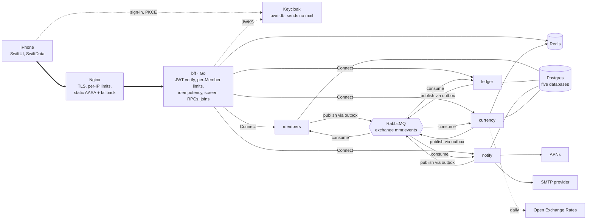
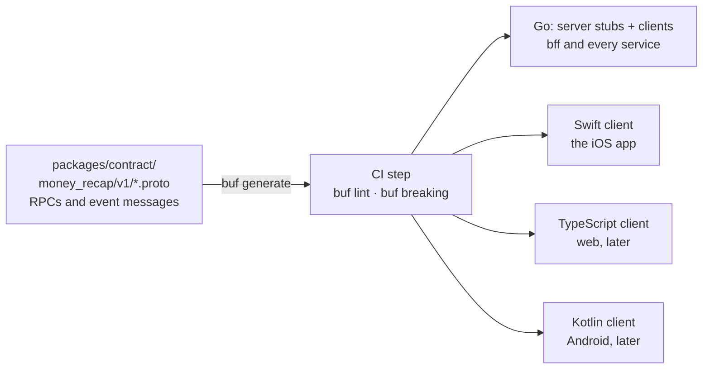
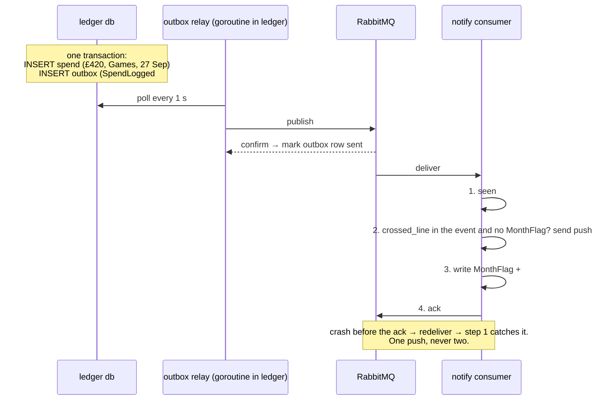
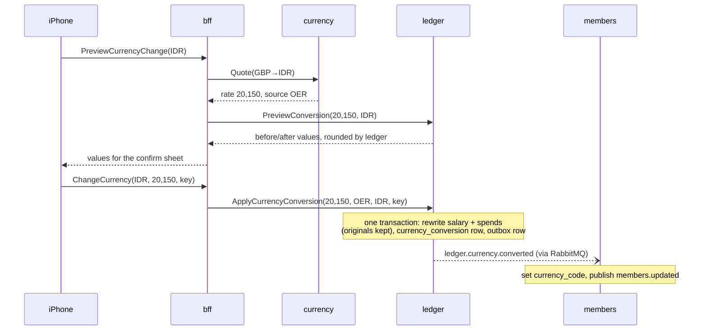
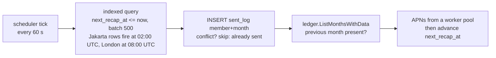

# My Money Recap — Architecture

| | |
|---|---|
| Status | Draft v2, 2026-09-16. Decisions A1–A15 are listed in §11, which is the decision register; its Status column is the only place acceptance is recorded. |
| Scope | The backend behind the iOS app named in `PRD.md` D11: the edge, the API the phone calls, the services, the broker, the cache, the databases and identity. The iOS app's internals live in `IOS.md` (beside this file), whose decisions are numbered `I*`. |
| Vocabulary | `CONTEXT.md` is the glossary. Terms in **bold caps** are defined there. Service names are lower-case code: `members`, `ledger`, `notify`, `currency`, `bff`. |
| Rules | `PRD.md` owns every product rule this document implements. Section references like §8.9 point there. |

## 1. Summary

The iPhone talks to one thing, a Go **BFF** (backend for frontend), through Nginx. The BFF verifies the Keycloak token, applies per-**Member** limits, and joins answers from four Go services, each with its own Postgres database: `members` (who the Member is), `ledger` (every money fact and all of PRD §8), `notify` (every notification in PRD §10), and `currency` (exchange rates). Services never read each other's databases. They talk synchronously over Connect RPC and asynchronously through RabbitMQ using the outbox pattern. Redis holds rate limits, idempotency keys, the daily rate table and the JWKS. Keycloak handles sign-in and owns no app data.

Payment and AI/ML services after phase 1, and web and Android clients later, plug in without changing this shape: a new service is one more box behind the BFF, and a new client is one more generated client of the same contract.

## 2. Decisions this document rests on

| Source | Decision |
|---|---|
| PRD D11, D31, §11 | Native iOS 17+, SwiftUI. Money is printed on the phone by the platform formatter. The phone caches its last snapshot in SwiftData. |
| PRD D6–D8, §9 | Keycloak for identity: Apple, Google and magic-link sign-in. Every service verifies the JWT on every request but the pre-authentication procedures §4.2 point 3 names. |
| PRD §7 | Postgres. Amounts are `NUMERIC` with an ISO 4217 code. Salary and target settings are append-only rows. |
| PRD D61, D63 | Read offline, write online. Offline, the phone shows its last snapshot with a "Last updated" line. |
| A2 (this doc) | The server computes every figure; the phone only stores and displays. |
| A3 (this doc) | One IANA timezone per Member, sent by the app; every "today" in PRD §8 and §10 is evaluated in it. |
| A5–A7 (this doc) | Nginx at the edge, RabbitMQ for events, Redis in phase 1. |
| Product direction | Go services, one container each. Payment and AI/ML services after phase 1. Web and Android clients later. |

## 3. The whole system



Solid arrows are synchronous calls a request waits for. Dotted arrows are background traffic. The bold path is what one tap on the phone travels. Nothing on the right talks to the phone directly.

## 4. Cross-cutting rules

### 4.1 One contract file, every client generated (A1)

Every API here, phone-to-BFF and BFF-to-service, is defined once in `packages/contract/money_recap/v1/*.proto`. Buf generates the Go server stubs and clients, the Swift client for the app, and later the TypeScript and Kotlin clients. `buf breaking` runs in CI against `main` and fails the build on an incompatible change, so a renamed field cannot reach the phone. Event payloads on RabbitMQ are protobuf messages from the same package, so events and RPCs share types. Connect speaks plain HTTP/1.1 and HTTP/2, which is why Nginx proxies it with an ordinary `proxy_pass` and why a web client later needs no gateway change.



### 4.2 Authentication, at three points

1. **Nginx** does not read the token. Open-source Nginx has no JWT module; that is Nginx Plus. Nginx terminates TLS, limits requests and connections per IP, and hides internal addresses.
2. **The BFF** verifies the Keycloak JWT against the realm's JWKS, cached and refreshed on an unknown key id, on every request but `RequestMagicLink` — its own pre-authentication procedure, exempted by the rule point 3 states, since it is sent before a Member has a token and its handler therefore reads the address from the request rather than from the claims (#69). It rejects expired or wrong-audience tokens before any service is called. A token it cannot check because the JWKS is out of reach is answered `unavailable`, not `unauthenticated`, so the phone keeps its session and its last snapshot instead of refreshing (PRD D61); a token whose key is already cached still verifies, and each service in point 3 answers the same way. It applies the per-Member limit in Redis keyed by the token subject, because thousands of phones behind one carrier address make a per-IP limit useless for fairness.
3. **Each service** verifies the same JWT again, as PRD §9 requires. The BFF forwards the bearer token unchanged. A bug in the BFF therefore cannot expose one Member's rows to another. The reason is that rule's own limit: a pre-authentication procedure is sent before a Member has a token, so it has no Member and no rows to isolate, and it is exempt by procedure name and never by service, leaving every other procedure of the same service behind the check (`internal/auth`). `notify.EmailMagicLink` is one, since the BFF reaches it on a request that carries no token (#68); the BFF's own `RequestMagicLink` is the other (#69).

### 4.3 Events: RabbitMQ with the outbox pattern (A4, A5)

RabbitMQ is a queue: it delivers each message to one consumer in a queue and forgets it after the ack. That is what phase 1 needs. Correctness comes from the pattern around it, which is the same for every broker.

| Element | Setting | Why |
|---|---|---|
| Exchange | `mmr.events`, type topic, durable | One exchange; routing keys name the producer and the fact, e.g. `ledger.spend.logged`. |
| Queues | Quorum queues, one per consumer service and topic family: `ledger.members`, `notify.members`, `currency.members`, `notify.ledger`, `members.ledger` (currency converted), `members.purges` (the three `*.member.purged` events) | Quorum queues are replicated and are RabbitMQ 4's recommended durable queue. |
| Dead letters | `mmr.dlx` exchange, `<queue>.dead` queues, delivery limit 5 | A poison message stops after five tries and waits for a human instead of blocking the queue. |
| Publishing | Publisher confirms on; message id = outbox row id; persistent | The relay marks an outbox row sent only after the broker confirms it. |
| Consuming | Manual ack, prefetch 16, `processed_events` table keyed by message id | At-least-once delivery means duplicates happen; the table makes them harmless. |



The Spend and its event are written together, so neither can exist without the other. Delivery is at least once; step 1 makes a second delivery harmless. The consumer always evaluates and stamps for itself; it never depends on a synchronous call having happened first. Debezium is the heavyweight relay that reads the outbox from the write-ahead log; a Go loop polling the outbox table every second is the phase-1 version. The relay selects rows with `FOR UPDATE SKIP LOCKED`, so two replicas of a service polling the same table never contend or double-publish.

### 4.4 Redis: five jobs (A6)

| Job | Owner | Key | TTL | If Redis is down |
|---|---|---|---|---|
| Per-Member rate limit | bff | `rl:{subject}:{minute}`, INCR + EXPIRE | 2 min | Fail open: requests pass, a metric fires. Nginx per-IP limits still stand. |
| Magic-link rate limit | bff | `ml:{address}:{hour}`, INCR + EXPIRE | 1 h | **Fail closed**: the request is refused with `resource_exhausted`. PRD §11 makes five per address per hour a security requirement rather than fairness, and no backstop can stand behind it: `limit_req` keys on an IP address and cannot see an email address inside a request body, so §5's limit is not this one. The key is the address, not the subject, because `RequestMagicLink` carries no token. |
| Idempotency of writes, fast path | bff | `idem:{subject}:{Idempotency-Key}` → stored response | 24 h | Fail open. The guarantee is not here: every write RPC carries the key to the owning service, which enforces a unique `(member_id, idempotency_key)` inside the same transaction as the row (A14). A retry after a BFF crash or a Redis restart hits that constraint and gets the original result back, so a retried Save never creates two Spends. Redis only saves the round trip. |
| Exchange-rate cache | currency | `fx:{yyyy-mm-dd}:USD` → the day's rate table | 36 h | Fall back to the latest `rate_snapshot` row; fetch from OER if none. |
| JWKS cache | bff, services | `jwks:{realm}` | 1 h | Each process also keeps the last JWKS in memory, so token checks continue. |

Redis 8 is licensed AGPLv3 (alongside RSALv2 and SSPLv1). AGPL binds Redis itself, not programs that talk to it over a socket; nothing here modifies Redis. Valkey (BSD-3) is a drop-in swap if a licence policy ever requires it.

### 4.5 Time: one zone per Member, no zone list in code (A3)

The app sends `TimeZone.current.identifier` on every launch. `members` validates it with Go's embedded IANA database (`time/tzdata`) and stores it. Every "today" in PRD §8 and §10 is evaluated in that zone by the service doing the arithmetic: Money In on or after Payday (§8.2), the streak window (§8.5), days remaining (§8.7), "never in the future" on a Spend date (§8.10), and the Recap-ready and daily-reminder triggers (§10). Spend dates stay plain calendar dates, as D34 says. So is the sign-up date: `members` stores `signed_up_on`, the local date at the moment of sign-up, next to `created_at`, and the streak window (§8.5) and the partial-month rule (§8.11) read that date. A Member who later moves to another zone changes only what "today" means from now on; no past month is recomputed, because nothing in a past month reads the zone.

The `notify` scheduler does not compute local time per row on every tick. Each `member_facts` row carries `next_recap_at` and `next_reminder_at` as UTC timestamps, computed with `AT TIME ZONE` when the zone or the reminder time changes and again after each fire, and both columns are indexed. The tick is then one indexed range query:

```sql
SELECT member_id FROM member_facts
WHERE next_reminder_at <= now()
ORDER BY next_reminder_at
LIMIT 500;
```

No cron per zone and no zone table. Postgres and Go both carry the IANA data, so a daylight-saving change is a package update, and the next-fire columns are recomputed from it.

### 4.6 Observability (A11)

Once one tap on the phone crosses Nginx, the BFF and up to three services, a slow or failed request cannot be understood from one log file. Every Go process, the BFF included, uses the OpenTelemetry SDK for traces, metrics and logs and exports them over OTLP to one container, `grafana/otel-lgtm`, which bundles Tempo (traces), Loki (logs), Prometheus (metrics) and Grafana in a single image for phase 1. The BFF starts a trace per request and propagates the context in Connect headers and in RabbitMQ message headers, so a `SpendLogged` event and the push it caused appear under the Save that produced them. Every log line carries the trace id and the Member id, never the token. The three alerts worth having on day one: any service health check failing, any queue's dead-letter count above zero, and BFF p95 latency above one second (PRD §11).

## 5. The edge: Nginx (A7)

| | |
|---|---|
| Responsibility | TLS termination, per-IP and per-connection limits, routing, static files, hiding every internal address. No business logic, no token parsing. |
| Routes | `/api/` → bff. `/auth/` → Keycloak. `/.well-known/apple-app-site-association` → static, `application/json`, no redirect. `/magic` → the static fallback page. |
| Limits | `limit_req_zone $binary_remote_addr rate=60r/s burst=120`, deliberately generous because a mobile carrier can put thousands of phones behind one address. `limit_conn` 100 per address. A stricter 5 r/min on the magic-link path only, which blunts a flood from one IP address and is **not** PRD §11's five per email address per hour: `limit_req` keys on an IP address and cannot see an address inside a request body, so the BFF enforces that limit itself, fail closed (§4.4). |
| Certificates | Let's Encrypt via an `acme.sh` sidecar whose deploy hook runs `nginx -s reload` (`certbot/certbot` was rejected: `research/2026-09-14-setup-automation.md` §1.5). |
| Why Nginx | The most widely deployed reverse proxy, documented everywhere, and it keeps TLS and abuse control out of Go. |
| Known limit | JWT validation needs Nginx Plus or the njs module. The design does not depend on it; the BFF verifies tokens. |

## 6. The API: `bff`

| | |
|---|---|
| Responsibility | The only thing the phone talks to. Screen-shaped RPCs, JWT verification, per-Member limits, idempotency, fan-out to services and the join. Owns no database. |
| RPCs | `RequestMagicLink`, `GetHome`, `GetRecap(month)`, `ListRecapMonths`, `ListSpends(month)`, `LogSpend`, `EditSpend`, `DeleteSpend`, `GetOnboardingState`, `SaveProfile`, `SetTimezone` (called on every launch), `GetSettings`, `SaveSalary`, `SaveTarget`, `PreviewCurrencyChange`, `ChangeCurrency`, `SaveNotificationPrefs`, `RegisterDevice`, `RequestExport`, `RequestDeletion`, `CancelDeletion`. Each is a thin join or pass-through to the service RPCs in §7. |
| Depends on | `members`, `ledger`, `notify`, `currency` over Connect; Redis; Keycloak JWKS. |
| Publishes | Nothing. The BFF never writes state, so it needs no outbox. |
| Why a BFF | Home needs the profile (`members`), the numbers (`ledger`) and the warning state (`notify`). Someone must join them. Doing it in Go keeps the phone a pure display and keeps the join out of Nginx, which cannot do it. |

### 6.1 Flow: GetHome

```mermaid
sequenceDiagram
    participant P as iPhone
    participant B as bff
    participant M as members
    participant L as ledger
    participant N as notify
    P->>B: GetHome (bearer token)
    B->>B: verify JWT, per-Member limit
    B->>M: GetOrCreateBySubject, 1 s timeout
    par in parallel, 1 s timeout each
        B->>M: GetProfile
        B->>L: GetMonthSummary(current)
        B->>N: GetWarningState(current)
    end
    B->>B: join → HomeView
    B-->>P: HomeView; phone stores it in SwiftData
```

`members` and `ledger` are required: if either times out, the BFF returns an error and the phone keeps drawing its last snapshot. `notify` is optional: if it times out, the HomeView is returned without a warning banner and a metric fires. A notification service can never blank the Home screen.

### 6.2 Flow: LogSpend

1. The phone sends `LogSpend` with an `Idempotency-Key` it generated when the sheet opened. Every write RPC in this document carries one; `LogSpend` is the worked example.
2. The BFF verifies the JWT, checks the per-Member limit, and looks up the key in Redis. A hit returns the stored response without touching `ledger`.
3. The BFF calls `ledger.LogSpend(key, …)`. Ledger looks up `member_facts`; on a miss (the Spend arrived before `members.created` was consumed) it calls `members.GetProfile` once and upserts, and if that fails it returns a retryable error. It validates D57 and §8.10 in the Member's zone, then in one transaction writes the Spend with the key under the unique `(member_id, idempotency_key)`, the outbox row, and recomputes the month. A duplicate key returns the original Spend's `MonthSummary`, not an error. The response includes `crossed_line`, computed here against the §8.8 line, so no other service does that arithmetic.
4. The BFF calls `notify.EvaluateWarning(month, crossed_line, warning)` with a 300 ms timeout, `warning` being ledger's §8.8 copy. Notify stamps `month_flag` with that copy if `crossed_line` and no stamp exists, and returns the warning state. On timeout the BFF continues without that month's banner; the event path below will stamp it a second later. `notify` can be down and a Member can still record a coffee.
5. The BFF stores the response under the idempotency key for 24 hours and returns a fresh `HomeView`. The phone animates the numbers (§6.9) and replaces its snapshot.
6. Separately, the relay publishes `ledger.spend.logged` carrying the same figures and `crossed_line`. Notify consumes it, stamps `month_flag` if not yet stamped, and sends the push if the stamp is fresh. Both the stamp and the push are idempotent on `(member_id, month)`, so it does not matter whether step 4 ran, ran twice, or never ran. The event path is the guarantee; the synchronous call is only the user experience.

`EditSpend` runs the same six steps with `EditSpendResponse` and `ledger.spend.edited`. Step 4 names the month the Spend now sits in (`EditSpendResponse.month`), the only month an edit can push over the line; the month it left only loses Spent, which never un-fires a warning (PRD §8.8). Ledger answers `crossed_line` true only when the write's month is the current one (§8.8), so step 4 for a past month stamps nothing. Home is always the current month, so when a write's month is a past one (a Spend logged, edited or moved there), the fresh `HomeView`'s banner comes from `GetWarningState(current)` as in §6.1, never from that month's kept copy. `DeleteSpend` never crosses the line (`DeleteSpendResponse.crossed_line` is always false), so it skips step 4 and its banner comes from `GetWarningState(current)` too.

## 7. The services

### 7.1 `members`

| | |
|---|---|
| Responsibility | Who the Member is: Keycloak subject, email as the token's `email` claim reports it, Display Name, Avatar, Currency code, timezone, sign-up date, deletion request. First-sign-in detection (PRD §5 step 5). Onboarding progress (§6.4). The 24-hour deletion job (§9). |
| Owns | `member` (id, keycloak_subject, email, display_name, avatar_key, currency_code, timezone, created_at, signed_up_on, deletion_requested_at, deleted_at, onboarding_step), `deletion_progress` (member_id, keycloak_deleted_at, ledger_purged_at, notify_purged_at, currency_purged_at), `outbox`, `processed_events`. |
| RPCs | `GetOrCreateBySubject` (saves the token's `email` claim on create and refreshes it on every call whose token carries one, so a change made in Keycloak reaches us on the next sign-in; a refreshed token lacks the claim after an admin clears the address, and the stored one stays), `GetProfile`, `SaveProfile` (Display Name, Avatar, Currency and the onboarding step just completed or skipped, one write per step), `SetTimezone`, `RequestDeletion`, `CancelDeletion`. Every write takes an idempotency key (A14). |
| Publishes | `members.created`, `members.updated` (name, avatar, timezone, currency, email), `members.deletion.requested`, `members.deletion.cancelled`, `members.deleted`. |
| Consumes | `ledger.currency.converted` → set `currency_code`, then publish `members.updated`. `ledger.member.purged`, `notify.member.purged`, `currency.member.purged` → stamp `deletion_progress`. |
| Why separate | Identity and profile change rarely and are needed by every other service. Publishing them as events lets `ledger` and `notify` keep the few facts they need, timezone, `signed_up_on` and email, without calling `members` on every request. The email is an identifier, not a credential: it is the standard OIDC claim, read from a signed token over TLS, and storing it carries the same risk as storing the Display Name. |

Flow: deletion and restore (D39, D60)

1. `RequestDeletion` stamps `deletion_requested_at`, publishes `members.deletion.requested`, and the BFF tells the phone to sign out and erase its cache.
2. A sign-in within 24 hours: the BFF calls `GetOrCreateBySubject`, sees the stamp is under 24 hours old, and the phone shows the restore sheet (§6.18). "Keep my account" calls `CancelDeletion`, which clears the stamp and publishes `members.deletion.cancelled`.
3. A worker in `members` runs every 10 minutes. For every stamp older than 24 hours it sets `deleted_at` on the member row, inserts a `deletion_progress` row, and writes the `members.deleted` outbox row, all in one transaction. The row is a tombstone: `GetOrCreateBySubject` treats it as absent. No remote call is inside this transaction.
4. A second step, retried until it succeeds, deletes the Keycloak user through the admin API and stamps `keycloak_deleted_at`. A 404 from Keycloak counts as success, so a retry after a half-finished run is harmless.
5. `ledger`, `notify` and `currency` each consume `members.deleted`, purge that Member's rows idempotently, and publish `<service>.member.purged`. `members` consumes those three and stamps `deletion_progress`.
6. When all four stamps are present the member row is hard-deleted. An alert fires for any `deletion_progress` row incomplete one hour after `deleted_at`, which is how a broken consumer is noticed instead of leaving Spend rows behind indefinitely.

### 7.2 `ledger`

| | |
|---|---|
| Responsibility | All money facts and **all** of PRD §8, nothing of it anywhere else: salary and target settings, Spends, currency rewrites and their rounding (§8.4, §8.9), and every computed figure: Spent, Money In, Saved, target amount, kept%, Streak, Splurge, Archetype, partial-month status, the target sentence, the warning line and whether it was crossed (§8.8). `notify` receives a boolean; `currency` supplies a rate. |
| Owns | `salary_setting`, `saving_target_setting`, `spend`, `currency_conversion`, `member_facts` (replica: member_id, timezone, signed_up_on, currency_code), `outbox`, `processed_events`. `spend` and `salary_setting` carry `original_amount` and `original_currency`, the values as typed, untouched by a later conversion; every write table carries `idempotency_key` with a unique index on `(member_id, idempotency_key)`. |
| RPCs | `GetMonthSummary(month)`, `GetRecap(month)`, `ListMonthsWithData`, `ListSpends(month)`, `LogSpend`, `EditSpend`, `DeleteSpend`, `GetSettings`, `SaveSalary(applies_from)`, `SaveTarget`, `PreviewConversion(rate, to)`, `ApplyCurrencyConversion(rate, source, to)`, `GetSpentToday(member_ids[])`, `ExportCSV`. Every write takes an idempotency key (A14). |
| Rounding | Decimals per currency come from CLDR through `golang.org/x/text/currency`, the same data the phone's formatter reads, so no table of currencies exists in the code. The stored value is the truth; the phone only prints it. |
| Publishes | `ledger.spend.logged`, `ledger.spend.edited`, `ledger.spend.deleted`, `ledger.salary.changed`, `ledger.target.changed`, `ledger.currency.converted`, `ledger.member.purged`. Every spend event carries the recomputed month figures and `crossed_line`, so `notify` never recalculates. |
| Consumes | `members.created`, `members.updated` → upsert `member_facts`. `members.deleted` → purge, then publish `ledger.member.purged`. |
| Tests | The PRD §8 worked examples and the §12 acceptance criteria live as JSON fixtures in `packages/contract/fixtures/ledger/`, typed by the contract's `LedgerFixture`: written in slice 2 (#42, decoded against the schema by `apps/backend/internal/ledger/fixtures_test.go`), run by `ledger` in slice 5. Each fixture is one ledger and one "as of" date with the expected numbers, including `crossed_line` and the rounded conversion results. The ledger's test suite runs every fixture. Because no other service implements any of §8, this is the single answer key for the arithmetic. |
| Why one service for all of it | §8.9 rewrites salary rows and Spend rows "in one transaction". Keeping both tables in one database keeps that a real transaction instead of a saga. The §8 rules read every table here; splitting them would turn every computation into three network calls. |

Flow: currency change (§8.9)



The rewrite of every amount is one Postgres transaction inside `ledger`; each rewritten row keeps `original_amount` and `original_currency`, so what the Member typed is never lost (PRD §8.9). `members` learns the new code from the event, not from a call, so a failure there is retried by the broker and the worst case is a code that lags the amounts by seconds, never amounts that are half converted. A second tap with the same key returns the first result.

Flow: salary edit after Payday (D56)

1. The phone calls `GetSettings`; the response includes `payday_passed_this_month`, computed by `ledger` in the Member's zone.
2. If true, the phone shows the D56 sheet and sends `SaveSalary(applies_from = this_month | next_month)`. If false, it sends `unspecified` with no sheet; `ledger` reads that as `this_month` before its own Payday clock and answers `failed_precondition` on or after it, so a flag that went stale while Settings was open makes the phone show the sheet instead of rewriting a paid month.
3. `ledger` appends a `salary_setting` row with that `effective_from`. Nothing is updated in place, so September's Recap is reproducible from the rows.

### 7.3 `notify`

| | |
|---|---|
| Responsibility | Deciding and sending every notification in PRD §10, and remembering what was sent. Device tokens. Notification preferences. The Target Warning state the Home banner reads. All outbound email: the magic-link email (§7.5) and the CSV export (PRD §6.16). Keycloak sends no mail. |
| Owns | `notification_preference`, `device` (apns_token, member_id), `month_flag` (member_id, year_month, target_warning_sent_at, target_warning_message: ledger's §8.8 copy as it read when the month was stamped, so the Home banner stays until the 1st however Spent moves afterwards), `sent_log` (unique on member_id, kind, period), `email_status` (member_id, address, last_bounce_at), `magic_link_send` (idempotency_key, email, sent_at: one row per magic-link send, unique on `(email, idempotency_key)` — A14's `(member_id, idempotency_key)` has no Member on this path, and the key alone let one address lock every other one out of its own link; every send sweeps rows past the retention window in the same transaction, because a row holding a raw address and no member_id is one the purge below cannot reach), `member_facts` (replica: timezone, display_name, email, next_recap_at, next_reminder_at), `processed_events`. |
| RPCs | `GetWarningState(month)` answering `fired` and the kept copy, `EvaluateWarning(month, crossed_line, warning)` answering `fired`, `fired_now` and the kept copy, `GetPrefs`, `SavePrefs`, `RegisterDevice`, `EmailMagicLink(email, link)`, `EmailExport(csv)`. Every write takes an idempotency key (A14). `notify` holds no rule from PRD §8; `crossed_line` is computed by `ledger`. |
| Email | One SMTP provider, credentials mounted as a secret file (A13). `EmailMagicLink` takes the typed address because no member row may exist yet; `EmailExport` reads the address from `member_facts`. A hard bounce recorded by the provider's webhook stamps `email_status.last_bounce_at`; `EmailExport` refuses an address with a bounce newer than its last change, which is the "Apple private-relay address that has bounced" case in PRD §6.16, and the BFF turns that into the `InlineError` that offers Profile. |
| Consumes | `ledger.spend.logged`, `ledger.spend.edited` → stamp `month_flag` if `crossed_line` and unstamped, send the push if the stamp is fresh. `members.updated` → replica, recompute `next_*_at`. `members.deleted` → purge, then publish `notify.member.purged`. |
| Schedulers | Every minute: one indexed query on `next_recap_at`, one on `next_reminder_at` (§4.5), in batches of 500. Each batch is one `ledger.GetSpentToday(member_ids[])` call for the reminder, then one APNs request per Member from a bounded worker pool. Insert into `sent_log` first, send only if the insert won, so a crash between the two never double-sends and two `notify` replicas never both send. |
| APNs | Token-based auth with a .p8 key, HTTP/2 to Apple. A 410 response deletes the device row. |
| Why separate | It is the only service with schedulers and an outbound push connection. Keeping it out of `ledger` keeps the money service free of clocks and Apple. |

Flow: Recap ready at 09:00 local



A partial month still sends (PRD §10). The daily reminder is the same loop on `next_reminder_at` with one batched `ledger.GetSpentToday(member_ids[])` per 500 Members. At phase-1 scale this is a handful of rows a minute; the batch, the index and the worker pool are what keep a popular reminder time from becoming a burst of one RPC and one push per Member from a single loop.

Flow: CSV export (PRD §6.16, D39)

1. The phone calls `RequestExport`. The BFF calls `ledger.ExportCSV`, which streams every non-deleted Spend for that Member as CSV.
2. The BFF calls `notify.EmailExport(csv)`. Notify checks `email_status`, sends through SMTP, and writes `sent_log`.
3. The BFF returns success and the phone's button becomes `Sent ✓` for 60 seconds (D67). A refused address returns the §6.16 `InlineError`. The file is never stored server-side; a second tap regenerates it.

### 7.4 `currency`

| | |
|---|---|
| Responsibility | Exchange rates and conversion quotes. Fetching Open Exchange Rates once a day (D35), caching, the manual-rate fallback for unsupported pairs, and the before/after figures for the confirm sheet. |
| Owns | `rate_snapshot` (date, base, rates jsonb, fetched_at), `processed_events`. |
| RPCs | `Quote(from, to)` → rate, source, as_of, or `UNSUPPORTED_PAIR`. No arithmetic on amounts: rounding and rewriting are `ledger`'s (§7.2), so §8 has one implementation. |
| Consumes | `members.deleted` → nothing to purge; publishes `currency.member.purged` so `members` can complete its deletion tracking. |
| Redis | `fx:{date}:USD`, 36-hour TTL. On a miss, read the latest `rate_snapshot`; on none, fetch OER. |
| Why separate | It is the only service that calls a third-party API with a key and a quota. A quota failure or an OER outage returns an `InlineError` with Retry (§8.9 step 1) and nothing else notices. |

### 7.5 Keycloak

| | |
|---|---|
| Responsibility | Sign-in. Brokers Apple and Google, issues login tokens through the Phase Two extension, issues and refreshes session tokens, ends sessions. Holds no app data and sends no email. |
| Owns | Its own database, `keycloak`, in the same Postgres container. |
| Image | `quay.io/phasetwo/phasetwo-keycloak`, pinned to a tag whose bundled `keycloak-magic-link` and Apple identity-provider extensions match its Keycloak version. Never `latest`: the magic-link extension is compiled against one Keycloak minor and has broken on the next (`research/2026-09-14-a10-magic-link.md` §1). |
| Configuration as code | The official `keycloak/keycloak` OpenTofu provider under `infra/tofu/realm/` (A13): the realm, the `ios` public client, the BFF's service-account client, the `login-token` scope, the custom direct-grant flow, the test Member and the Google and Apple identity providers (#71), whose client ids, Team ID and Key ID are variables and whose secrets are vault references. A one-shot container applies it on every start, so a realm edit takes effect with `docker compose up`. No SMTP block: Keycloak sends nothing. The JSON import it replaced was skipped once the realm existed, so it could not carry later changes; kcadm is imperative. |
| Apple sign-in | The bundled Apple identity-provider extension takes the Team ID, Key ID and `.p8` key and signs the client-secret JWT itself on every code exchange (§9; `research/2026-09-14-setup-automation.md` §3). |
| Secrets | Keycloak's file vault: `--vault=file --vault-dir=/run/secrets` with the `KEY_ONLY` key resolver, and the two identity-provider secrets referenced as `${vault.google_client_secret}` and `${vault.apple_sign_in_key}`. The files are mounted from the SOPS-decrypted set (§10, A13), under the names Keycloak 26.6 looks for, with every underscore doubled (`infra/secrets/README.md`). Google's resolves. The Apple extension pinned in the image (1.17.0) never asks the vault: it base64-decodes the literal reference as its `.p8`, so Sign in with Apple cannot finish a code exchange with real values until that changes (#71). The one exception is the `bff` client secret, which is an OpenTofu variable and so is in OpenTofu state and in the environment: the file vault resolves its placeholder only for the SMTP password, identity-provider secrets and LDAP, and the A10 smoke script and the `members` wrong-audience test must know the value in advance. |

Flow: email sign-in (D7, D32, acceptance 2)

Keycloak's magic-link action token cannot be placed on the app's domain and is consumed by a plain GET, which mail scanners issue (`research/2026-09-14-a10-magic-link.md` §2–3). The extension's newer **Login Token** path avoids both, so that is A10.

1. The phone sends `RequestMagicLink(email)`. The BFF enforces 5 requests per email per hour in Redis (PRD §11), then calls the extension's `POST /realms/mmr/login-token` with `expiration_seconds: 900`, `reusable: false`, `force_create: true` and `set_email_verified: true`, using its service account. The response is an opaque `lt:<uuid>`.
2. The BFF calls `notify.EmailMagicLink(email, link)` and `notify` emails `https://app.example.com/magic?lt=…`. Nginx serves a static page for `/magic` and the apple-app-site-association file from `/.well-known/`, so on an iPhone with the app installed iOS opens the app instead of the page.
3. The app POSTs `grant_type=password&scope=login-token&login_token=…` to Keycloak's token endpoint and receives its tokens. The `login-token` scope routes the `ios` client's direct grant to the Login Token branch; without it the same flow runs the username-password validators (the test seam), because the Login Token authenticator fails the flow outright when the field is absent, so the two cannot be plain alternatives. No browser is involved on the email path; Apple and Google still use `ASWebAuthenticationSession` with PKCE. An expired or used token returns `invalid_grant`, which the app shows as the §6.3 `InlineError`.
4. On a laptop, or when the Member has set links to open in the browser (Apple TN3155), the static page says "Open this link on your phone" and offers an "Open in app" button on the app's custom scheme. The page performs no request with `lt`, and a scanner GET on the URL reaches only that static page, so the token cannot be consumed by anything but the app.

**Open item, resolved 2026-09-16.** `infra/compose/a10-smoke.sh` proves on `quay.io/phasetwo/phasetwo-keycloak:26.6.6.1789466980` (Keycloak 26.6.6, magic-link 0.75) that the Login Token endpoint issues a token for the test user and the `ios` client redeems it through the direct grant, that the second redemption is refused with `invalid_grant`, and that the password grant still works. CI's `backend` job runs it on every pull request that touches the backend, `infra/` or the contract (#14).

## 8. Data ownership

| Table | Database | Writer | Readers |
|---|---|---|---|
| `member`, `deletion_progress` | members | members | members only; others hold `member_facts` replicas fed by events |
| `salary_setting`, `saving_target_setting`, `spend`, `currency_conversion` | ledger | ledger | ledger only |
| `member_facts` (replica) | ledger, notify | that service's consumer | that service |
| `notification_preference`, `device`, `month_flag`, `sent_log`, `email_status`, `magic_link_send` | notify | notify | notify only |
| `rate_snapshot` | currency | currency | currency only |
| `outbox`, `processed_events` | every service | that service | that service's relay and consumers |
| Keycloak tables | keycloak | Keycloak | Keycloak only |

One Postgres container, five databases, five roles, each role granted only its own database. A service that tries to read another's tables fails at connection time, which is the cheapest way to keep the boundary honest.

## 9. Justifications

| Decision | Why | Rejected |
|---|---|---|
| Nginx at the edge | TLS, per-IP limits and static files without Go code. Universally documented. | Caddy: simpler certificates, fewer knobs. Envoy: stronger, heavier. A separate API gateway product: nothing for it to do that the BFF does not. |
| BFF verifies tokens | Open-source Nginx cannot; every service does anyway. | Nginx Plus, njs, OpenResty: paid or extra runtimes. |
| Four services, not one | The goal is to learn service boundaries, events and ownership. The boundaries follow the PRD's own sections: §7 rows, §8 rules, §9 identity, §10 notifications, D35 rates. | Modular monolith: simplest, teaches least. Ten services: nothing left to own. |
| All of §8 inside `ledger` | §8.9's single transaction, and every rule reads every table. | A separate recap service: three network calls per number and a saga for currency change. |
| Replicated member facts | `ledger` and `notify` need timezone, `signed_up_on` and email on every computation or send. Events keep the copies fresh without a call per request. | Calling `members` per request: a dependency in the hot path. Sharing the database: not a boundary. |
| RabbitMQ | The textbook queue: routing, dead letters, quorum queues, per-message acks. MPL-2.0. Streams exist if replay is ever needed. | NATS: lightest, less to learn. Kafka: heaviest, replay not needed yet. Postgres queue: simplest, no broker skills. |
| Redis in phase 1 | Five real jobs (§4.4). AGPL binds Redis, not the app. | Valkey: identical API, drop-in if policy changes. No cache: fewer parts, no idempotency store. |
| Protobuf, Buf, Connect | One schema for RPCs and events; Go, Swift, TS and Kotlin generated; plain HTTP through Nginx. | OpenAPI: fine for phone-to-BFF, no event types. GraphQL: for many clients, not one. gRPC alone: needs HTTP/2 end to end and a proxy for browsers. |
| Outbox and `processed_events` | The only pattern under which "Spend saved but event lost" and "event delivered twice" are both impossible to observe. | Publish after commit without outbox: loses events on a crash. Exactly-once from the broker: does not exist end to end. |
| Server-side computation | One implementation of §8, one answer key, no drift. | Phone-side arithmetic: a second implementation in Swift. |
| Synchronous `EvaluateWarning` | The banner is in the Save response, as §8.8's "after saving a Spend" reads. | Event-only: the banner appears on the next `GetHome`, a second later. |
| Idempotency enforced in the owning service | A unique key inside the write's own transaction survives a BFF crash and a Redis restart; a cache cannot. | Redis as the guarantee: a crash between commit and cache write duplicates the Spend. |
| Originals kept on conversion | Two columns preserve what the Member typed; the rewrite the PRD asks for still happens. | Convert on read: reverses D12 and puts rounding in every read. Rewrite only: the typed amount is gone. |
| `next_*_at` columns for schedules | An indexed range scan instead of `AT TIME ZONE` per row per minute; batched RPCs and a worker pool for the fan-out. | Per-row local-time query: a full scan every tick and one call per Member at a popular time. |
| `notify` optional on every read and write path | A notification service must never block a money entry or blank Home; the event path already guarantees the flag and the push. | Synchronous, required: `notify` down means no Spends can be logged. |
| Login Token, not the action-token magic link | The action token lives on Keycloak's host and is consumed by any GET; the login token is opaque, app-redeemed, atomically single-use. | Action-token link with `send_email:false` and our own wrapper page: workable, but a scanner that follows the unwrapped URL still burns it. |
| SOPS + age, not env files | Secrets encrypted in git, decrypted to files at deploy, no daemon, MPL-2.0 and BSD-3. | Vault/OpenBao: a server for one VM. Doppler/Infisical: a hosted service for one developer. `.env`: plain text on disk and in `docker inspect`. |
| Apple identity-provider extension, not generic OIDC | It signs the client secret from the `.p8` on every exchange, so the six-month rotation job does not exist. | Generic OIDC with a hand-rotated JWT: a recurring operations task that fails silently when forgotten. |

## 10. Containers in phase 1

| Container | Image | Ports | Depends on |
|---|---|---|---|
| nginx | nginx:stable | 443, 80 | bff, keycloak |
| acme | neilpang/acme.sh | — | shares the cert volume with nginx; deploy hook reloads nginx |
| bff | built from the one Go module `apps/backend`, command `cmd/bff` (the one `Dockerfile`, `CMD=bff`) | 8080 internal | members, ledger, notify, currency, redis |
| members, ledger, notify, currency | built from the one Go module `apps/backend`, command `cmd/<service>` (the one `Dockerfile`, `CMD=<service>`) | 8080 internal each | postgres, rabbitmq, and redis where §4.4 lists it |
| keycloak | quay.io/phasetwo/phasetwo-keycloak, pinned tag (§7.5) | 8080 internal | postgres |
| postgres | postgres:17 | 5432 internal | volume |
| rabbitmq | rabbitmq:4-management | 5672, 15672 internal | volume |
| redis | redis:8 | 6379 internal | — |
| otel-lgtm | grafana/otel-lgtm | 4317 internal, 3000 admin-only | volume |
| pg-backup | built from `infra/pg-backup` (cron + `pg_dump`) | — | postgres |

Thirteen containers, one `compose.yaml`, health checks on every one so `depends_on: condition: service_healthy` starts them in order. Migrations run as a one-shot step per service before that service starts: the same image with the `migrate` subcommand, which `depends_on: condition: service_completed_successfully` orders (`members-migrate` is the first, #15). The same compose file runs on a laptop and on the first VM. Kubernetes comes after phase 1 is stable.

**The thirteen are the VM's.** A laptop runs the same file plus two containers that never reach the VM: Mailpit, behind the `mail` profile, is the SMTP host `notify` sends to (#68), and a one-shot OpenTofu step builds the realm on every `up` (#65). Development-only containers are outside the count on any machine. Nginx and the `acme.sh` sidecar are two of the thirteen already, so joining the laptop stack (#72) changes no number: what changes is that there they serve plain HTTP and the sidecar holds no certificate, because ACME needs a domain.

**What this does and does not buy.** The service split gives independent deployment and clean ownership. It does not give independent scaling: one VM, one Postgres process and one disk are shared, so a runaway query in `ledger` slows Keycloak and `notify` too. Nothing in phase 1 should be designed as if the four services could be scaled apart; that arrives with separate database instances, after phase 1.

**Secrets (A13).** Every secret lives in `infra/secrets/prod.yaml`, encrypted with SOPS and an age key, and is committed. The deploy step decrypts it into files under `/run/secrets` and Compose mounts them with `secrets:`; Go services read `*_FILE` paths, Keycloak reads them through its file vault, and nothing is passed as an environment variable, which Docker's own docs advise against for secrets. The age private key on the VM and in the GitHub `production` environment is the only value a human ever holds. Rotation is edit, commit, deploy. Vault and OpenBao were rejected as a server for one VM; Doppler and Infisical as a hosted service for one developer.

**Infrastructure as code.** `infra/tofu/` holds DNS records and the apple-app-site-association file, the VM with cloud-init and firewall, the Keycloak realm, and API tokens for providers that expose them (Resend or Postmark for SMTP). What stays human is one browser session each: Apple Developer Program enrolment and its two `.p8` keys and Services ID, the Google OAuth client, the Open Exchange Rates App ID, the first SMTP-provider account, the domain purchase, the cloud account, and one `age-keygen`. The setup wizard is scoped to exactly those, each ending in pasting the value into `sops edit infra/secrets/prod.yaml` (`research/2026-09-14-setup-automation.md` §4).

**Delivery (A15).** One long-lived branch, `main`. CI (`.github/workflows/ci.yml`) runs on every pull request and on `main`. `quality` runs every pre-commit hook and always fires. Four jobs then run only when the files they build or check changed, generated output included, decided by `dorny/paths-filter` in a `changes` job: `design-system` (generated tokens, Swift tokens and inlined artwork are fresh; typecheck; TypeScript coverage), `contract` (`buf lint`, `buf breaking` against `main`, generated code is fresh), `backend` (golangci-lint, the Compose stack, then `go vet`, every Go test including the Connect-boundary and end-to-end tests, Go coverage, and `infra/compose/a10-smoke.sh` on the pinned Keycloak image) and `ios` (SwiftFormat, SwiftLint, build and unit tests on a simulator picked at runtime, iOS coverage). A final `all green` job gathers their results and is the one to require, because a job skipped by `if:` reports success while a workflow skipped by a `paths:` filter reports nothing at all and would block a pull request forever. The gating exists because this repository is private and macOS minutes bill at ten times the Linux rate: the `ios` job alone is 30 to 40 of the 45 to 55 billable minutes a full run costs, because each job is billed rounded up to the whole minute. `.github/workflows/security.yml` runs alongside it — govulncheck, OSV-Scanner, Semgrep, Trivy and a full-tree gitleaks scan — on every pull request and every Monday. Its jobs are not gated: all of them run on Linux, and govulncheck reports only the advisories the Go code reaches, so its verdict can change while `go.mod` does not. Merging to `main` means tested and integrated, not deployed. Deployment is a tag: pushing `vX.Y.Z` runs a deploy workflow in the GitHub `production` environment that first decrypts `infra/secrets/prod.yaml` with the environment's age key, then builds the images and pushes them to GHCR, copies the Compose file and the edge configuration, and runs Compose on the VM (`.github/workflows/deploy.yml`, `infra/README.md` "Deploying"); the iOS build for the same tag goes to TestFlight. No `development` branch: for one developer merging one ticket at a time, git-flow adds a second merge per change and lets finished work sit unreleased. GitHub's branch protection is unavailable on this repository's plan, so "never commit to `main`" is a rule in `AGENTS.md` rather than a server-side gate.

**Backups (A12).** `pg-backup` runs `pg_dump` of each of the five databases at 03:00 UTC to an S3-compatible bucket in the same region, encrypted with a key from the secrets file, and keeps 30 daily copies. RabbitMQ and Redis hold nothing that cannot be rebuilt: an unpublished outbox row is re-published by the relay, and every Redis key is a cache or a short-lived lock. Once a quarter, a restore into a scratch Postgres is run and the ledger fixtures are executed against it; a backup that has never been restored is not a backup.

## 11. Decisions to record as ADRs

| # | Decision | Status |
|---|---|---|
| A1 | Contract: protobuf, Buf, Connect; `buf breaking` required in CI; event messages in the same package. | in use since slice 1 (#17: the phone-facing `GetHome` and the `members` RPCs are generated from `packages/contract`, and the end-to-end test calls the BFF through the generated client); full contract and event messages since slice 2 (#42: every RPC of §6 and §7, the screen views and every event of §4.3, `buf breaking` at `PACKAGE` level) |
| A2 | All of §8 lives in `ledger` and nowhere else, including the warning-line check and conversion rounding; the phone stores and formats; the §8 fixtures are the answer key. | proposed |
| A3 | `member.timezone` as an IANA name; every "today" in §8 and §10 evaluated in it; the `notify` scheduler is the §4.5 query. | proposed |
| A4 | Events: outbox relay, at-least-once, `processed_events` dedupe keyed by message id. | proposed |
| A5 | Broker: RabbitMQ, topic exchange, quorum queues, dead-letter after five tries. | proposed |
| A6 | Redis for rate limits, idempotency, rate cache and JWKS; fail-open and fail-closed rules per job; AGPL noted. | in use since slice 3 (#69: §4.4's magic-link limit is the first job built — `INCR` and `EXPIRE` keyed by the address, failing closed, in the BFF's first Redis client; the other four rows are still proposed) |
| A7 | Front door: Nginx for TLS, per-IP limits and static files; the BFF verifies the JWT; every service verifies again. | in use on the laptop since #72 (PR #82): the four routes, the per-IP limits and the two static files, over plain HTTP. TLS is not live anywhere: there is no domain, so the `acme.sh` sidecar holds no certificate. The BFF and each running service verify the JWT, the two pre-authentication procedures excepted by name (§4.2) |
| A8 | Service boundaries: `members`, `ledger`, `notify`, `currency`; payment and AI reserved; replicated member facts fed by events. | proposed |
| A9 | Data: one Postgres container, five databases, one role each, no cross-database grants. Deployment: Docker Compose for phase 1. | in use since slice 1 |
| A10 | Email sign-in: Phase Two Login Token redeemed by the app through the direct grant; the BFF requests it and limits 5 per email per hour; `notify` emails the app-domain link; the static fallback never touches the token; the Phase Two image is pinned. | accepted on tag 26.6.6.1789466980, 2026-09-16 (`infra/compose/a10-smoke.sh`, #14) |
| A11 | Observability: OpenTelemetry in every Go process, OTLP to one `otel-lgtm` container, trace context carried in Connect and RabbitMQ headers. | proposed |
| A12 | Backups: nightly `pg_dump` per database to object storage, 30 days kept, quarterly restore drill. | proposed |
| A13 | Secrets: SOPS + age, encrypted in git, mounted as files; Keycloak file vault; OpenTofu for DNS, VM, realm and provider tokens; the wizard covers only the nine human steps. | in use in part: SOPS + age and secrets as files since #66 (PR #76), no age key generated yet; the OpenTofu realm since #65 (PR #75); the wizard since #67 (PR #78); the Keycloak file vault since #71, resolving Google's secret but not Apple's `.p8` (§7.5). DNS and the VM are not described or applied yet |
| A14 | Every write RPC carries an idempotency key; the owning service enforces it with a unique index inside the write's transaction; Redis is only a fast path. `notify` is optional on every path. Schedulers insert `sent_log` before sending. Conversions keep the typed originals. | proposed |
| A15 | Trunk-based delivery: `main` is the only long-lived branch; every change is a short branch and a pull request with CI green; deployment is a separate step triggered by a version tag, run by a GitHub Actions job in the `production` environment; a staging server, if ever needed, is another environment, never a branch. | in use since slice 1 (`AGENTS.md` "Branching"); the deploy workflow `.github/workflows/deploy.yml` is written, linted by `actionlint` and has never run (#73), and its first tag push is the follow-up issue's (`infra/README.md` "Deploying") |
