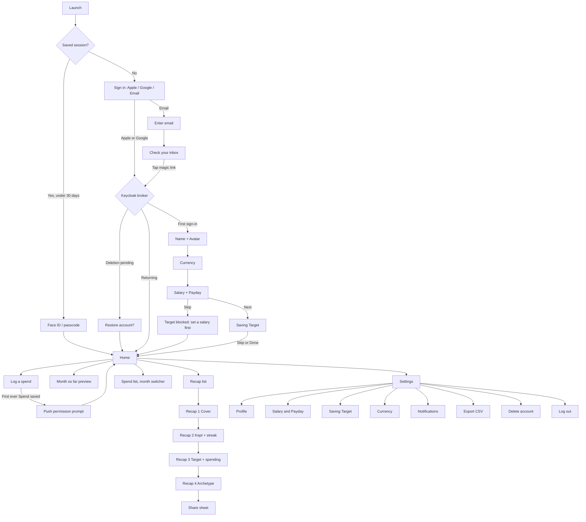

# My Money Recap — Product Requirements Document

| | |
|---|---|
| Status | Draft v2. Decisions D41–D67 from the design review of 2026-09-08; D68–D71 from the screen work of 2026-09-11 |
| Platform | Native iOS 17+, iPhone and iPad |
| Vocabulary | `CONTEXT.md` (beside this file) is the glossary. Terms in **bold caps** below are defined there. |
| Design system | `../my-money-recap-ds/` (`@my-money-recap/ui`). Its `README.md` carries the visual rules; `src/tokens/tokens.json` the values. |
| Screen inventory | `SCREEN-STATES.md` is the per-screen contract. Every state named here has a row there. |
| Architecture | `ARCHITECTURE.md` (beside this file) is the backend design that implements these rules: the edge, the BFF, the four services, the broker, the cache and identity. Its decisions are numbered `A*`. |
| Design handoff | `design/design_handoff_my_money_recap/` — eleven canvases holding all 118 screens (four from 2026-09-08, seven under `design-files/2026-09-11/`), plus the quoted canvas notes. Live at <https://claude.ai/design/p/5f615747-48cd-4708-9369-becee9793f4e> and <https://claude.ai/code/artifact/c2140f85-a23f-4979-a0a5-b1bdd1d2947c>. Renders are not in git. |

## 1. Summary

My Money Recap is a personal money tracker for adults, dressed as a playful kids' app. A **Member** sets a monthly **Salary**, a **Payday** and a **Saving Target**, logs each **Spend** by hand, and at the end of every calendar month gets a four-screen, Wrapped-style **Recap**: what came in, what was kept, where the rest went, the longest no-spend **Streak**, and a money-personality **Archetype** to share.

The four Recap screens exist as artboards and as React components in the design system. This document specifies the whole product around them: sign-in, onboarding, Home, Spend logging, the Recap rules, settings, notifications, offline behaviour, and the platform constraints.

## 2. Goals and non-goals

**Goals**

1. A Member can go from app install to a filled Home screen in under three minutes.
2. Logging a Spend takes one tap from Home plus amount and Category.
3. Every Recap screen is fillable from the data the flow captures; no Recap screen ever shows a placeholder for data the app never asked for.
4. All numbers are computed live from stored data. There is one source of truth and no frozen copies.
5. **No screen ever shows a number the app did not observe.** A Recap that covers four days says so; a Streak never counts days before the Member signed up; a Salary edit never rewrites a month that has already been paid.
6. The app is readable with no network connection.
7. The app passes App Store review on the first submission: Sign in with Apple present, account deletion present.

**Non-goals for v1**

- Chores, earnings, side income, or any income other than the Salary.
- Named saving goals with a price ("Skateboard fund"). Only the percentage Saving Target exists.
- Explicit savings jars or accounts. **Saved** is computed, never logged.
- Multiple members, family accounts, parent views, or any child user.
- **Offline *logging*.** Reading offline is in scope (D61); writing offline is not.
- Bank connections, receipts, recurring Spends, budgets per Category.
- Android or web.

## 3. Users

One persona: an adult (18+) who wants a light, fun way to see whether they kept the money they meant to keep this month. They are not a child, and the app never treats them as one. The kids' visual theme (illustrations, chunky type, one bright ground per screen) is a style, not a signal about the audience. Money concepts are therefore always named plainly in the UI: "salary", "saving target", "spend".

## 4. Decisions log

Every design question raised while writing this document, with the decision taken. These are settled; reopen one only with a reason. D1–D40 date from 2026-09-04; D41–D67 from the design review of 2026-09-08; D68–D71 from drawing the remaining screens on 2026-09-11. Where a later entry changed an earlier one, the earlier row was rewritten in place, so every row is current.

| # | Question | Decision |
|---|---|---|
| D1 | Who owns the account | The Member, an adult. One Member per account. No child users. |
| D2 | What "monthly salary" means | A single fixed monthly amount, the only income. Chore earnings from the mockups are dropped. |
| D3 | What "target saving" means | A monthly Saving Target stored as a percentage of Salary. No named goals. |
| D4 | How money gets recorded | Salary is credited automatically on Payday. Spends are logged by hand. |
| D5 | What "Saved" is | Computed: Money In minus total Spends for the calendar month. |
| D6 | Identity provider | Keycloak, run from its official Docker image. No custom authenticator code. |
| D7 | Email sign-in | Passwordless magic link via the Phase Two magic-link extension. Email must be verified before use. |
| D8 | Social sign-in | Sign in with Apple (required by App Store guideline 4.8), Google, Email. Three buttons, Apple first. |
| D10 | Setup fields | Display Name, Avatar, Currency. Age band dropped. |
| D11 | Platform | Native iOS 17+, SwiftUI, iPhone and iPad. |
| D12 | Currency | Chosen by the Member at setup from the full ISO 4217 list. Changeable later; all stored amounts are converted once at that moment's rate and rewritten. |
| D13 | Onboarding strictness | Display Name required. Salary and Saving Target skippable, with empty-state cards on Home until set. |
| D14 | Home contents | Greeting, hero figure, Saved and Spent, Saving Target progress, Log a spend, See last month, past Recaps. **The hero figure is set by D42, not by this entry.** |
| D15 | PRD scope | Whole product including the four Recap screens and their rules. |
| D16 | Salary label in UI | Plain: "Your monthly salary". Theme lives in illustration and tone, never in renaming money concepts. |
| D17 | Payday | Member sets a day of month. Money In appears from that day. **Extended by D51.** |
| D18 | Saving Target unit | Stored as a percentage; entry form shows amount and percentage and converts live. Default suggestion 20%. |
| D20 | Categories | Fixed eight: Snacks, Games, Toys, Rides, Clothes, Bills, Gifts, Other. No custom Categories. |
| D21 | Spend editing | Amount, Category, date, optional note. Backdating up to 60 days. Edit and delete any time. |
| D22 | Recap freshness | Computed live on every open. A backdated Spend changes last month's Recap. |
| D23 | Recap screen 2 | "How you earned it" list removed. Screen shows Money In, amount kept vs Saving Target, and the Streak. |
| D24 | Recap screen 3 | "% of the way to the skateboard" becomes "% of your Saving Target". Category breakdown and Splurge stay. |
| D25 | Archetype rules | Defined in §8.6. First match wins. |
| D26 | Streak | Resets on the 1st of every month. Counts local calendar days with no Spend. **Narrowed by D43.** |
| D27 | Past Recaps | List, newest first, from Home. Months with no data hidden. |
| D28 | Sharing | Screen 4 only, as an image through the iOS share sheet, without Salary figures. |
| D29 | Notifications | Recap ready (on by default), daily reminder (off), Target Warning (on). Permission asked after the first Spend. |
| D31 | Stack named here | Keycloak, SwiftUI, Postgres. The backend is a Go BFF in front of four Go services (`members`, `ledger`, `notify`, `currency`), RabbitMQ and Redis, behind Nginx. Everything about that shape, including why, lives in `ARCHITECTURE.md`; this document only states the rules it must implement. **Rewritten 2026-09-12; the original read "one backend service".** |
| D32 | Magic link landing | iOS universal link opens the app; web fallback page when the app is absent. Link valid 15 minutes, single use. |
| D33 | Recap period | Calendar month, always. Payday only moves when Money In appears inside it. **Reaffirmed by D41.** |
| D34 | Day boundaries | Device local date at the moment of logging, stored as a plain date. |
| D35 | Exchange rates | Open Exchange Rates free tier, cached daily on the backend. Manual rate entry as fallback for unsupported pairs. |
| D36 | Avatars | Six new animal characters in the existing illustration style, none of them an Archetype character. |
| D37 | Home ground | Violet (`ground.recap`), so Home rhymes with the Recap cover. |
| D38 | Target Warning | Fires once per month, the first time total Spends exceed Salary × (1 − Saving Target). **Extended by D53.** |
| D39 | Deletion and export | Both in v1. Deletion removes the Keycloak user and all data within 24 hours. Export is a CSV of all Spends emailed to the Member. **Extended by D60.** |
| D40 | iPad | Same single-column layout capped at 390pt width, centred on a full-bleed ground, portrait and landscape. **Cap raised to 600pt by D68.** |
| **D41** | **Does a "month" follow the calendar or the pay cycle?** | **The calendar month, always — D33 stands.** A Member paid on the 25th lives 25 Aug → 24 Sep, but a pay-cycle month would rename every month chip to a date range, break "Your September in money" as a shareable line, and rewrite §8.1, §8.5, D26 and all 62 artboards. Instead the *display* is corrected: **the Saved figure is hidden entirely until Money In > 0** (§8.3, §6.8). |
| **D42** | **What is the hero number on Home?** | **Spent.** It is the figure that changes daily and the only one the Member can act on. Money In and Saved are chips beneath it. This matches the drawn design (B1, A8). |
| **D43** | **Where does the Streak start in the Member's first month?** | **`max(1st of the month, the Member's sign-up date)`.** Counting from the 1st awards no-spend days from before the app existed. Applies to the sign-up month only; every later month starts on the 1st. |
| **D44** | **Can a Saving Target be set without a Salary?** | **No.** If Salary was skipped, onboarding step 4 shows a prompt back to step 3 and Done goes to Home. A percentage of an unknown Salary has no amount, no `kept%`, no progress bar and no Archetype; forbidding the state removes four undrawn screens. |
| **D45** | **Which currency do the screens support?** | **The full ISO 4217 list (D12 stands), plus a long-number rule.** `StatHero` sizes itself to fit its card, 80 → 56 → 40pt (§11). Home, the Recap cover and the share image must each be drawn in IDR as proof before new work lands; every artboard to date is GBP, and `Rp 3.000.000` is three times the width of `£900`. |
| **D46** | **How does a Member leave a Recap?** | **A 44pt close control, top-left of Recap screens 1–4, and tappable `PageDots`.** The drawn design has no exit control of any kind. |
| **D47** | **What does a Member look at before their first Recap?** | **A "month so far" preview**, reachable from the Home card that currently reads "Your first recap arrives on 1 October". Read-only, no Archetype, no Share. See D64 for its artboards. |
| **D48** | **Where does the screen-by-screen contract live?** | **`SCREEN-STATES.md`**, keyed to the handoff's screen ids (A0–A8, B1–B8, C1–C7, D1–D12). This document owns the rules; that file owns the states and the copy. The 2026-09-08 gaps list was closed out against both and has since been deleted; its decisions are D41–D67. |
| **D49** | **How much of the non-happy path is specified now?** | **All of it, weighted.** Loading, offline and error states get artboards (§11, §6.19). Dynamic Type and iPad get written rules plus demonstration artboards, not 62 redraws. |
| **D50** | **Components the design uses that the library does not have** | **Build `PromptCard`, `DayPicker` and `InlineError`.** Each is hand-composed on the canvases today and appears on two or more screens, so they will drift. Built 2026-09-08. A fourth candidate, `SelectRow`, was dropped on inspection: the shipped `ListRow` with `trailing="check"` and `selected` already has no `IconWell` and already draws a violet check, so it *is* the currency select row. A fifth, `Toast`, is **not** built — see D67. |
| **D51** | **Payday 29, 30 and 31** | **The picker offers 1–31 plus `Last day`, disables nothing, and shows the three real dates that follow the selection** — e.g. tapping 31 in September shows `Next paydays: 30 Sep · 31 Oct · 30 Nov`, computed on device. Disabling days is possible but wrong: the picker is on screen twice in the app's life and cannot guard the eleven months the Member is not looking at, while disabling 29–31 in a February setup locks out anyone genuinely paid on the 30th. |
| **D52** | **The Member's first month, when Payday already passed before sign-up** | **A Partial Recap** (§8.11) built around Spent, not Salary. Money In is 0, there is no Archetype, and screen 1 reads `Your first {n} days`. Showing the full Salary would credit money the app never observed; showing nothing at all would discard real spending data. |
| **D53** | **Does the Target Warning fire before Payday?** | **Yes, with different copy.** Before Payday: `You've spent {spent} of the {line} you meant to spend this month.` After: `You've passed your saving line. {over} over.` Holding the warning until Payday would silence it for the three weeks it exists to cover. |
| **D54** | **The Home hero when no Salary is set** | **Still Spent.** The hero shows the Spent figure and the Salary prompt moves below it as a `PromptCard`. Replacing the whole hero with a prompt (as drawn) hides a Spend the Member just logged. |
| **D55** | **The month-so-far preview before Payday** | Shows Spent, the Category split and the Streak. The target percentage and the kept-vs-target bar are replaced by `Your salary lands on the {payday}.` A preview opened on the 10th would otherwise read `0% of your saving target`. |
| **D56** | **Editing Salary after Payday has passed** | **Ask.** Saving after the current month's effective Payday opens a sheet: `The {amount} I was paid on {date}` (applies to this month) or `My new salary, from {next payday}` (applies from next month). A date-based rule cannot tell a correction from a raise. Editing *before* Payday needs no sheet. **Payday changes are always forward-only** — no sheet — so moving Payday from the 25th to the 5th on the 20th cannot make a salary appear for a date that already passed. |
| **D57** | **Maximum amount** | **11 digits before the decimal separator.** The field refuses further keystrokes and shows `That's more than the app can store.` An 8-digit IDR salary is ordinary; an untrapped typo breaks every layout. Eleven is the most the hero card can show at its smallest step for a currency with a symbol: `Rp 99.999.999.999` measures 297 of the card's 298pt at 40pt and a twelfth digit overflows (317pt). A currency the formatter prints as a three-letter code (`BHD 99,999,999,999` is 328pt) still overflows above nine digits; those amounts are absurd for a salary and the hero clips rather than wraps (2026-09-11, measured in `scripts/measure.tsx`). |
| **D58** | **Logging a Spend with no connection** | The `Log a spend` button is disabled at 40% and Home carries a `Banner`: `No connection. You can look, but not log.` A connection that fails *during* a save keeps the existing behaviour — sheet open, values intact, Save enabled to retry. |
| **D59** | **Reaching a past month's Spends** | **A month switcher at the top of the Spend list.** Today the list is current-month only, so a mistake in last month's data is unreachable although D21 permits editing it. |
| **D60** | **Signing in during the 24-hour deletion window** | **Signing in cancels the deletion**, after a confirm: `Welcome back — do you want to keep your account after all?` The 24 hours becomes a grace period rather than a queue. Extends D39. |
| **D61** | **Offline** | **Read offline, write online.** Every figure the app shows is arithmetic over the Member's own Spends and needs no server. The session is persisted on device behind biometric unlock, and the Member's data is cached, so Home, the Spend list and every past Recap render with no signal. Writes still require the network. Offline *logging* with sync stays out of scope (§14). |
| **D62** | **Session lifetime** | **30 days from last use**, not from last sign-in. Face ID (or the device passcode) on each cold launch. Counting from sign-in would force a full re-authentication on the morning the Recap notification arrives. |
| **D63** | **Stale cache across two devices** | When offline, Home shows `Last updated {day} {time}` under the month chip. D11 supports iPhone and iPad, so an iPad's cache can legitimately lag an iPhone's writes. |
| **D64** | **The preview and the Partial Recap are the same screens** | **Four artboards serve both**, with the screen-1 headline and the screen-4 closing line swapped by state. The layouts are identical; two copies would drift. |
| **D65** | **Editing the Saving Target** | **Forward-only, no sheet.** Unlike a Salary, a Target cannot be *mistyped* — it is a goal the Member chose, so there is no correction case to ask about. Raising it retroactively would turn a met target into a missed one and change a finished month's Archetype. |
| **D66** | **Dynamic Type on the Recap** | At accessibility text sizes the four Recap screens become **one vertical scroll**, with `PageDots` acting as section markers. At default sizes nothing changes. Scrolling inside a horizontal pager makes a diagonal drag turn the page; capping the type would break §11. |
| **D67** | **The Toast component** | **Not built.** After D58 gave the offline message to `Banner`, the only remaining use was the export confirmation, which the `Send it` button already covers by changing to `Sent ✓` and dimming for 60 seconds. |
| **D68** | **iPad column width** (2026-09-11) | **Single column, capped at 600pt instead of 390**, centred, portrait and landscape; the two Home buttons sit side by side and `Sheet`s take the column's width. A two-column iPad layout was sketched and rejected: it needs a second navigation model for little gain. Supersedes the width in D40. |
| **D69** | **Home with no Salary set** (2026-09-11) | **It scrolls.** The Spent hero (191pt) plus the salary `PromptCard` (191pt) plus the target `PromptCard` (136pt) put the buttons at 740–856pt. `Log a spend` stays above the fold; the layout keeps the prompts at full height so nothing jumps when they are filled in. |
| **D70** | **Category chips on the Log-a-spend sheet** (2026-09-11) | **The shipped `Chip` tone variant** — 30pt uppercase pill, 44pt hit area via `tappable` — not the 44pt mixed-case pill the 2026-09-08 B2/B3 sheets hand-drew. |
| **D71** | **Long numbers and money, without hand-written rules** (2026-09-11) | Amounts are exact decimals with an ISO 4217 code (§7); the platform formatter prints them with the viewer's locale and the currency's own decimals, and no table in the system says how many decimals a currency has. `StatHero` and `AmountField` **measure** the printed string and draw it at the largest of 80/56/40pt (48/36/28pt) that fits — never a character count, which was shown to shrink a rupiah salary that fit. `PromptCard` takes the measured height of the card it replaces. `RecapGoalScreen` draws three bars in every currency. Page dots are tappable in their own slice of the row, the one exception to the 44pt width rule. |

## 5. End-to-end flow

Step by step:

1. **Launch.** If a session saved within the last 30 days exists (D61, D62), the app asks for Face ID or the device passcode and goes to Home — this path works with no network. Otherwise Sign in.
2. **Sign in.** Three buttons. Apple and Google go through Keycloak's identity brokering. Email asks for an address and sends a magic link.
3. **Email verification.** For the email path, the account is unusable until the link is tapped; tapping it is the verification. Apple and Google addresses are trusted by the broker and need no separate verification.
4. **Deletion check.** If the Member requested deletion less than 24 hours ago, the restore confirm appears before anything else (D60).
5. **First sign-in detection.** The backend checks whether a Member record exists for the Keycloak subject. None means onboarding; otherwise Home.
6. **Onboarding.** Name + Avatar (required), Currency (required), Salary + Payday (skippable), Saving Target (skippable, and **blocked when Salary was skipped**, D44). Progress is saved screen by screen, so a force-quit resumes at the next unanswered screen.
7. **Home.** Current month numbers, target progress, actions.
8. **Log a spend.** Bottom sheet over Home. Disabled with no connection (D58). On the first Spend ever saved, the app asks for push permission.
9. **Recap.** From Home, the previous month's Recap or the list of past months. Four horizontally paged screens with a close control. Screen 4 shares. Before the first Recap exists, the month-so-far preview (D47).
10. **Settings.** Everything set in onboarding is editable, plus notifications, export, delete, log out.

## 6. Screen specifications

Every screen uses `Screen` from the design system with one of the four grounds. Component names refer to exports of `@my-money-recap/ui`. Component states follow the design system: pressed = scale 0.97 and brightness 0.92, disabled = opacity 0.4. Motion follows the `motion.*` tokens in `tokens.json` and honours Reduce Motion. `SCREEN-STATES.md` carries the exact copy for every state named here and marks which are drawn.

### 6.1 Sign in

| | |
|---|---|
| Ground | violet (`recap`) |
| Components | `Illustration` (cover art), `Headline` size l, `SubCopy`, three `Button`s |
| Copy | Headline "Your month in money." Sub "Sign in to start your recap." |
| Actions | Sign in with Apple (Apple's own button style, listed first), Continue with Google, Continue with email |
| States | Loading spinner inside the pressed button while Keycloak round-trips. **`InlineError` inside the card** on cancel or failure, buttons re-enabled, cleared on the next tap. The inline block can never overlap the buttons. |

Rules

- All three paths open Keycloak through `ASWebAuthenticationSession` with PKCE. The iOS app is a public client; no client secret ships in the binary.
- Sign in with Apple is brokered in Keycloak as a generic OIDC provider. The Apple client secret is a JWT that must be rotated at least every 6 months; this is an operations requirement.
- Google is Keycloak's built-in Google provider with "Trust email" on.

### 6.2 Enter email

| | |
|---|---|
| Ground | violet |
| Components | `Headline` size m, `Card` with a single `TextField`, `Button` |
| Validation | RFC 5322 syntax check on device. Errors appear only after blur or a Send attempt, never while typing. |
| Action | "Send me a link" |

### 6.3 Check your inbox

| | |
|---|---|
| Ground | violet |
| Components | `Illustration`, `Headline` size m, `SubCopy`, `HelperText` |
| Copy | "Check your inbox." "We sent a link to {email}. It works for 15 minutes." Helper: "Resend" (enabled after 30 seconds, with a live m:ss countdown) and "Use a different email". |
| Exit | Tapping the link opens the app via universal link and completes sign-in. If the app is not installed on the device that opened the email, the web fallback page says to open the app on the phone. |
| Failure states | Expired link (>15 min), already-used link, and rate limit reached (5 per email per hour) each return the Member to 6.2 with an `InlineError` naming the cause. |

### 6.4 Onboarding 1 · Name and Avatar

| | |
|---|---|
| Ground | violet |
| Components | `Eyebrow` "Step 1 of 4", `Headline` size m "What should we call you?", `Card` with `TextField`, `Card` with `AvatarGrid` (six `Illustration`s in a 3 × 2 grid, 68pt cells, 88pt hit area), `Button` "Next" |
| Validation | Display Name 1 to 30 characters, trimmed, letters, spaces, hyphens and apostrophes. Avatar required. Next disabled until both valid. |
| Prefill | Apple and Google supply a name when they share one; when they do not, the field is empty and no avatar is selected. |

**Moving between onboarding steps.** Every step after the first carries a 44pt back chevron to the previous step. Each step is saved when its primary button is tapped, so a force-quit resumes at the first unanswered step with earlier answers intact and re-selected — the Currency list opens on the saved choice, not on the device locale. Going back and changing an answer never clears a later one, except that removing the Salary re-blocks step 4 (D44).

### 6.5 Onboarding 2 · Currency

| | |
|---|---|
| Ground | violet |
| Components | `Eyebrow` "Step 2 of 4", `Headline` "Which currency?", `Card` with a searchable list of `ListRow trailing="check"` |
| Content | Full ISO 4217 list, sorted by name, searchable by code or name. Device locale's currency preselected, so Next is always enabled. |
| Empty search | "No currency matches {query}." with a link to clear the search. |

### 6.6 Onboarding 3 · Salary and Payday

| | |
|---|---|
| Ground | violet |
| Components | `Eyebrow` "Step 3 of 4", `Headline` "Your monthly salary", `Card` with `AmountField` (currency symbol fixed), `Card` with `DayPicker`, `Button` "Next", `HelperText` link "Skip for now" |
| Validation | Amount > 0 and at most 11 digits before the decimal separator (D57). Payday 1–31 or `Last day`, default 25. Both required together, or skip both. |
| Payday helper | The three dates that follow the current selection, computed on device: `Next paydays: 25 Sep · 25 Oct · 25 Nov`. Updates on every tap. For 29, 30, 31 and `Last day` this is what tells the Member what a short month does (D51). |

### 6.7 Onboarding 4 · Saving Target

| | |
|---|---|
| Ground | violet |
| Components | `Eyebrow` "Step 4 of 4", `Headline` "How much do you want to keep?", `Card` with "Share of salary to keep", the percentage at 80px, `Slider` 0–100 in steps of 5, live amount preview, `Button` "Done", `HelperText` link "Skip for now" |
| Default | 20%. |
| Salary skipped (D44) | The card is replaced by a `PromptCard`: "Set a salary first" / "A target is a share of your salary, so we need the salary first." Tapping it returns to step 3. "Done" reads "Skip for now" and goes to Home. |
| Exit | Done or Skip goes to Home. |

### 6.8 Home

| | |
|---|---|
| Ground | violet |
| Layout, top to bottom | `ChipRow` with month chip and a Settings chip (both `tappable`); optional offline `Banner`; greeting `Headline` size m "Hi, {Display Name}" with `Avatar` at 56pt; hero `Card` `underIllustration`; optional Target Warning `Banner`; target `Card`; two `Button`s; Recap list |

**Hero card (D42, D54).** `StatHero` eyebrow "Spent so far", value = **Spent**. Before the effective Payday the eyebrow extends: "Spent so far · salary lands in {n} days". `StatChipRow` beneath: `Money in {amount}` and — **only when Money In > 0** — `Saved {amount}` (D41). Tapping the hero card opens the Spend list (§6.10). With no Salary set the hero still shows Spent, and a `PromptCard` "Set your monthly salary" sits below it (D54).

**Why the Saved chip is hidden before Payday (D41).** A Member paid on the 25th spends the first three weeks of the month from last month's salary. Money In is 0, so Saved computes to a negative number, and showing `Saved −£900` on a green chip states the opposite of the Member's actual position. Spent and Money In together already say everything true.

**Target card.** `CardTitle` "Saving target", right-aligned "{Saved} of {target amount}". `ProgressBar` value = Saved (clamped at 0), max = target amount. `HelperText` = one sentence from §8.7. No Spends this month: "Nothing spent yet. Streak day {n}."

**Target card, no Saving Target set.** The whole card becomes a `PromptCard` "Set a saving target" at the same 136pt height. The daily-allowance sentence is omitted — it is derived from the target amount — and the Target Warning cannot fire (§8.8). The hero card is unaffected: Spent, Money In and Saved are all computable without a target.

**Month chip.** Tappable. It opens the Spend list at the month switcher (§6.10, D59), which is the only place in the app where a Member changes which month they are looking at.

**Target Warning banner (D38, D53).** Coral `Banner` above the target card, from the moment the warning fires until the 1st. Dismissable for the session only.

**Offline banner (D58, D63).** Grey `Banner` at the top: "No connection. You can look, but not log." The month chip gains a second line: `Last updated {day} {time}`.

**Actions.** `Button` "Log a spend" (primary, ink, `plus` glyph) and `Button variant="secondary"` "See last month". "See last month" is disabled when the previous month has no data. "Log a spend" is disabled when offline (D58).

**Recap list.** `DataRowList` of `ListRow`s, newest first, label = month name, value = Archetype name. A Partial Recap month (§8.11) shows "Partial" as its value. Months with no Spend and no Money In are hidden. The current month is not listed; it is reachable through the preview card instead.

**Preview card (D47).** When no Recap exists yet, a dashed card reads "Your first recap arrives on {date}." It is tappable and opens the month-so-far preview (§6.17).

### 6.9 Log a spend (sheet)

| | |
|---|---|
| Presentation | `Sheet` over Home, white surface, `radius.card` top corners, drag handle, scrim |
| Fields | `AmountField` (numeric keypad, currency symbol fixed, decimals from the Currency, 11-digit cap per D57), Category (eight `Chip tone={hue}` in a wrapping row, one selected, 44pt), Date (defaults to today, picker limited to the last 60 days and today), Note (optional, 80 characters) |
| Action | `Button` "Save". Disabled until amount > 0 and a Category is selected. |
| After save | Sheet closes, Home numbers animate with `motion.reveal.number`. First ever Spend saved: the push-permission prompt appears after the sheet closes. |
| Write failure | `InlineError` in the sheet, sheet stays open, values intact, Save stays enabled. |
| Offline | Not reachable — the Home button is disabled (D58). |

### 6.10 Spend list, detail and edit

Reached by tapping the Home hero card (D42 makes the hero the Spent figure, so the hero is the natural way in).

**Spend list.** `Sheet variant="full"`. A **month switcher** sits under the title (D59): the current month by default, tapping it lists every month with data, newest first. Below it, one `DataRow` per Category with Spends that month, largest first, `IconWell` in the Category tone, sub-line "{spent} so far, {n} spends". Empty month: a centred prompt and a plus button that opens 6.9, plus the streak line.

**Category detail.** One Category, newest first, date as a secondary line, and that Category's share of the month.

**Spend detail.** Same fields as 6.9, prefilled, plus a destructive "Delete" `ListRow` with a single confirm (iOS action sheet). Deleting is not undoable in v1.

**Editing an old Spend.** The date field offers only the last 60 days. A Spend dated earlier than that keeps its date, shown as read-only text with the helper "Dates older than 60 days can't be changed." Amount, Category and Note stay editable. Editing or deleting a Spend in a past month immediately changes that month's Recap (D22).

**Note truncation.** A `DataRow` label shows the note when there is one, otherwise the Category name, on one line with a trailing ellipsis.

### 6.11 Recap · screen 1 Cover

`RecapCoverScreen`. Props: month name, Display Name, Money In, Saved, Spent. Copy: eyebrow "{Month} {Year}", chip "{Display Name}'s recap", headline "Your {Month} in money", `StatHero` "Money that came your way" = Money In, chips Saved and Spent. The "Earned" chip is removed (D2). A 44pt close control sits top-left (D46) and `PageDots` are tappable.

### 6.12 Recap · screen 2 Kept and streak

`RecapEarningScreen`. Ground yellow. Illustration: the saving-target jar. Chips "Kept", "{Month}". Headline: "You kept {Saved} of {Money In}. That's {kept%} of your target." `Card` with `CompareBars` of Saved vs Saving Target amount, `scale="max"`. `StreakBadge` with the Streak length, `StreakDots` for the month, `HelperText` "{start} to {end}. {badge copy}". Badge copy: Streak ≥ 7 "New badge unlocked.", otherwise "Beat it next month."

With no Saving Target the headline drops its second sentence and the compare card becomes the component's own no-target branch — pass `targetAmount={null}`, never `undefined`.

### 6.13 Recap · screen 3 Target and spending

`RecapGoalScreen`. Ground coral. Chips "Target", "Spending". Headline "{kept%} of your saving target" with `SubCopy` from §8.7. `Card` "Saving target" with `ProgressBar` and the `piggy` marker. `Card` "Where {Spent} went", `CardTitle` "Mostly {top Category}", one `CategoryBar` per Category with a Spend, sorted descending, showing percentage of Spent — **capped at four**, with the remainder rolled into one line naming those Categories and their combined percentage.

The cap is **three** `CategoryBar`s plus the roll-up line (D71): four fit only in pounds, and the screen must fit every currency at 844pt without scrolling; `maxCategoryBars` in the shipped component defaults to 3.

`Card` accent "The splurge": "{amount} on {note or Category}. Your biggest single buy." Hidden when there are no Spends — pass `splurge={null}`, never `undefined`.

**No Saving Target set.** Reachable whenever the Member skipped onboarding step 4 (D44 forbids only the reverse — a target with no salary). The headline becomes "Where {Spent} went" and the `SubCopy` is dropped, because there is no percentage to state. The saving-target `Card` becomes a `PromptCard` "Set a saving target". The Category breakdown and the Splurge are unaffected — neither needs a target.

### 6.14 Recap · screen 4 Archetype

`RecapPersonalityScreen`. Ground green. Headline "This month, {Display Name}, you were", Archetype name, one-line description (§8.6), the Archetype's mascot, `CompareBars` Saved vs Spent (`scale="total"`), `Button` "Share your {Archetype}", `ArchetypeRow` with four `ArchetypePill`s. No `PageDots` — this is the screen that gets screenshotted. The close control from D46 is present.

The component keys its mascot off the `archetype` prop through an internal map; there is no illustration prop. `Illustration maxHeight` is already applied, so the taller Hustler mascot no longer clips the pill row.

**No Archetype (§8.6).** When Money In is 0 or no Saving Target is set, screen 4 shows a `PromptCard` in place of the mascot: with no Salary, "Set your monthly salary to get a recap"; with no Target, "Set a saving target to get an archetype". Both open the matching Settings screen. The Share button is hidden. The Home and past-Recap list rows show "Partial" rather than an Archetype name.

### 6.15 Share

`Button` on screen 4 renders screen 4 to a 1080 × 1920 image and opens `UIActivityViewController`. There are **four** share images, one per Archetype — the mascots differ in aspect ratio, and the Hustler mascot is the tallest, so each needs its own composition proof at 1080 × 1920. The image shows Archetype, month, Display Name, Saved and Spent only. It never shows Salary, Money In, `kept%`, the target amount, the Streak, the Splurge, the Category split, the Avatar or the email (D28). Sharing is unavailable on a Partial Recap (§8.11).

### 6.16 Settings

`Sheet variant="full"` on the violet ground, with `DataRowList` sections of `ListRow`s. Each row opens a screen reusing the matching onboarding card.

- Profile: Display Name, Avatar. Saving updates the Home greeting and every Recap, including past ones — Recaps are computed live and store nothing (§7, Goal 4).
- Salary and Payday: same cards as 6.6, plus the D56 sheet when the current month's Payday has passed. Row reads "Not set" when skipped.
- Saving Target: same card as 6.7. Forward-only, no sheet (D65). Row reads "Not set" when skipped.
- Currency: list as 6.5, then a confirm sheet showing the rate and before/after values. If the pair is unsupported, a field asks for the rate manually. If the rate fetch fails, an `InlineError` with a Retry. If the Member has no Salary and no Spends, there is nothing to convert: the currency changes directly with no confirm sheet.
- Notifications: three `Toggle`s (Recap ready, Daily reminder with a time picker default 20:00, Target Warning), each writing immediately. When push permission is denied, all three sit disabled at 40%, a `Banner` explains, and tapping deep-links to iOS Settings. The Settings row then reads "Off in iOS Settings" rather than a count.
- Export: "Email me a CSV of every spend." One tap; the button becomes `Sent ✓` and dims for 60 seconds (D67). If the account has no deliverable address — an Apple private-relay address that has bounced — an `InlineError` says so and offers Profile.
- Delete account: two-step confirm (button, then typed "DELETE"). Signs out immediately; deletion completes within 24 hours; signing in inside that window offers to restore (D60).
- Log out: iOS action sheet confirm, then Sign in.

### 6.17 Month so far / Partial Recap (new, D47, D52, D64)

**Four artboards serve three situations.** The layout is identical in all three; only the screen-1 headline and the screen-4 closing line change.

| Situation | Screen 1 headline | Screen 4 line |
|---|---|---|
| Current month, still running (preview) | "{Month} so far" | "Your recap arrives on {1st of next month}." |
| Sign-up month where Payday preceded sign-up (§8.11) | "Your first {n} days" | "Your first full recap arrives on {date}." |
| Any past month with Money In 0 and at least one Spend | "Your {Month} spending" | "Set your monthly salary to get a full recap." |

- **Screen 1** — `StatHero` "What you've spent" = Spent. Chip "{n} spends". No Money In figure at all.
- **Screen 2** — `StreakBadge`, `StreakDots`, the streak sentence. No `CompareBars`; there is no Money In to compare.
- **Screen 3** — "Where {Spent} went" with the same four-bar-plus-rollup rule and the Splurge card. Before Payday the target card is replaced by "Your salary lands on the {payday}." (D55); after Payday in a past partial month it is omitted.
- **Screen 4** — no mascot, no Archetype, no Share. The four `ArchetypePill`s are shown at 40% so the Member can see what is coming.

Read-only. The close control and tappable `PageDots` from D46 apply.

### 6.18 Restore account (new, D60)

Shown immediately after a successful sign-in when `deletion_requested_at` is within 24 hours. `Sheet variant="full"`, coral tint. Headline "Welcome back". Body names the deletion time and what will be lost. `Button` "Keep my account" clears the flag and continues to Home; `Button variant="secondary"` "Continue with deletion" signs out.

### 6.19 Loading, offline and error states (new, D49)

- **Home, first load.** No cache exists after a first sign-in. Skeleton: the two cards at their filled heights (191 and 136pt) with `ink.100` blocks in place of numbers. No spinner.
- **Home, offline.** The offline `Banner`, the `Last updated` line, cached numbers, `Log a spend` disabled.
- **Recap, loading.** The cover ground with the illustration only; numbers fade in.
- **Settings, offline.** Rows render from cache; every row that writes is disabled at 40% with the offline `Banner` at the top.
- **Write failure.** `InlineError` in place, never a toast, never an overlay. Content moves down rather than being covered.

## 7. Data model

Amounts are exact decimals (`NUMERIC`, never a float or an integer count of minor units) stored with the Member's ISO 4217 code, capped at 11 digits before the decimal separator (D57). How many decimals a currency shows, its symbol and its separators are the platform formatter's business at print time (§11, D71); nothing in the system stores or looks up a decimal count. Dates are plain calendar dates without timezone (D34). All entities belong to exactly one Member.

| Entity | Fields | Notes |
|---|---|---|
| Member | id, keycloak_subject, display_name, avatar_key (one of six), currency_code, **timezone**, **created_at**, **deletion_requested_at** | One per Keycloak user. `created_at` is load-bearing: it bounds the Streak (D43) and identifies the sign-up month (D52). `deletion_requested_at` drives D60. `timezone` is an IANA name sent by the app on each launch; every "today" in §8 and every local time in §10 is evaluated in it (`ARCHITECTURE.md` A3). |
| SalarySetting | member_id, amount_minor, payday (1–31 **or the token `last`**), effective_from (year-month) | Append-only. The row with the latest effective_from ≤ a month is the one in force for that month. D56 decides which month a new row starts from. |
| SavingTargetSetting | member_id, percent (0–100), effective_from (year-month) | Same append-only pattern, always effective from the **next** month (D65). |
| Spend | id, member_id, amount_minor, category (enum of eight), date, note, created_at, updated_at | Soft-deleted rows are excluded from every computation. |
| CurrencyConversion | member_id, from_code, to_code, rate, source (provider or manual), applied_at | Audit record of each rewrite. |
| NotificationPreference | member_id, recap_ready, daily_reminder, daily_reminder_time, target_warning, apns_token | |
| MonthFlag | member_id, year-month, target_warning_sent_at | Ensures the Target Warning fires once per month. |

**On device only (D61, D63):** the encrypted session, a read-only cache of the above, and `cache_updated_at` for the "Last updated" line. The cache is never written to by the app itself — a successful server write refreshes it.

The Recap has no table. It is a computation over the above (D22). Nothing about a Recap is ever frozen, including the Display Name shown on it.

## 8. Domain rules

Every rule below is followed by a worked example against one shared ledger, so a number copied from an artboard can be checked against the rule that produced it.

**The canonical ledger.** Maya. Salary £2,400, Payday 25, Saving Target 20%. September 2026 (30 days). Signed up before September. Spends totalling £1,760, none dated 12–20 September, largest single Spend £420 on the 27th.
**The IDR ledger** (for D45 proofs). Budi. Salary Rp 15.000.000, Payday 25, Target 20% → target Rp 3.000.000. Spends Rp 9.400.000.

### 8.1 Month

A **Recap Month** is a calendar month in local dates (D33, D41). Everything below is computed for one month M.

### 8.2 Payday and Money In

- Effective payday for M = `last` → the number of days in M; otherwise `min(Payday, days in M)`.
- Money In for M = the Salary in force for M, if the effective payday has passed or is today; otherwise 0. For a past month it is the full Salary — **except** the sign-up month, where §8.11 applies.
- With no Salary in force, Money In = 0.

*Worked:* Maya's effective payday for September = min(25, 30) = 25. On 20 September, Money In = £0. On 25 September, Money In = £2,400. A Member with Payday 31 gets 30 September, 31 October, 28 February 2027, 29 February 2028. A Member with `Last day` gets 30 September, 31 October, 28 February 2027.

### 8.3 Spent, Saved, Splurge

- Spent = sum of Spends dated in M, not deleted.
- Saved = Money In − Spent. **It is not displayed at all while Money In is 0** (D41); the `ProgressBar` clamps at 0.
- Splurge = the largest single Spend in M. Ties resolve to the earliest date.

*Worked:* on 20 September Maya has Spent £900 and Money In £0, so Home shows the hero `£900`, the chip `Money in £0`, and **no Saved chip**. On 30 September she has Spent £1,760 and Money In £2,400, so Saved = £640 and the chip appears. Her Splurge is £420.

### 8.4 Saving Target amount

Target amount = `round-half-up(Salary in force × percent ÷ 100)` to the Currency's decimals as the platform formatter reports them at the time. `kept%` = `round(Saved ÷ Target amount × 100)`, clamped 0 to 999. A Target of 0% means no Target: the component's `targetAmount <= 0` branch is the "not set" state.

*Worked:* £2,400 × 20 ÷ 100 = £480. Saved £640 ÷ £480 × 100 = 133%. Budi: Rp 15.000.000 × 20 ÷ 100 = Rp 3.000.000.

### 8.5 Streak

- A day counts as spend-free if no non-deleted Spend is dated on it.
- The **streak window** is `max(1st of M, the Member's sign-up date)` to the last day of M for past months, or to today for the current month (D43).
- Streak = the longest run of consecutive spend-free days inside that window.
- A month with no Spends has a Streak equal to the elapsed days **of the window**, not of the month.
- Streaks never cross month boundaries (D26).

*Worked:* Maya signed up before September, so her window is 1–30 September and her Streak is 9 days (12 to 20 September). A Member who signs up on 4 September and logs a first Spend on the 10th has a window starting on the 4th and a Streak of 6 days, not 9 — the 1st, 2nd and 3rd are days the app never saw. On the first-run Home that same Member reads "Streak day 1", not "Streak day 4".

### 8.6 Archetype

Evaluated in order. First match wins. Requires Money In > 0 **and** a Saving Target; otherwise there is no Archetype and §6.14's prompt state applies.

| Archetype | Rule | One-line description |
|---|---|---|
| Squirrel | Saved ≥ Target amount and Streak ≥ 7 | "You stashed more than you meant to, and you didn't crack once." |
| Hustler | Saved ≥ Target amount and Streak < 7 | "You hit your number while still living a little." |
| Treat-Yourself | Saved < Target amount and Splurge ≥ 25% of Spent | "One big treat tipped the month. Worth it?" |
| Slow Burner | Saved < Target amount, no single splurge | "Lots of little spends added up. Sneaky." |

*Worked:* Maya — Saved £640 ≥ £480 and Streak 9 ≥ 7 → Squirrel.
Edge case: Saved < Target amount with zero Spends is impossible, because Spent = 0 means Saved = Money In ≥ Target amount.

### 8.7 Target progress sentence

Used on Home and Recap screen 3. `days remaining` counts today and is never less than 1 — it is `days in M − today + 1`, and the month length is computed, never assumed.

- Before Payday: "Nothing to keep yet. Your salary lands on the {payday}."
- Current month, on track (Spent ≤ Salary − Target amount): "Keep spending under {daily allowance} a day and you'll make it.", where `daily allowance = max(0, floor((Salary − Target amount − Spent) ÷ days remaining))`.
- Current month, over the line: "You're {over} past your line. Next month is a fresh start."
- Past month, met: "Target met. {Saved − Target amount} to spare."
- Past month, missed: "{Target amount − Saved} short of your target."

*Worked:* 1 October, nothing spent: (2,400 − 480 − 0) ÷ 31 = £61 a day. On 31 October, days remaining = 31 − 31 + 1 = 1, never 0. A Member £300 over the line gets `max(0, −300)` = £0, never a negative allowance.

### 8.8 Target Warning

The warning line is `Salary − Target amount`. The warning fires when, after saving a Spend, Spent for the current month first exceeds that line and MonthFlag has no `target_warning_sent_at` for this month. It sends a push if enabled, shows the Home `Banner` regardless, and stamps the MonthFlag. Editing or deleting Spends never un-fires it. It cannot fire without both a Salary and a Target.

Copy depends on whether Payday has passed (D53):

- Before Payday: "You've spent {spent} of the {line} you meant to spend this month."
- On or after Payday: "You've passed your saving line. {over} over."

*Worked:* Maya's line is £2,400 − £480 = £1,920. Passing it on 20 September gives "You've spent £2,000 of the £1,920 you meant to spend this month." Passing it on 27 October gives "You've passed your saving line. £170 over."

### 8.9 Currency change

1. Fetch the rate. If the pair is unsupported, ask the Member for a rate. If the fetch fails, show an `InlineError` with Retry.
2. If the Member has no Salary and no Spends, skip the confirm sheet and change the code directly.
3. Otherwise the confirm sheet shows the rate and before/after values.
4. In one transaction: rewrite every SalarySetting amount and every Spend amount as `round-half-up(amount × rate)` to the new Currency's decimals; set `member.currency_code`; write a CurrencyConversion row.
5. Saving Target percentages are untouched.
6. Not reversible except by converting again at a new rate.

*Worked:* GBP → IDR at 20,150. £2,400 → Rp 48.360.000. £1,760 → Rp 35.464.000. The percentage stays 20%.

### 8.10 Editing rules

- Spend date must be within the last 60 days including today; never in the future. A Spend already older than that keeps its date and shows it read-only (§6.10).
- Amount must be > 0 and at most 11 digits before the separator (D57).
- **Salary edits (D56).** Saving before the current month's effective Payday creates a row effective from the current month, with no sheet. Saving on or after it opens the "which salary is this" sheet; the answer decides whether the new row is effective from the current month or the next one.
- **Payday edits (D56).** Always effective from the next month. The screen says so: "Your new payday starts in {next month}."
- **Saving Target edits (D65).** Always effective from the next month, no sheet. The screen says so.

*Worked:* Maya edits £2,400 → £2,800 on 27 September. The sheet appears. "The £2,800 I was paid on 25 September" makes September's Money In £2,800 and its target £560. "My new salary, from 25 October" leaves September at £2,400 and Home reads "£2,800 from your next payday, 25 October." Editing on 20 September shows no sheet and applies to September.

### 8.11 Partial months (new, D52, D64)

A month M is **partial** when either:

- M is the Member's sign-up month and M's effective Payday fell strictly before `Member.created_at`; or
- Money In for M is 0 and M has at least one Spend.

For a partial month: Money In is 0, Saved is not computed or displayed, there is no Archetype, and the Recap is the four screens in §6.17 rather than §6.11–6.14. The Home and past-Recap list rows read "Partial". Sharing is unavailable.

*Worked:* a Member signs up on 27 September with Payday 25. September's effective payday (the 25th) precedes 27 September, so September is partial. With £200 of Spends across four days, screen 1 reads "Your first 4 days" over `£200`. Their first full Recap is October's, on 1 November. A Member who signs up on 4 September with the same Payday is **not** partial — the 25th is still ahead of them, so they see the money land and get a normal September Recap.

## 9. Authentication and session

- **Keycloak** from the official Docker image, one realm, one public OIDC client for iOS with PKCE required, redirect URI on the app's universal-link domain.
- **Brokers:** Google (built-in, Trust email on), Apple (generic OIDC, Trust email on, client-secret JWT rotated every 6 months).
- **Magic link:** Phase Two `keycloak-magic-link` extension, user created on first use, lifetime 900 seconds, single use. The link target is the app's universal link; the same URL serves a fallback web page for other devices.
- **Email verification:** the magic-link tap marks the email verified. The realm setting "Verify email" is on.
- **Session on the device (D61, D62).** Refresh tokens are stored in the Keychain with `kSecAttrAccessibleWhenUnlockedThisDeviceOnly` and are released only after a successful `LAContext` evaluation (Face ID, Touch ID, or the device passcode as fallback). The session is valid for **30 days from last use**; each launch that unlocks successfully extends it. After 30 days of no use, or on Log out, the Keychain entry and the local cache are erased and the next launch shows Sign in. Refresh-token rotation stays on in Keycloak.
- **Offline launch.** Unlocking the session does not require the network. The app opens on Home with cached data and the offline `Banner`. Token refresh is attempted in the background and its failure is not an error.
- **Backend:** verifies Keycloak JWTs on every request; the Member is looked up by the token subject.
- **Log out:** calls Keycloak's end-session endpoint, erases the Keychain entry and the cache.
- **Delete account:** stamps `deletion_requested_at`, signs out immediately, erases the local cache. A backend job deletes the Keycloak user and all Member rows 24 hours later **unless the flag was cleared** by a restore (D60).

## 10. Notifications

| Notification | Default | Trigger | Copy |
|---|---|---|---|
| Recap ready | on | 09:00 local on the 1st of each month, if the previous month has data | "Your {Month} recap is ready. See how you did." |
| Daily reminder | off | Member-chosen time, only if no Spend was logged today | "Log today's spends before you forget." |
| Target Warning | on | §8.8 | "You've passed your saving line for {Month}." |

A partial month still sends "Recap ready" — there is something to see (§6.17). Push permission is requested once, after the first Spend is saved. If denied, the Settings toggles are disabled and deep-link to iOS Settings, and the Settings row reads "Off in iOS Settings".

## 11. Non-functional requirements

- **Platform:** iOS 17+, SwiftUI, iPhone and iPad, portrait and landscape. iPad uses the same single-column layout capped at 600pt, centred on the ground; the two Home buttons sit side by side and `Sheet`s anchor to the bottom of the column, not the screen (D40, D49, D68).
- **Performance:** Home renders from cache instantly and refreshes from the network; any write completes in under 1 second on a normal connection. Recap screens page at 60fps.
- **Connectivity (D61):** reading works offline from the cache; every write requires the network. A failed write shows an inline error and keeps the sheet open with the values intact.
- **Long numbers (D45, D57, D71):** `StatHero` draws the printed amount at 80pt, or 56 / 40pt when the full string does not fit its card, measured on screen (SwiftUI `.minimumScaleFactor` over the same three sizes). `AmountField` does 48 → 36 → 28pt the same way. Amounts are capped at 11 digits before the decimal separator, the most the hero shows at 40pt in every currency. Home, the Recap cover and the share image must each be proven in IDR.
- **Accessibility:** Dynamic Type up to the "Large" accessibility size; **at accessibility sizes the four Recap screens become one vertical scroll with `PageDots` as section markers** (D66). VoiceOver labels on every chip, bar and button — a `CategoryBar` reads "Bills, 35 percent, £616"; a `StatChip` reads "Money in, zero pounds"; the hidden Saved chip is absent from the accessibility tree, not present-and-empty. All tappable elements at least 44 × 44pt, except page dots, which own their slice of a 44pt-tall row like the system page control (D71). Reduce Motion replaces reveals with 150ms fades.
- **Localisation:** v1 ships en-GB copy only. Money is printed by the platform formatter from the amount and the Member's currency code: symbol and decimals come from the currency's CLDR data, separators from the device language (an Indonesian phone prints `Rp 15.000.000`, a British phone printing rupiah `Rp 15,000,000`). Dates follow the device locale.
- **Privacy:** no analytics SDK in v1. Data stored server-side in one region and cached on device inside the app's container, protected by the device passcode and erased on log out or deletion. The share image never contains Salary or Money In.
- **Security:** TLS everywhere, JWT verification on every request, no secrets in the binary, rate limiting on the magic-link endpoint (5 per email per hour), biometric gate on the persisted session.
- **App Store compliance:** Sign in with Apple present (4.8), in-app account deletion (5.1.1(v)), privacy nutrition label listing email and financial data as linked to the user.

## 12. Acceptance criteria

1. A new Member signing in with Google reaches Home with a Display Name, Avatar and Currency in under three minutes, with Salary and Saving Target skipped, and Home shows the Spent hero at 0 plus both prompts.
2. Tapping a magic link on the phone opens the app signed in; tapping it on a laptop shows the fallback page.
3. Force-quitting and relaunching asks for Face ID and returns to Home without a network round-trip. After 30 days of no use, the same launch shows Sign in.
4. Setting Salary 3,000,000 IDR, Payday 25, target 20% on the 10th shows a hero of `Rp 0` with the eyebrow "Spent so far · salary lands in 15 days", a `Money in Rp 0` chip and **no Saved chip**; on the 25th the Saved chip appears and the target reads Rp 600,000.
5. Logging Spends totalling 2,400,001 IDR in that month fires the Target Warning exactly once, even after further Spends, with the before-Payday wording if it happens before the 25th.
6. A month with Money In 36, Spent 11 across Snacks 5, Games 4, Toys 2, and a 9-day Streak, target 60%, yields Archetype Squirrel, Splurge 4 on Games, kept% 116.
7. Backdating a Spend into last month changes last month's Recap numbers on next open, with no manual refresh.
8. Switching Currency from BHD to IDR rewrites all amounts at the shown rate, records one CurrencyConversion row, and leaves percentages unchanged.
9. Deleting the account signs the Member out immediately; signing in within 24 hours offers to restore and, when accepted, leaves all data intact; otherwise the Keycloak user and all rows are gone within 24 hours.
10. Sharing from screen 4 produces an image containing no Salary or Money In figure, and the Share button is absent on a partial month.
11. **A Member who signs up on 4 September and logs a first Spend on the 10th sees "Streak day 1" on first-run Home and a 6-day Streak in the September Recap, not 9.**
12. **A Member who signs up on 27 September with Payday 25 gets a Partial Recap on 1 October headed "Your first 4 days", with no Archetype and no Share, and a full Recap on 1 November.**
13. **Selecting Payday 31 in September shows `Next paydays: 30 Sep · 31 Oct · 30 Nov` and credits Money In on 30 September.**
14. **Editing Salary from £2,400 to £2,800 on 27 September opens the "which salary" sheet; choosing "from next payday" leaves the September Recap at £2,400.**
15. **With the device in airplane mode, launching the app reaches Home through Face ID, shows cached numbers with a "Last updated" line, disables "Log a spend", and opens last month's Recap correctly.**
16. **At the largest accessibility text size the Recap is one vertical scroll and no content is clipped.**

## 13. Implications for the design system

The four grounds, two fonts and white cards are unchanged. **The radius scale gained a third value**: `radius.inset` 16px, which this section's `InlineError` row requires and which `.mmr-row`'s press wash had been spelling as a space step. The scale is now `radius.card` 28 / `radius.inset` 16 / `radius.pill` 999, and nothing in the shipped CSS sits outside those three.

**Already built and verified in the library (2026-09-04 syncs).** `TextField`, `AmountField`, `Slider`, `AvatarGrid`, `Avatar`, `Sheet` (`variant="bottom" | "full"`), `Banner`, `Toggle`, `ListRow`, `Button variant="secondary"`, `Chip tone={hue} selected` and `Chip tappable`, `CompareBars scale="total" | "max"`, `RecapGoalScreen maxCategoryBars`, `Illustration maxHeight`.

**Facts about the library that are easy to get wrong**, each verified against source:

- `Icon` carries **17** glyph names. There is no `close` glyph — a cross is `plus` rotated 45°.
- `maxCategoryBars` defaults to **3** (D71).
- `RecapEarningScreen.targetAmount` and `RecapGoalScreen.splurge` are `T | null` and their null branches render.
- `RecapPersonalityScreen` has **no illustration prop**. Its mascot map is module-private; the only lever is `archetype`. `maxHeight={300}` is already applied and all four mascots measure 816pt.
- The Category hues are Snacks coral, Games violet, Toys yellow, Rides sky, Clothes green, Bills ink, Gifts gold, Other rust, as `tokens.json` has them.
- `Sheet` has **no** `fullSheet` or flex-grow prop. The fill-remaining-height behaviour on the canvases is an inline `flexGrow: 1`.

**Three components added on 2026-09-08 (D50).** Each appears on two or more screens. The currency list is `ListRow trailing="check"`; it needs no component of its own.

| Component | Where it appears | Built from |
|---|---|---|
| `PromptCard` | Home hero prompt, Home target prompt, onboarding step 4 blocked state, Recap 4 no-Archetype, Settings empty rows | `Card` + `Eyebrow`/`CardTitle` + a 44pt violet-100 chevron well (`IconWell size={44} glyphSize={20}`) + `HelperText`. `height` is the measured height of the card it replaces (D71: 191pt for the pound Home hero, 136pt for the target card) so nothing jumps; omitted, the card hugs its content. The card *is* the button, so the three text parts are asked for their `as="span"` form. |
| `DayPicker` | Onboarding 3, Settings salary | Horizontal 44pt pills 1–31 plus `Last day`, selected as an ink pill, scrolled to centre the selection, with the three-date helper below (D51). The dates are a **prop**: the component does no calendar arithmetic, so §8.2's `min(Payday, days in month)` stays with the caller. |
| `InlineError` | Sign in, email, log-a-spend write failure, currency rate failure, export failure | coral-100 fill, `radius.inset` 16, coral-500 dot, coral text Nunito 800 13. Pushes content down; never overlays. |

There is no `Toast` (D67): the export confirmation is the button's own `Sent ✓` state.

**No new illustrations.** The existing set covers every screen, including the four Archetype mascots, the magic-link envelope and the saving-target jar.

**One new interaction to specify:** the Recap close control (D46) and the accessibility-size vertical scroll (D66). Neither adds a component — the close control is `Icon plus` rotated 45° in a 44pt hit area.

## 14. Out of scope, candidates for v2

Named saving goals with a price and an illustration; chore-style earnings; **offline logging with sync**; custom Categories; recurring Spends; explicit savings jars; family accounts; Android; sharing all four Recap screens; undo for a deleted Spend; localisation beyond en-GB.
