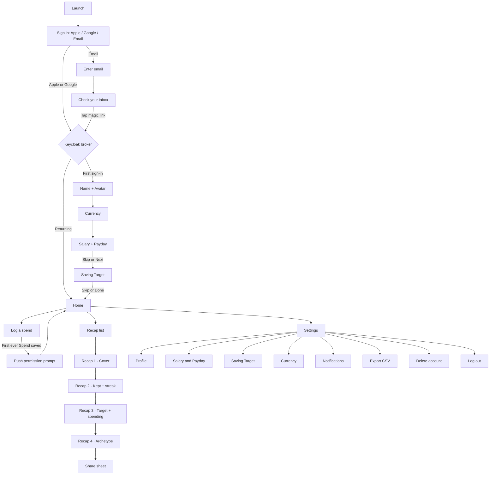

# Kids Money Recap — Product Requirements Document

| | |
|---|---|
| Status | Draft v1, all design questions resolved 2026-09-04 |
| Platform | Native iOS 17+, iPhone and iPad |
| Vocabulary | `../CONTEXT.md` is the glossary. Terms in **bold caps** below are defined there. |
| Design system | `../../kids-money-recap-ds/` (`@kids-money-recap/ui`). `../DESIGN.md` holds the design decisions. |

## 1. Summary

Kids Money Recap is a personal money tracker for adults, dressed as a playful kids' app. A **Member** sets a monthly **Salary**, a **Payday** and a **Saving Target**, logs each **Spend** by hand, and at the end of every calendar month gets a four-screen, Wrapped-style **Recap**: what came in, what was kept, where the rest went, the longest no-spend **Streak**, and a money-personality **Archetype** to share.

The four Recap screens already exist as artboards and as React components in the design system. This document specifies the whole product around them: sign-in, onboarding, Home, Spend logging, the Recap rules, settings, notifications, and the platform constraints.

## 2. Goals and non-goals

**Goals**

1. A Member can go from app install to a filled Home screen in under three minutes.
2. Logging a Spend takes one tap from Home plus amount and Category.
3. Every Recap screen is fillable from the data the flow captures; no Recap screen ever shows a placeholder for data the app never asked for.
4. All numbers are computed live from stored data. There is one source of truth and no frozen copies.
5. The app passes App Store review on the first submission: Sign in with Apple present, account deletion present.

**Non-goals for v1**

- Chores, earnings, side income, or any income other than the Salary.
- Named saving goals with a price ("Skateboard fund"). Only the percentage Saving Target exists.
- Explicit savings jars or accounts. **Saved** is computed, never logged.
- Multiple members, family accounts, parent views, or any child user.
- Offline logging and sync.
- Bank connections, receipts, recurring Spends, budgets per Category.
- Android or web.

## 3. Users

One persona: an adult (18+) who wants a light, fun way to see whether they kept the money they meant to keep this month. They are not a child, and the app never treats them as one. The kids' visual theme (illustrations, chunky type, one bright ground per screen) is a style, not a signal about the audience. Money concepts are therefore always named plainly in the UI: "salary", "saving target", "spend".

## 4. Decisions log

Every design question raised while writing this PRD, with the decision taken. These are settled; reopen one only with a reason.

| # | Question | Decision |
|---|---|---|
| D1 | Who owns the account | The Member, an adult. One Member per account. No child users. |
| D2 | What "monthly salary" means | A single fixed monthly amount, the only income. Chore earnings from the mockups are dropped. |
| D3 | What "target saving" means | A monthly Saving Target stored as a percentage of Salary. No named goals. |
| D4 | How money gets recorded | Salary is credited automatically on Payday. Spends are logged by hand. |
| D5 | What "Saved" is | Computed: Money In minus total Spends for the calendar month. |
| D6 | Identity provider | Keycloak, run from its official Docker image. No custom authenticator code. |
| D7 | Email sign-in | Passwordless magic link via the Phase Two magic-link extension. Email must be verified before use. |
| D8 | Social sign-in | Sign in with Apple (required by App Store guideline 4.8), Google, Email. Three buttons, Apple first. |
| D9 | Session | Stays signed in until logout, force-quit, or device restart. Tokens held in memory only, never persisted. Every cold launch shows sign-in. |
| D10 | Setup fields | Display Name, Avatar, Currency. Age band dropped. |
| D11 | Platform | Native iOS 17+, SwiftUI, iPhone and iPad. |
| D12 | Currency | Chosen by the Member at setup from the full ISO 4217 list. Changeable later; all stored amounts are converted once at that moment's rate and rewritten. |
| D13 | Onboarding strictness | Display Name required. Salary and Saving Target skippable, with empty-state cards on Home until set. |
| D14 | Home contents | Greeting, Money In so far, Saved and Spent, Saving Target progress, Log a spend, See last month, past Recaps. |
| D15 | PRD scope | Whole product including the four Recap screens and their rules. |
| D16 | Salary label in UI | Plain: "Your monthly salary". Theme lives in illustration and tone, never in renaming money concepts. |
| D17 | Payday | Member sets a day of month. Money In appears from that day. |
| D18 | Saving Target unit | Stored as a percentage; entry form shows amount and percentage and converts live. Default suggestion 20%. |
| D19 | Editing Salary or Target mid-month | Applies to the current month and forward. Past months keep the values in force when they ended. |
| D20 | Categories | Fixed eight: Snacks, Games, Toys, Rides, Clothes, Bills, Gifts, Other. No custom Categories. |
| D21 | Spend editing | Amount, Category, date, optional note. Backdating up to 60 days. Edit and delete any time. |
| D22 | Recap freshness | Computed live on every open. A backdated Spend changes last month's Recap. |
| D23 | Recap screen 2 | "How you earned it" list removed. Screen shows Money In, amount kept vs Saving Target, and the Streak. |
| D24 | Recap screen 3 | "% of the way to the skateboard" becomes "% of your Saving Target". Category breakdown and Splurge stay. |
| D25 | Archetype rules | Defined in §8.6. First match wins. |
| D26 | Streak | Resets on the 1st of every month. Counts local calendar days with no Spend. |
| D27 | Past Recaps | List, newest first, from Home. Months with no data hidden. |
| D28 | Sharing | Screen 4 only, as an image through the iOS share sheet, without Salary figures. |
| D29 | Notifications | Recap ready (on by default), daily reminder (off), Target Warning (on). Permission asked after the first Spend. |
| D30 | Offline | Connection required. |
| D31 | Stack named here | Keycloak, SwiftUI, one backend service with a relational database. Everything else belongs to a separate architecture document. |
| D32 | Magic link landing | iOS universal link opens the app; web fallback page when the app is absent. Link valid 15 minutes, single use. |
| D33 | Recap period | Calendar month, always. Payday only moves when Money In appears inside it. |
| D34 | Day boundaries | Device local date at the moment of logging, stored as a plain date. |
| D35 | Exchange rates | Open Exchange Rates free tier, cached daily on the backend. Manual rate entry as fallback for unsupported pairs. |
| D36 | Avatars | Six new animal characters in the existing illustration style, none of them an Archetype character. |
| D37 | Home ground | Violet (`ground.recap`), so Home rhymes with the Recap cover. |
| D38 | Target Warning | Fires once per month, the first time total Spends exceed Salary × (1 − Saving Target). |
| D39 | Deletion and export | Both in v1. Deletion removes the Keycloak user and all data within 24 hours. Export is a CSV of all Spends emailed to the Member. |
| D40 | iPad | Assumption, not asked: same single-column layout capped at 390pt width, centred on a full-bleed ground, portrait and landscape. |

## 5. End-to-end flow

Step by step:

1. **Launch.** No persisted session exists by design (D9), so the app always opens on Sign in.
2. **Sign in.** Three buttons. Apple and Google go through Keycloak's identity brokering. Email asks for an address and sends a magic link.
3. **Email verification.** For the email path, the account is unusable until the link is tapped; tapping it is the verification. Apple and Google addresses are trusted by the broker and need no separate verification.
4. **First sign-in detection.** The backend checks whether a Member record exists for the Keycloak subject. None means onboarding; otherwise Home.
5. **Onboarding.** Name + Avatar (required), Currency (required), Salary + Payday (skippable), Saving Target (skippable). Progress is saved screen by screen, so a force-quit resumes at the next unanswered screen.
6. **Home.** Current month numbers, target progress, actions.
7. **Log a spend.** Bottom sheet over Home. On the first Spend ever saved, the app asks for push permission.
8. **Recap.** From Home, the previous month's Recap or the list of past months. Four horizontally paged screens. Screen 4 shares.
9. **Settings.** Everything set in onboarding is editable, plus notifications, export, delete, log out.

## 6. Screen specifications

Every screen uses `Screen` from the design system with one of the four grounds. Component names refer to exports of `@kids-money-recap/ui`. Component states follow the design system: pressed = scale 0.97 and brightness 0.92, disabled = opacity 0.4. Motion follows `DESIGN.md` §4.4 and honours Reduce Motion.

### 6.1 Sign in

| | |
|---|---|
| Ground | violet (`recap`) |
| Components | `Illustration` (cover art), `Headline` size l, `SubCopy`, three `Button`s |
| Copy | Headline "Your month in money." Sub "Sign in to start your recap." |
| Actions | Sign in with Apple (Apple's own button style, listed first), Continue with Google, Continue with email |
| States | Loading spinner inside the pressed button while Keycloak round-trips. Error toast on cancel or failure, buttons re-enabled. |

Rules

- All three paths open Keycloak through `ASWebAuthenticationSession` with PKCE. The iOS app is a public client; no client secret ships in the binary.
- Sign in with Apple is brokered in Keycloak as a generic OIDC provider. The Apple client secret is a JWT that must be rotated at least every 6 months; this is an operations requirement.
- Google is Keycloak's built-in Google provider with "Trust email" on.

### 6.2 Enter email

| | |
|---|---|
| Ground | violet |
| Components | `Headline` size m, `Card` with a single text field, `Button` |
| Validation | RFC 5322 syntax check on device; the backend does nothing more than hand off to Keycloak. |
| Action | "Send me a link" |

### 6.3 Check your inbox

| | |
|---|---|
| Ground | violet |
| Components | `Illustration`, `Headline` size m, `SubCopy`, `HelperText` |
| Copy | "Check your inbox." "We sent a link to {email}. It works for 15 minutes." Helper: "Resend" (enabled after 30 seconds) and "Use a different email". |
| Exit | Tapping the link opens the app via universal link and completes sign-in. If the app is not installed on the device that opened the email, the web fallback page says to open the app on the phone. |

### 6.4 Onboarding 1 · Name and Avatar

| | |
|---|---|
| Ground | violet |
| Components | `Eyebrow` "Step 1 of 4", `Headline` size m "What should we call you?", `Card` with text field, `Card` with the Avatar grid (six `Illustration`s in a 3 × 2 grid, selected one gets the `ArchetypePill` ring treatment), `Button` "Next" |
| Validation | Display Name 1 to 30 characters, trimmed, letters, spaces, hyphens and apostrophes. Avatar required. Next disabled until both valid. |

### 6.5 Onboarding 2 · Currency

| | |
|---|---|
| Ground | violet |
| Components | `Eyebrow` "Step 2 of 4", `Headline` "Which currency?", `Card` with a searchable list |
| Content | Full ISO 4217 list, sorted by name, searchable by code or name. Device locale's currency preselected. |
| Validation | One selection required. |

### 6.6 Onboarding 3 · Salary and Payday

| | |
|---|---|
| Ground | violet |
| Components | `Eyebrow` "Step 3 of 4", `Headline` "Your monthly salary", `Card` with amount field (currency symbol fixed), `Card` with Payday picker (1 to 31), `Button` "Next", `HelperText` link "Skip for now" |
| Validation | Amount > 0 in the account Currency's minor units. Payday 1 to 31, default 25. Both required together, or skip both. |
| Helper copy | Under Payday: "If the month is shorter, we use its last day." |

### 6.7 Onboarding 4 · Saving Target

| | |
|---|---|
| Ground | violet |
| Components | `Eyebrow` "Step 4 of 4", `Headline` "How much do you want to keep?", `Card` with percentage slider 0 to 100 in steps of 5, amount preview beneath, `ProgressBar` preview, `Button` "Done", `HelperText` link "Skip for now" |
| Default | 20%. If Salary was skipped, the amount preview is hidden and only the percentage is shown. |
| Exit | Done or Skip goes to Home. |

### 6.8 Home

| | |
|---|---|
| Ground | violet |
| Layout, top to bottom | `ChipRow` with month chip ("September 2026") and a Settings chip; greeting `Headline` size m "Hi, {Display Name}" with the Avatar at 56pt; hero `Card` `underIllustration`; target `Card`; two `Button`s; Recap list |

**Hero card.** `StatHero` eyebrow "Money in so far" value = Money In to date. `StatChipRow` with `StatChip` Saved (green) and Spent (coral). Before Payday: eyebrow "Salary lands in {n} days", value 0. No Salary set: card becomes a prompt "Set your monthly salary" that opens Settings › Salary.

**Target card.** `CardTitle` "Saving target", right-aligned "{Saved} of {target amount}". `ProgressBar` value = Saved, max = target amount. `HelperText` = one sentence from the rules in §8.7. No Saving Target set: "Set a saving target" prompt. No Spends this month: "Nothing spent yet. Streak day {n}."

**Target Warning banner.** Coral `Card` above the target card, shown from the moment the warning fires until the 1st: "You've passed your saving line. {over} over." Dismissable for the session only.

**Actions.** `Button` "Log a spend" (primary, ink) and `Button` "See last month" (secondary). "See last month" is disabled when the previous month has no data.

**Recap list.** `DataRowList` of past Recap Months, newest first, `DataRow` label = month name, value = Archetype name. Months with no Spend and no Money In are hidden. The current month is not listed; its Recap is reachable only from the 1st of the next month, when it becomes "last month".

### 6.9 Log a spend (sheet)

| | |
|---|---|
| Presentation | Bottom sheet over Home, white surface, `radius.card` top corners |
| Fields | Amount (numeric keypad, currency symbol fixed, minor units per Currency), Category (eight `Chip`s in a wrapping row, one selected), Date (defaults to today, picker limited to the last 60 days and today), Note (optional, 80 characters) |
| Action | `Button` "Save". Disabled until amount > 0 and a Category is selected. |
| After save | Sheet closes, Home numbers animate to the new values with `motion.reveal.number`. First ever Spend saved: the push-permission prompt appears after the sheet closes. |

### 6.10 Spend detail and edit

Reached by tapping a Spend in the month's list (the Spent chip on Home opens that list). Same fields as the sheet, prefilled, plus a "Delete" action with a single confirm. Editing or deleting a Spend in a past month immediately changes that month's Recap (D22).

### 6.11 Recap · screen 1 Cover

Existing `RecapCoverScreen`. Props: month name, Display Name, Money In, Saved, Spent. Copy: eyebrow "{Month} {Year}", chip "{Display Name}'s recap", headline "Your {Month} in money", `StatHero` "Money that came your way" = Money In, chips Saved and Spent. The "Earned" chip is removed (D2).

### 6.12 Recap · screen 2 Kept and streak

Existing `RecapEarningScreen`, revised (D23). Ground yellow. Illustration: the saving-target jar. Chips "Kept", "{Month}". Headline: "You kept {Saved} of {Money In}. That's {kept%} of your target." `Card` with a `CompareBars` of Saved vs Saving Target amount, `scale="max"` (Target is a benchmark, not a share of a whole). `StreakBadge` with the Streak length, `StreakDots` for the month, `HelperText` "{start} to {end}. {badge copy}". Badge copy: Streak ≥ 7 "New badge unlocked.", otherwise "Beat it next month."

When Saving Target is not set, the headline is "You kept {Saved} of {Money In}." and the compare card is replaced by a prompt to set a target.

### 6.13 Recap · screen 3 Target and spending

Existing `RecapGoalScreen`, revised (D24). Ground coral. Chips "Target", "Spending". Headline "{kept%} of your saving target" with `SubCopy` from §8.7. `Card` "Saving target" with `ProgressBar` (marker replaced by a piggy-bank glyph, D24). `Card` "Where {Spent} went", `CardTitle` "Mostly {top Category}", one `CategoryBar` per Category with a Spend, sorted descending, showing percentage of Spent — capped at the five largest, with any remainder rolled into one line naming those Categories and their combined percentage. Eight bars do not fit the artboard. `Card` accent "The splurge": "{amount} on {note or Category}. Your biggest single buy." Hidden when there are no Spends.

### 6.14 Recap · screen 4 Archetype

Existing `RecapPersonalityScreen`. Ground green. Headline "This month, {Display Name}, you were", Archetype name, one-line description (§8.6), Archetype `Illustration`, `CompareBars` Saved vs Spent, `Button` "Share your {Archetype}", `ArchetypeRow` with the four `ArchetypePill`s, this month's selected. The component currently always shows the squirrel illustration; it must switch per Archetype, which needs three new illustrations (§13).

### 6.15 Share

`Button` on screen 4 renders screen 4 to a 1080 × 1920 image and opens `UIActivityViewController`. The image omits Money In and Salary; it shows Archetype, month, Display Name, Saved and Spent totals only (D28).

### 6.16 Settings

Plain white surface with `DataRowList` sections. Each row opens a screen reusing the matching onboarding card.

- Profile: Display Name, Avatar.
- Salary and Payday: same card as 6.6. Change applies to the current month and forward (D19).
- Saving Target: same card as 6.7.
- Currency: list as 6.5, followed by a confirm sheet "Convert everything to {code}? All your amounts will be converted at today's rate ({rate}). This can't be undone." Rate fetched before the sheet is shown; if the pair is unsupported, a field asks for the rate manually (D35).
- Notifications: three toggles (Recap ready, Daily reminder with a time picker default 20:00, Target Warning).
- Export: "Email me a CSV of every spend." One tap, confirmation toast.
- Delete account: two-step confirm (button, then typed "DELETE"). Signs out immediately; deletion completes within 24 hours.
- Log out.

## 7. Data model

Amounts are integers in the Currency's minor units (IDR 0 decimals, GBP 2, BHD 3). Dates are plain calendar dates without timezone (D34). All entities belong to exactly one Member.

| Entity | Fields | Notes |
|---|---|---|
| Member | id, keycloak_subject, display_name, avatar_key (one of six), currency_code, created_at | One per Keycloak user. |
| SalarySetting | member_id, amount_minor, payday (1–31), effective_from (year-month) | Append-only. The row with the latest effective_from ≤ a month is the one in force for that month. Editing creates a new row for the current month (D19). |
| SavingTargetSetting | member_id, percent (0–100), effective_from (year-month) | Same append-only pattern. |
| Spend | id, member_id, amount_minor, category (enum of eight), date, note, created_at, updated_at | Soft-deleted rows are excluded from every computation. |
| CurrencyConversion | member_id, from_code, to_code, rate, source (provider or manual), applied_at | Audit record of each rewrite (D39). |
| NotificationPreference | member_id, recap_ready, daily_reminder, daily_reminder_time, target_warning, apns_token | |
| MonthFlag | member_id, year-month, target_warning_sent_at | Ensures the Target Warning fires once per month. |

The Recap has no table. It is a computation over the above (D22).

## 8. Domain rules

### 8.1 Month

A **Recap Month** is a calendar month in local dates. Everything below is computed for one month M.

### 8.2 Payday and Money In

- Effective payday for M = min(Payday, number of days in M).
- Money In for M = Salary in force for M, if the effective payday has passed or is today; otherwise 0. For a past month it is always the full Salary.
- With no Salary in force, Money In = 0 and the Recap shows the Salary prompt instead of an Archetype.

### 8.3 Spent, Saved, Splurge

- Spent = sum of Spends dated in M, not deleted.
- Saved = Money In − Spent. May be negative; displayed as "−{amount}" and the progress bar clamps at 0.
- Splurge = the largest single Spend in M. Ties resolve to the earliest date.

### 8.4 Saving Target amount

Target amount = round-half-up(Salary in force × percent ÷ 100) in minor units. kept% = Saved ÷ Target amount × 100, rounded to a whole number, clamped 0 to 999.

### 8.5 Streak

- A day counts as spend-free if no non-deleted Spend is dated on it.
- Streak = the longest run of consecutive spend-free days within M, from the 1st to the last day of M for past months, or to today for the current month.
- A month with no Spends has a Streak equal to its elapsed days.
- Streaks never cross month boundaries (D26).

### 8.6 Archetype

Evaluated in order. First match wins. Requires Money In > 0 and a Saving Target; otherwise no Archetype.

| Archetype | Rule | One-line description |
|---|---|---|
| Squirrel | Saved ≥ Target amount and Streak ≥ 7 | "You stashed more than you meant to, and you didn't crack once." |
| Hustler | Saved ≥ Target amount and Streak < 7 | "You hit your number while still living a little." |
| Treat-Yourself | Saved < Target amount and Splurge ≥ 25% of Spent | "One big treat tipped the month. Worth it?" |
| Slow Burner | Saved < Target amount, no single splurge | "Lots of little spends added up. Sneaky." |

Edge case: Saved < Target amount with zero Spends is impossible, because Spent = 0 means Saved = Money In ≥ Target amount.

### 8.7 Target progress sentence

Used on Home and Recap screen 3.

- Current month, on track (Spent ≤ Salary − Target amount): "Keep spending under {daily allowance} a day and you'll make it." where daily allowance = (Salary − Target amount − Spent) ÷ days remaining, floored, never below 0.
- Current month, over the line: "You're {over} past your line. Next month is a fresh start."
- Past month, met: "Target met. {Saved − Target amount} to spare."
- Past month, missed: "{Target amount − Saved} short of your target."

### 8.8 Target Warning

Fires when, after saving a Spend, Spent for the current month first exceeds Salary − Target amount, and MonthFlag has no target_warning_sent_at for this month. Sends a push if enabled, shows the Home banner regardless, and stamps the MonthFlag. Editing or deleting Spends never un-fires it.

### 8.9 Currency change

1. Fetch rate from the provider (D35). If unsupported, ask the Member for a rate.
2. Confirm sheet shows the rate.
3. In one transaction: rewrite every SalarySetting amount and every Spend amount as round-half-up(amount × rate) in the new Currency's minor units; set member.currency_code; write a CurrencyConversion row.
4. Saving Target percentages are untouched.
5. Not reversible except by converting again at a new rate.

### 8.10 Editing rules

- Spend date must be within the last 60 days including today; never in the future.
- Amount must be > 0.
- Salary and Saving Target edits create a new setting row effective from the current month. Past months are unaffected.

## 9. Authentication and session

- **Keycloak** from the official Docker image, one realm, one public OIDC client for iOS with PKCE required, redirect URI on the app's universal-link domain.
- **Brokers:** Google (built-in, Trust email on), Apple (generic OIDC, Trust email on, client-secret JWT rotated every 6 months).
- **Magic link:** Phase Two `keycloak-magic-link` extension, configured to create the user on first use, link lifetime 900 seconds, single use. The link target is the app's universal link so iOS opens the app; the same URL serves a fallback web page for other devices.
- **Email verification:** the magic-link tap marks the email verified. The realm setting "Verify email" is on, so an unverified email account cannot complete sign-in by any other path.
- **Session in the app:** access and refresh tokens are held in process memory only. Nothing is written to Keychain or disk. Backgrounding keeps the process and thus the session; force-quit or reboot loses it and the next launch shows Sign in (D9). Refresh token rotation on in Keycloak, with SSO Session Idle 30 minutes and SSO Session Max 24 hours, so a phone left in the background overnight re-authenticates the next day.
- **Backend:** verifies Keycloak JWTs on every request; the Member is looked up by the token subject.
- **Log out:** calls Keycloak's end-session endpoint and clears memory.
- **Delete account:** backend deletes the Keycloak user via the admin API, then all Member rows, within 24 hours.

## 10. Notifications

| Notification | Default | Trigger | Copy |
|---|---|---|---|
| Recap ready | on | 09:00 local on the 1st of each month, if the previous month has data | "Your {Month} recap is ready. See how you did." |
| Daily reminder | off | Member-chosen time, only if no Spend was logged today | "Log today's spends before you forget." |
| Target Warning | on | §8.8 | "You've passed your saving line for {Month}." |

Push permission is requested once, after the first Spend is saved. If denied, the toggles in Settings deep-link to iOS Settings.

## 11. Non-functional requirements

- **Platform:** iOS 17+, SwiftUI, iPhone and iPad, portrait and landscape. iPad uses the same single-column layout capped at 390pt, centred on the ground (D40).
- **Performance:** Home renders from cache instantly and refreshes from the network; any write completes in under 1 second on a normal connection. Recap screens page at 60fps with the reveal animations from `DESIGN.md` §4.4.
- **Connectivity:** every write requires the network. A failed write shows an inline error and keeps the sheet open with the values intact.
- **Accessibility:** Dynamic Type up to the "Large" accessibility size; VoiceOver labels on every chip, bar and button; all tappable elements at least 44 × 44pt (this lifts the 30pt header chips and 24pt archetype pills from the mockups when they become tappable); Reduce Motion replaces reveals with 150ms fades.
- **Privacy:** no analytics SDK in v1. Data stored server-side in one region. The share image never contains Salary or Money In.
- **Security:** TLS everywhere, JWT verification on every request, no secrets in the binary, rate limiting on the magic-link endpoint (5 per email per hour).
- **App Store compliance:** Sign in with Apple present (4.8), in-app account deletion (5.1.1(v)), privacy nutrition label listing email and financial data as linked to the user.

## 12. Acceptance criteria

1. A new Member signing in with Google reaches Home with a Display Name, Avatar and Currency in under three minutes, with Salary and Saving Target skipped, and Home shows both prompts.
2. Tapping a magic link on the phone opens the app signed in; tapping it on a laptop shows the fallback page.
3. Force-quitting and relaunching shows the Sign in screen. Backgrounding for 5 minutes and returning shows Home.
4. Setting Salary 3,000,000 IDR, Payday 25, target 20% on the 10th shows "Salary lands in 15 days", Money In 0; on the 25th shows Money In 3,000,000 and target 600,000.
5. Logging Spends totalling 2,400,001 IDR in that month fires the Target Warning exactly once, even after further Spends.
6. A month with Money In 36, Spent 11 across Snacks 5, Games 4, Toys 2, and a 9-day Streak, target 60%, yields Archetype Squirrel, Splurge 4 on Games, kept% 116.
7. Backdating a Spend into last month changes last month's Recap numbers on next open, with no manual refresh.
8. Switching Currency from BHD to IDR rewrites all amounts at the shown rate, records one CurrencyConversion row, and leaves percentages unchanged.
9. Deleting the account signs the Member out immediately; the Keycloak user and all rows are gone within 24 hours.
10. Sharing from screen 4 produces an image containing no Salary or Money In figure.

## 13. Implications for the design system revision

The PRD keeps the four grounds, two fonts, two radii and white cards. Everything below was **built and synced to the design-system project on 2026-09-04**; `../../kids-money-recap-ds/.design-sync/NOTES.md` records the build. Two changes touch an existing component's behaviour and are called out where they occur; nothing else alters how an existing component looks.

**One new surface.** Log a spend, Settings and every settings sub-screen are a white surface, not a fifth ground. `Sheet` (bottom sheet, `radius.card` on the top corners, drag handle) and `Sheet variant="full"` sit *on top of* the violet ground. The four grounds are unchanged.

**New glyphs in `Icon`** (no new component), taking it from 6 glyphs to 18: `piggy` (the 64×30 saving-target marker replacing `skateboard`), the eight Category glyphs `snacks`, `games`, `toys`, `rides`, `clothes`, `bills`, `gifts`, `other` (16px filled, for `IconWell`), and `settings`, `chevron`, `plus` (20px stroked). There is no `close` glyph: a cross is `plus` rotated 45°.

**New data colours** (tokens only): five Category colours so `CategoryBar` can colour eight Categories. The three that already existed keep the hues drawn on the Goal artboard — **Snacks coral, Games violet, Toys yellow** — and the five added are Rides sky, Clothes green, Bills ink-500, Gifts gold, Other rust. No two Categories share a hue. (An earlier draft of this section had Snacks yellow and Toys coral, contradicting `tokens.json`, `DESIGN.md` §1.1 and the Goal artboard; the built mapping won.) Two tints were derived to match the existing 100s: `gold.100` `#FDEFD0` and `rust.100` `#F7E0D3`.

**New illustrations:** none. The batch-2 renders in `illustration-prompts.md` already cover every screen — six Avatars, the three Archetype mascots (Hustler, Treat-Yourself, Slow Burner) so `RecapPersonalityScreen` switches per Archetype, the magic-link envelope, and the saving-target jar, which is Recap screen 2's hero. Recap screen 3 keeps the vending machine; what the skateboard scene loses is its **marker**, now the `piggy` glyph (D24).

**New components** — all eight built, plus `Avatar` (the single 56pt badge beside the Home greeting, which shares a source file with `AvatarGrid`).

| Component | Why | Built from |
|---|---|---|
| `TextField` | Email, Display Name, amount, note | `Card` inner, Nunito 800, ink text, violet focus ring |
| `AmountField` | Currency-aware amount entry | `TextField` plus fixed symbol and minor-unit formatting |
| `Slider` | Saving Target percentage | `ProgressBar` track with a draggable knob |
| `AvatarGrid` | Onboarding 1 | six `Illustration`s with the `ArchetypePill` selected ring |
| `Sheet` | Log a spend | white surface, `radius.card` top corners, drag handle |
| `Banner` | Target Warning | coral `Card` variant with dismiss |
| `Toggle` | Settings | iOS switch tinted violet |
| `ListRow` | Settings, Currency list | `DataRow` with chevron and no `IconWell` |

**Variants added after the part 2 and 3 canvases flagged them missing** (2026-09-04): `Button variant="secondary"` (the white pill with an ink label — the token existed but no component consumed it) and `Chip tone={hue} selected` (the eight Category selection chips, each on its own tint, flipping to the ink inverse fill with a white glyph). `Illustration` also gained `maxHeight`, because the four Archetype mascots share a `width` but differ in aspect ratio and the tallest clipped the pill row.

**Existing component changes**

- `RecapEarningScreen`: chores `DataRowList` dropped; `CompareBars` of Saved vs Target added; the saving-target jar is its illustration. **Not renamed** — a rename moves four keys in the sync manifest (`componentSrcMap`, `overrides`, `renderHashes`, `sourceKeys`) and re-grades the card, which is not worth a tidier name. The name `RecapEarningScreen` is the screen's identity; "Kept and streak" is what it shows.
- `RecapGoalScreen`: headline and helper copy driven by §8.7; progress marker `piggy`. **Behaviour change:** it draws at most `maxCategoryBars` (**default 4**, measured) and rolls the remainder into one labelled line. Eight bars overflowed the 844pt artboard by 90pt and pushed the page dots off screen; five still overflowed by 6. `DESIGN.md` §2 sets information-density at 3, so four plus a roll-up is both what fits and what the system implies. It also has a no-spends mode: with `spentTotal` 0 the card reads "Nothing spent this month" and the splurge is hidden.
- `RecapPersonalityScreen`: illustration prop keyed by Archetype; blurbs come from §8.6 verbatim. The mascot is capped with `maxHeight` so the taller Hustler bee cannot push the Archetype pill row off the screen.
- `RecapCoverScreen`: Earned `StatChip` removed.
- Header `Chip` and `ArchetypePill`: `tappable` prop added. It lifts the hit area to 44pt with a centred pseudo-element, so the drawn pill keeps its size and no existing screen shifts.
- `CompareBars`: **behaviour change.** It scaled every row against the sum of all rows while its own documentation claimed the largest. A `scale` prop now makes the choice explicit — `total` (the default, so screen 4 renders exactly as before) and `max`, which screen 2 uses because "Kept" is measured against a benchmark, not shown as a share of a whole.
- The font-inheritance gap noted in the design system's `NOTES.md` is fixed: `font-family` is set on `.kmr-card` and the five text classes, so `Card` text renders in Nunito outside `Screen`.
- **Props that hide content take `null`, not `undefined`.** `RecapEarningScreen.targetAmount` and `RecapGoalScreen.splurge` both have defaults, so passing `undefined` silently restored the default and made the "not set" and "no spends" states unreachable. Both are now `T | null`, and the splurge also hides itself whenever Spent is 0.

## 14. Out of scope, candidates for v2

Named saving goals with a price and an illustration; chore-style earnings; offline logging with sync; custom Categories; recurring Spends; explicit savings jars; family accounts; Android; a 30-day persisted session with biometric lock; sharing all four Recap screens.
