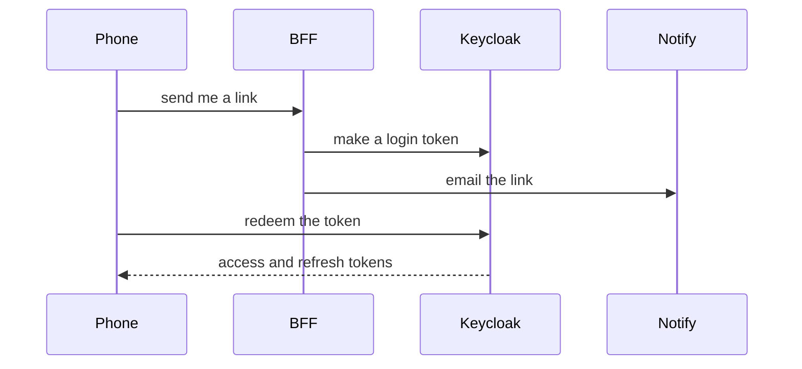
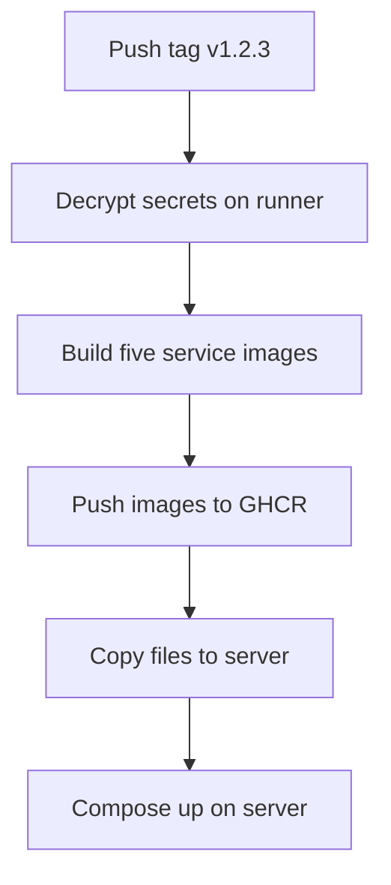

# infra

Everything that runs the backend: the Compose stack, the sign-in realm, the edge, the secrets, the setup wizard
and the deploy.

| Path | What lives here |
| --- | --- |
| `infra/compose/` | The one `compose.yaml` a laptop, CI and the server all run ([README](compose/README.md)) |
| `infra/tofu/realm/` | The Keycloak realm `mmr` in OpenTofu, applied on every `up` |
| `infra/nginx/` | The edge: routes, limits and two static files ([README](nginx/README.md)) |
| `infra/secrets/` | Every secret, encrypted with SOPS and an age key ([README](secrets/README.md)) |
| `infra/wizard/` | The nine setup steps only a person can do ([README](wizard/README.md)) |
| `.github/workflows/deploy.yml` | The deploy, started by a version tag |

## Signing in

A Member signs in with Apple, Google or an email link. Keycloak issues the tokens; the backend never sees a
password. This is the email link; the dashed arrow is an answer:

- **The link** works once and for 15 minutes. Opening it on another device shows a page that never uses the
  token.
- **Apple and Google** go through Keycloak's identity providers, with "Trust email" on.
- **The session** lasts 30 days from last use. Each refresh token works once.
- **Log out** ends the session in Keycloak and forgets the phone's push token.
- **Clients in the realm**: `ios` for the app, `bff` for sign-in links, and one each for `notify` and `members`,
  whose background jobs have no Member token.

## Deploying

Pushing a tag like `v1.2.3` is the only way to deploy. A branch push, `main` included, deploys nothing.

- It runs in the GitHub `production` environment. Its one secret is `SOPS_AGE_KEY`, the age key.
- The server gets `compose.yaml`, what it mounts, a `.env` written by `infra/compose/machine-env.sh`, and
  Keycloak's two vault files. The server never holds the age key.
- The server's `.env` differs from a laptop's: `MMR_HOST` is the domain, `REALM_SSL_REQUIRED=external`,
  `NGINX_HOST_PORT=80`, and there is no test Member.

## Not ready yet

The deploy has never run, and the server does not exist yet (#87). A deploy today would still have:

- **no mail**: the server runs no Mailpit, and `notify` has no real mail provider yet;
- **no TLS**: Nginx serves plain HTTP on port 80;
- **a placeholder Team ID** in the apple-app-site-association file;
- **no pinned host key**: the deploy's SSH trusts whichever server answers at the domain.
