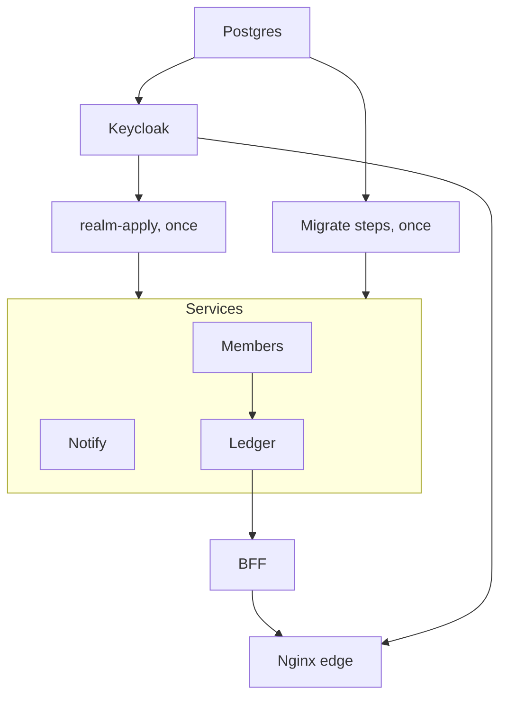

# infra/compose

The whole backend in one `compose.yaml`. A laptop, CI and the server all run it. Every command here uses
`--profile mail`, because Mailpit, the only mail host `notify` has, sits behind that profile.

To try it by hand or run the tests against it, see [TESTING.md](TESTING.md). When something goes wrong, see
[TROUBLESHOOTING.md](TROUBLESHOOTING.md). To run the app on a real iPhone, see the
[iOS TESTING.md](../../apps/ios/TESTING.md#run-on-a-physical-iphone).

## Run it

Docker Desktop must be running.

```bash
cp infra/compose/.env.example infra/compose/.env
```

Fill every empty value in `.env`. Any string works locally. Use only letters and digits for the
`*_DB_PASSWORD` values and `RABBITMQ_PASSWORD`, because they go into a URL.

Four keys are optional and not in the file: `OPEN_EXCHANGE_RATES_APP_ID` for live rates, and `APPLE_TEAM_ID`,
`APPLE_PUSH_KEY_ID` and `APPLE_PUSH_KEY` for real pushes. Add one only with a real value.

```bash
docker compose -f infra/compose/compose.yaml --profile mail up -d --build --wait
```

```bash
docker compose -f infra/compose/compose.yaml --profile mail ps
```

```bash
docker compose -f infra/compose/compose.yaml --profile mail down
```

Add `-v` to `down` to delete the data too.

## What comes up

An arrow points from a container to one that waits for it. "Once" boxes run, finish, and stop.



The three services also wait for RabbitMQ. Redis starts on its own; `currency` and the BFF wait for it. Mailpit
and the `acme` certificate sidecar wait for nothing.

| Container | Host port | What it is |
| --- | --- | --- |
| nginx | 8090 | The edge ([nginx README](../nginx/README.md)) |
| keycloak | 8080 | Sign-in, the realm `mmr` |
| bff | 8082 | What the phone calls |
| members, notify, ledger, currency | 8081, 8083, 8084, 8085 | The services, on this computer only |
| postgres, redis, rabbitmq | 5432, 6379, 5672 | Storage, on this computer only |
| mailpit | 8025 (web), 1025 (SMTP) | Catches every email, on this computer only |

Nginx, Keycloak and the BFF are open to the local network, so a phone can reach them. A port that is busy can
be moved with its `*_HOST_PORT` variable.

## The `mmr` realm

`realm-apply` builds the realm from `infra/tofu/realm/` on every `up`, so editing a file there and running `up`
changes it. The realm's clients and sign-in methods are in the [infra README, "Signing in"](../README.md#signing-in).

- **Test Member**: `test` / `test@example.com`, with the password `TEST_USER_PASSWORD` from `.env`. Only laptops
  and CI have one.
- **Re-applied on every `up`**: `TEST_USER_PASSWORD` and the three client secrets.
- **Apple and Google**: their ids are `replace-me` unless `.env` sets them, so the buttons reach a provider error.
