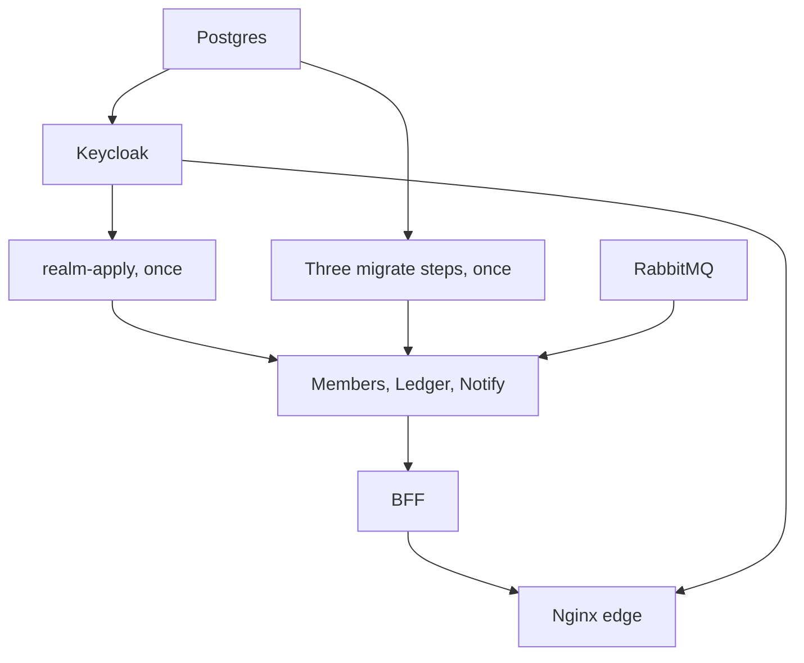

# infra/compose

The whole backend in one `compose.yaml`. A laptop, CI and the server all run it. Every command here uses
`--profile mail`, because Mailpit, the only mail host `notify` has, sits behind that profile.

To test against the stack, see [TESTING.md](TESTING.md). When something goes wrong, see
[TROUBLESHOOTING.md](TROUBLESHOOTING.md).

## Run it

Docker Desktop must be running.

```bash
cp infra/compose/.env.example infra/compose/.env
```

Fill every empty value in `.env`. Any string works locally, but use only letters and digits for the
`*_DB_PASSWORD` values, because they go into a URL. Three keys are optional and not in the file:
`OPEN_EXCHANGE_RATES_APP_ID` for live rates, and `APPLE_PUSH_KEY_ID` with `APPLE_PUSH_KEY` for real pushes.
Add one only with a real value.

```bash
docker compose -f infra/compose/compose.yaml --profile mail up -d --build --wait
```

```bash
docker compose -f infra/compose/compose.yaml --profile mail ps
```

```bash
docker compose -f infra/compose/compose.yaml --profile mail down
```

Add `-v` to `down` to delete the data too.

## What comes up

An arrow means the box below waits for the box above. "Once" boxes run, finish, and stop.



Redis starts on its own; `currency` and the BFF wait for it. Mailpit and the `acme` certificate sidecar wait for
nothing.

| Container | Host port | What it is |
| --- | --- | --- |
| nginx | 8090 | The edge (`infra/nginx/README.md`) |
| keycloak | 8080 | Sign-in, the realm `mmr` |
| bff | 8082 | What the phone calls |
| members, notify, ledger, currency | 8081, 8083, 8084, 8085 | The services, on this computer only |
| postgres, redis, rabbitmq | 5432, 6379, 5672 | Storage, on this computer only |
| mailpit | 8025 (web), 1025 (SMTP) | Catches every email, on this computer only |

Nginx, Keycloak and the BFF are open to the local network, so a phone can reach them. A port that is busy can
be moved with its `*_HOST_PORT` variable.

## One stack per laptop

A laptop runs one stack: the stock `mmr` project on the default ports. No worktree, agent or subagent starts a
second one with another `COMPOSE_PROJECT_NAME` or other host ports; four stacks at once filled the memory of a
16 GB laptop.

- Before `up`, run the `ps` command above and reuse what is running.
- Only one session at a time runs `up`, `--build`, `down` or the Go tests against the stack.
- Work that needs no stack can run in parallel.
- When the work is done, stop the stack with `down`.

## A phone on the LAN

A real iPhone cannot reach the Mac as `localhost`.

1. Set `MMR_HOST=<the Mac's LAN IP>` in `.env`, then run the `up` command again.
2. In Xcode, edit the scheme's Run action and add `MMR_ISSUER=http://<ip>:8080/realms/mmr` and
   `MMR_BFF_URL=http://<ip>:8082` (`apps/ios/README.md`, "Run on a physical iPhone").
3. Set `MMR_HOST` back to `localhost` and run `up` again before using the simulator.

## The `mmr` realm

`realm-apply` builds the realm from `infra/tofu/realm/` on every `up`, so editing a file there and running `up`
changes it. The realm's clients and sign-in methods are in `infra/README.md`, "Signing in".

- **Test Member**: `test` / `test@example.com`, with the password `TEST_USER_PASSWORD` from `.env`. Only laptops
  and CI have one.
- **Re-applied on every `up`**: `TEST_USER_PASSWORD` and the three client secrets.
- **Apple and Google**: their ids are `replace-me` unless `.env` sets them, so the buttons reach a provider error.

## Try it

A token for the test Member:

```bash
curl -s -X POST http://localhost:8080/realms/mmr/protocol/openid-connect/token -d grant_type=password -d client_id=ios -d username=test -d "password=$TEST_USER_PASSWORD" | jq -r .access_token
```

Home through the BFF with that token:

```bash
curl -s http://localhost:8082/money_recap.v1.BffService/GetHome -H "Authorization: Bearer $TOKEN" -H 'Content-Type: application/json' -d '{}'
```

The same call through the edge answers the same:

```bash
curl -s http://localhost:8090/api/money_recap.v1.BffService/GetHome -H "Authorization: Bearer $TOKEN" -H 'Content-Type: application/json' -d '{}'
```

## Mailpit

Every email `notify` sends lands in Mailpit. Read it at `http://localhost:8025`, or over its API:

```bash
curl -s "http://localhost:8025/api/v1/search?query=to:someone@example.test" | jq '.messages[0].ID'
```

Without `--profile mail`, `notify` still reports healthy but cannot send, so every sign-in link fails.

## Test against it

The Go test variables, and the two smoke tests, are in [TESTING.md](TESTING.md).
