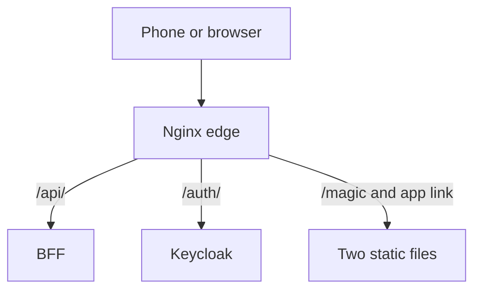

# infra/nginx

The edge: the one container the phone reaches. One file, `default.conf`, holds its routes and limits, and
`html/` holds its two static files.

## Where a request goes

The two static files are the sign-in fallback page and the Apple app link file. Anything else gets 404.



## How it works

- **`/api/`** goes to the BFF with the prefix removed: `/api/money_recap.v1.BffService/GetHome` arrives as
  `/money_recap.v1.BffService/GetHome`.
- **`/auth/`** goes to Keycloak. On a laptop every caller still uses Keycloak's own port.
- **`/.well-known/apple-app-site-association`** is served as `application/json` with no redirect, as Apple
  requires. Its Team ID is still a placeholder: nothing writes the real one in yet.
- **`/magic`** is the page an email link opens on a device without the app. It has no script, so it never uses
  the token.
- **Limits per IP address**: 60 requests a second with a burst of 120, and 100 connections, on `/api/` and
  `/auth/`. The sign-in link call alone is held to 5 a minute.
- **The 5 links per email address per hour** limit is the BFF's, in Redis, because Nginx cannot read an address
  inside a request.
- **TLS**: none yet. Nginx serves plain HTTP on port 80. The `acme` container shares a volume with it, ready
  for a certificate once there is a domain (#87).

## Test it

With the stack up (`infra/compose/README.md`, "Run it"):

```bash
curl -si http://localhost:8090/.well-known/apple-app-site-association | grep -i '^HTTP/\|^Content-Type'
```

```bash
curl -s http://localhost:8090/magic | grep -o 'Open My Money Recap[^<]*'
```

`TestEdge` in `apps/backend/internal/bff` checks the routes, both files and both limits.
