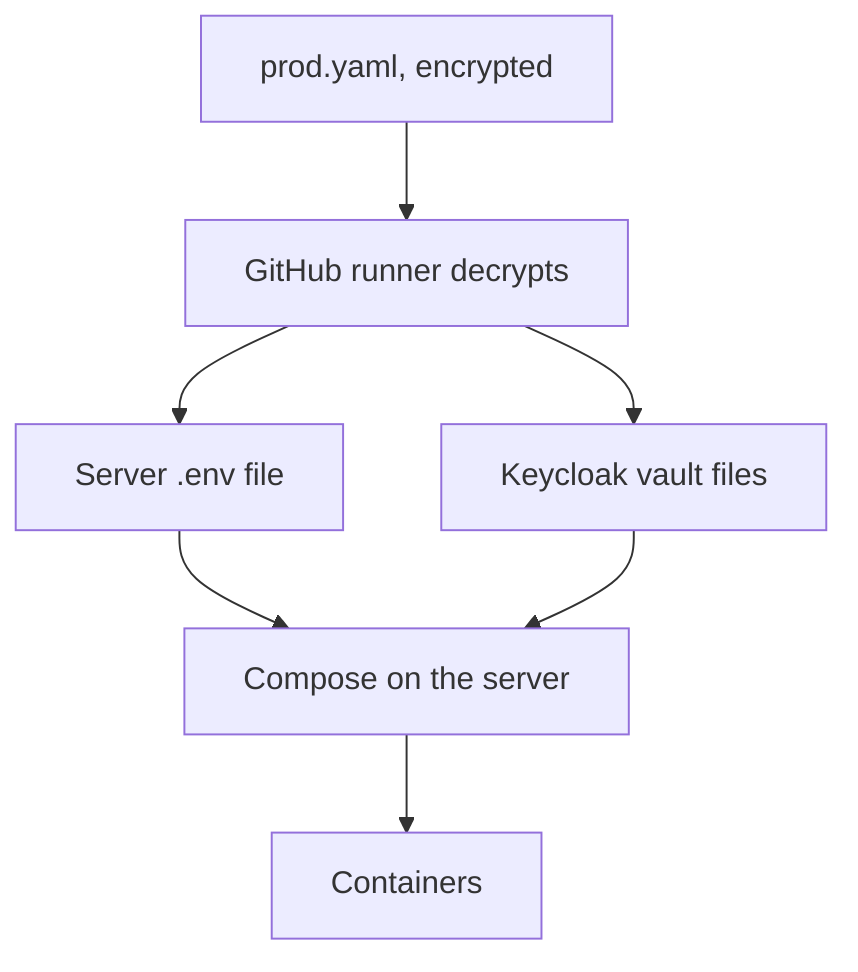

# infra/secrets

Every secret lives in one file, `prod.yaml`, encrypted with SOPS and an age key. The age private key is the
only secret a person ever holds; everything else is kept as ciphertext.

## How a secret reaches a container

The deploy decrypts on the GitHub runner, and `infra/compose/machine-env.sh` writes the server's `.env`. The
server never holds the age key.



## What is here

| Path | In git | What it is |
| --- | --- | --- |
| `example.yaml` | yes | Every key, with placeholder values. The wizard checks `prod.yaml` against it. |
| `decrypt.sh` | yes | Decrypts to one file per key, mode 0400. |
| `decrypt-smoke.sh` | yes | Proves `decrypt.sh` and `infra/compose/machine-env.sh` with a throwaway key. |
| `keyset.sh` | yes | The one reader of `example.yaml`'s keys, shared by the smoke test, the wizard and `machine-env.sh`. |
| `prod.yaml` | no, git-ignored | The real values. Once it holds them, delete its line in `.gitignore` and commit it with `.sops.yaml` ([#87](https://github.com/ravialdyh/my-money-recap-monorepo/issues/87)). |
| `.sops.yaml` at the repository root | no, git-ignored | Names the age public key. Written by the wizard's first step. |

No age key exists yet, so the repository holds the shape and no real value.

## The keys

- **From the wizard's steps**: the Apple, Google, Open Exchange Rates, mail, domain, cloud and deploy SSH
  values. `STEPS` in `infra/wizard/setup.sh` says which step fills which key.
- **For the stack itself** (`keyset.sh stack`): the Postgres, Keycloak and RabbitMQ passwords, the
  connection strings built from them, and the `bff`, `notify` and `members` client secrets.
- Each database password, and the RabbitMQ password, appears twice: once alone and once inside its connection
  string. Change both together.

## Keycloak's file vault

The realm holds only references, `${vault.google_client_secret}` and `${vault.apple_sign_in_key}`. Keycloak reads
the values from files Compose mounts in `/run/secrets`, named with every underscore doubled. On a laptop those
files are `infra/compose/vault/`, holding `replace-me`.

The Google secret works this way. The Apple extension in the pinned image does not read the vault, so Sign in
with Apple cannot finish with real values yet ([#87](https://github.com/ravialdyh/my-money-recap-monorepo/issues/87),
item 10).

## Run it

Decrypt by hand:

```bash
SOPS_AGE_KEY_FILE=~/.config/sops/age/keys.txt infra/secrets/decrypt.sh infra/secrets/prod.yaml infra/secrets/decrypted
```

`infra/secrets/decrypted/` is git-ignored. Never commit what is in it.

## Test it

```bash
infra/secrets/decrypt-smoke.sh
```

It needs `sops` and `age`, and no real secret. CI runs it in the `backend` job.
