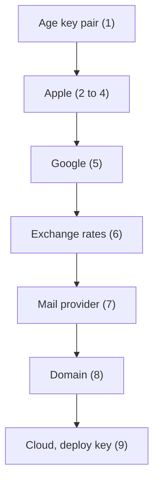

# infra/wizard

One script for the nine setup steps only a person can do. Steps 3 to 9 each end with a value pasted into
`infra/secrets/prod.yaml`. Any step can be skipped and done later.

## The nine steps

The script walks the steps in this order; each box shows its step number. Step 1 comes first because it creates
the file the others fill.



Steps 2 to 4 are Apple Developer Program enrolment, the App Store Connect API key, and the Services ID with the
two `.p8` keys.

## How it works

- **Step 1** makes the age key, or uses one already in `~/.config/sops/age/keys.txt`. It writes `.sops.yaml`
  and creates `prod.yaml` from `infra/secrets/example.yaml`. It never overwrites the key or `prod.yaml`. It
  rewrites `.sops.yaml` when that file does not name this key.
- **Step 9** also runs `ssh-keygen` for the deploy key, once `prod.yaml` exists.
- **`--check`** changes nothing. It reports each step done or missing, and exits non-zero while any is missing.
- **Done means** the key is in `prod.yaml`, no longer holds its placeholder, and the file decrypts.
- **Step 2** produces no value, so it is reported by hand and never fails the check.
- **The stack's own passwords and client secrets** get their own row, and a placeholder there fails the check.

## Run it

```bash
infra/wizard/setup.sh
```

```bash
infra/wizard/setup.sh --check
```

## Test it

```bash
infra/wizard/check-smoke.sh
```

It uses a throwaway age key in a temporary folder and leaves the repository untouched. CI runs it in the
`backend` job.
