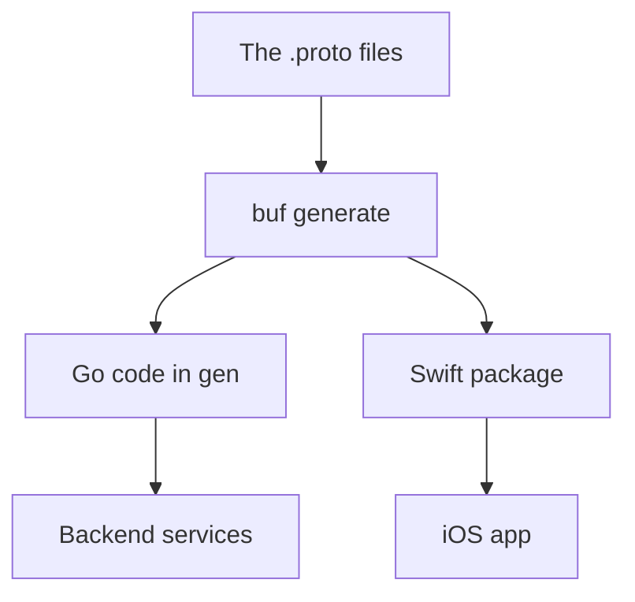

# packages/contract

The one API contract. Every call between the phone and the BFF, and between the services, is written once in
`money_recap/v1/*.proto`. The Go and Swift code is generated from it.

## From the contract to the code

One `buf generate` makes the Go and the Swift code from the same `.proto` files.



## What is in it

| File | Holds |
| --- | --- |
| `money.proto` | `Money`: an amount as a decimal string plus an ISO 4217 code, never a float |
| `shared.proto` | The enums, `Spend`, the event envelope and the view parts several services share |
| `bff*.proto` | `BffService`, the one service the phone calls, and its screen answers |
| `members*.proto` | `MembersService`, `Profile` and the `members.*` events |
| `ledger*.proto` | `LedgerService`, its reads, writes and `ledger.*` events, and the test fixture shape |
| `notify*.proto` | `NotifyService`, the notification settings, and `notify.member.purged` |
| `currency.proto` | `CurrencyService` and the `UnsupportedPair` error |

Each service block lists its calls, and each message says what it is for. Every write opens with an
`idempotency_key`.

| Generated output | Where | Used by |
| --- | --- | --- |
| Go messages, servers and clients | `apps/backend/gen/money_recap/v1/` | The BFF and the services |
| Swift: the `BffService` client and its messages | `swift/Sources/MoneyRecapContract/` | The iOS app, which calls only the BFF |

Never edit the generated files. Plugin versions are pinned in `buf.gen.yaml`. A plugin bump also moves its runtime
pin: `apps/backend/go.mod` for Go, and `swift/Package.swift` plus the Xcode project for Swift.

## Run it

After editing a `.proto`, from the repository root:

```bash
(cd packages/contract && buf lint && buf generate)
```

Then check that both sides still build:

```bash
(cd apps/backend && go build ./...)
```

```bash
(cd packages/contract/swift && swift build)
```

## Test it

The breaking-change check CI runs:

```bash
(cd packages/contract && buf breaking --against "$(git rev-parse --git-common-dir)#ref=origin/main,subdir=packages/contract")
```

CI's `contract` job runs on every contract change:

- `buf lint` with the `STANDARD` rules;
- `buf breaking` against `main` with the `PACKAGE` rules. Add fields; never reuse or rename a field number. A
  removed field's number and name become `reserved`, and a removal needs the owner's yes on its pull request;
- `buf generate`, then a check that the generated code in git is up to date.
