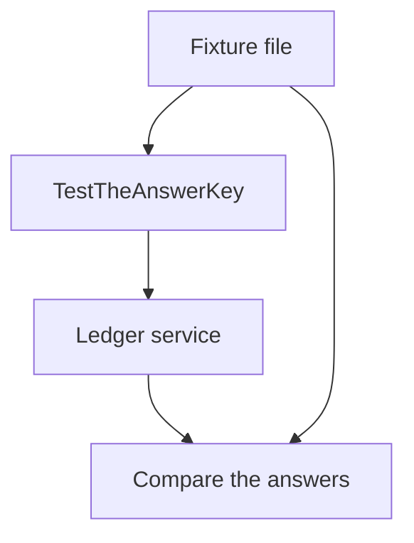

# Ledger fixtures

The answer key for the money rules (`apps/backend/cmd/ledger/MONEY-RULES.md`). Each JSON file is one worked
example: a Member's Salary, Saving Target and Spends, a date, and the numbers worked out by hand. Each file's
`doc` field says what it proves.

## How a fixture is checked



`TestTheAnswerKey` in `apps/backend/internal/ledger` saves the file's rows, sets the clock to its `asOf` date in
its `timezone`, and compares what `ledger` answers with what the file expects. Every file runs; none is skipped.

## How it works

- **Shape**: `LedgerFixture` in `money_recap/v1/ledger_fixture.proto`, written as protobuf JSON (`lowerCamelCase`
  names, enums by name). Each field's comment there says what it holds.
- **Left out means not checked** for a top-level field. Inside a listed message every field is checked, so an
  absent optional, such as Saved before Payday, must be absent in the answer too.
- **Never compared**: `Spend.id`, `createdAt` and `updatedAt`, which `ledger` sets itself.
- **Amounts** are decimal strings with the Currency's own decimals: GBP `"2400.00"`, IDR `"150000000"`. A sentence
  shows an amount as the app prints it: `£160`, `Rp26.000.000`.
- **Every Salary row and Spend** carries `originalAmount`, the amount as typed. After a Currency change each row
  keeps its original.
- **`streakDay`** is the Streak so far this month. **`streak.runStart`** and **`streak.runEnd`** name a Recap's
  longest run, the earlier of two equal ones.

## Add one

1. Name the file after what it proves, such as `squirrel-kept-116.json`.
2. Work every number by hand and explain it in `doc`.
3. Add the name to `manifest` in `apps/backend/internal/ledger/fixtures_test.go`, in alphabetical order.
4. Run the test:

```bash
cd apps/backend && go test ./internal/ledger/
```
